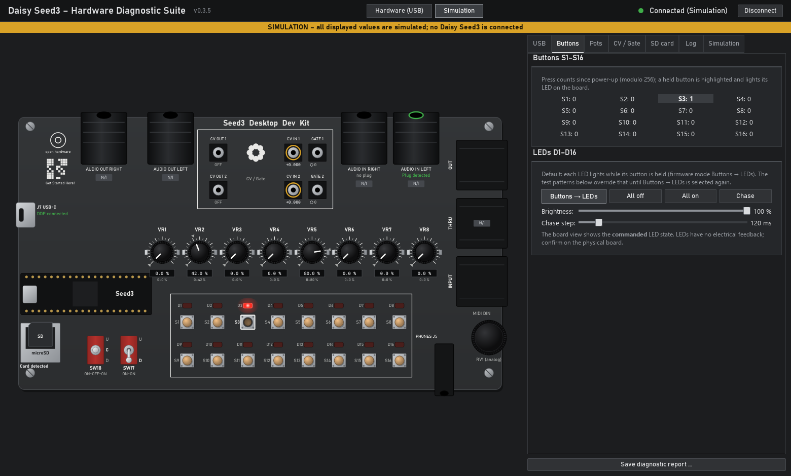

# Installation and usage

For the optional writable USB card-reader variant, see
[SD_CARD_READER.md](SD_CARD_READER.md). The regular diagnostic image stays
strictly read-only; its disabled reader controls explain which firmware is needed.



*Simulation screenshot: all values are simulated; no hardware is connected.*

## 1. Requirements

* Seed3 Desktop Development Kit and a USB-C **data** cable.
* Windows 11. Windows 10 is expected to work but has not been tested.
* Daisy bootloader **v6.x External** on the Seed3.
* `DaisyDiagnostic.bin` and `DaisyDiagnostic.exe`, built locally or downloaded
  from a successful [Hardware diagnostics run](https://github.com/sscheidl/Daisy-Seed/actions/workflows/diagnostics.yml).

Windows normally binds CDC devices to `usbser.sys` as a USB Serial Device (COMx).

## 2. Bootloader installation, only if needed

The diagnostic firmware does **not** install a bootloader. Skip installation if a
suitable external v6.x bootloader already exists, for example from Toy Piano.
Follow [FLASHING.md](FLASHING.md): connect through the **Seed3 module's USB-C port**,
hold BOOT while pressing RESET, then choose **v6.x (external)** in the
[Daisy Web Programmer](https://flash.daisy.audio/).

## 3. Flash the application through J7

1. Connect the computer to **J7 on the Desktop carrier**, above the Seed3.
2. Put the kit into update mode: with a firmware of this repository running, hold
   **S9 + S16** for 5 s (every firmware of this repository) or click **Firmware update
   mode …** in this application (diagnostic firmware). All 16 LEDs light up and the bootloader
   waits without a time limit. Otherwise press and release **RESET**, then press
   **BOOT** within about two seconds; the USR LED blinks quickly, then pulses slowly
   while the bootloader waits.
3. In the Web Programmer, connect, choose **Custom**, and upload `DaisyDiagnostic.bin`.
   Alternatively:

   ```bash
   dfu-util -a 0 -s 0x90040000:leave -D DaisyDiagnostic.bin -d ,0483:df11
   ```

4. After startup, the Seed3 USR LED blinks slowly (1 Hz) while waiting for the
   application. Buttons already control their corresponding LEDs in the default
   **Buttons → LEDs** mode, even without the PC application.

Flashing the diagnostic application replaces Toy Piano. Flash Toy Piano's `.bin`
to switch back; the existing bootloader is retained.

## 4. Start the Windows application

Double-click `DaisyDiagnostic.exe`. The EXE is unsigned, so Windows SmartScreen
may show a warning. From source, install Python 3.12 and run:

```bash
cd windows
python -m pip install -r requirements.txt
python -m daisy_diag
python -m daisy_diag --sim
python -m daisy_diag --port COM5
```

Options: `--sim`, `--port COMx`, `--selftest SECONDS` (exit 0 only if device data
was received), and `--screenshot FILE` (save a window image before the selftest exits).
Use `--help` for the English command-line reference.

## 5. Operation

### Connection

* **Hardware (USB)** scans every second for VID `0483`, PID `5740`, then verifies
  the device with a HELLO handshake. Other STM32 devices sharing this ID are
  skipped after a one-second handshake failure and backed off for five seconds.
* Choose a fixed port in the selector; a star marks a possible Daisy device.
* States are **Connected**, **Connecting**, **Disconnected**, **Connection error**,
  and **Incompatible protocol**. Normal receive timeout is 1.5 s; an explicitly
  requested SD test gets up to 20 s.
* The panel shows firmware/protocol/bootloader information, state rate, frame
  errors, lost frames, PING round-trip time, control rate (target 1000 Hz), and
  reconnection count.
* **Disconnect** also pauses automatic discovery. **Connect** resumes it.
  An unexpected USB disconnection triggers automatic reconnection.

### Board view

* **S1–S16:** two rows of eight buttons with pressed-state highlighting.
* **D1–D16:** red means the **commanded ON state**, not measured light output.
* **VR1–VR8:** knob position, percentage, and gray min/max markers since connection.
* **SW17/SW18:** two-/three-position toggles with U/C/D labels.
* **microSD:** No card / Card detected / Filesystem readable / Error.
* **Audio inputs:** plug indicators. **Audio outputs have no jack detection.**
* **CV / Gate:** CV IN 1/2 show the normalized value (−1…+1), GATE 1/2 a filled dot
  when high and the rising-edge count, CV OUT 1/2 the mode and DAC code. The jack
  rings give Eurorack-style feedback: CV IN rings run red (−1) over amber (0) to
  green (+1), CV OUT rings use the same scale over DAC code 0…4095 (no ring when
  Off), GATE rings light green while high and flash briefly on every counted
  rising edge. The scale is the normalized value, not volts.
* Gray **N/I** labels mark unimplemented functions; tooltips explain them.

### Control panel

The right-hand panel is split into categories: **USB** (connection, versions,
transport statistics, firmware update mode), **Buttons** (S1–S16 and LEDs D1–D16),
**Pots** (VR1–VR8, toggles, plug and card detection), **CV / Gate**, **SD card**
and **Log** (plus **Simulation** in simulation mode). Tab tooltips list the
contents; **Save diagnostic report …** is reachable from every tab.

### Buttons and LEDs

By default each LED D1–D16 lights while its button S1–S16 is held (firmware mode
**Buttons → LEDs**), on the real kit and in the simulation. The tab shows the press
counts and offers the test patterns **All off**, **All on** and **Chase** (with step
interval) plus brightness 0–100 %; **Buttons → LEDs** restores the default. The
LEDs have no electrical feedback: inspect the physical board to verify light output
and brightness.

### microSD

**Start read test (read-only)** mounts the filesystem, counts up to 1,000 entries
in the root directory, and unmounts it. No writing or formatting occurs. Results
show filesystem type, size, entry count, or a FatFs error. Streaming pauses during
the test. Reads have a five-second budget plus initialization; the host allows
up to 20 seconds for the result. If a CV OUT test signal is active, the app asks
and switches it Off first, because the firmware holds the last DAC code while it
blocks in the test.

### Pots, CV / Gate, Log

**Pots** shows knob percentage and raw ADC with min/max over every
received frame (resettable; the reset also clears the CV min/max), the toggle
positions, plug detection and card detection. **Log** holds the event log.

The **CV / Gate** tab lists CV IN 1/2 (normalized, raw ADC, min/max), the gate
states with edge counters, and the CV OUT test signal: **Off**, **Fixed** (two DAC
codes 0–4095), **Ramp** (triangle) or **Saw** (rising sawtooth) with a period of
50–10000 ms; CV OUT 2 carries the inverse in Ramp/Saw. CV OUT switches back to Off
when the connection ends. Volts are not displayed: the analog scaling has not been
measured yet. Before patching CV OUT into other equipment, check its input range.

### Simulation

Select **Simulation** or start with `--sim`. A yellow banner marks simulated data.
Click buttons, drag knobs or turn the mouse wheel, select toggle positions, and
toggle microSD/audio input plugs. Click a GATE jack to toggle it and turn the
mouse wheel over a CV IN jack to change its value; **Patch cables CV OUT → CV IN**
feeds the outputs back (simulation assumption: code 0–4095 = CV IN 0–+1). The
**Simulation** tab simulates USB unplug/replug, frozen firmware, corrupt frames,
Windows eject / bus reset, and cards with/without a filesystem.
The model uses the same wire protocol; it is not a replacement for real hardware.

## 6. Troubleshooting

| Symptom | Check |
| --- | --- |
| No Daisy found | Use J7 and a data cable; check firmware and Windows Device Manager |
| Port found, no DDP reply | Another application or bootloader may be running; flash diagnostic firmware and reset |
| Cannot open port | Close terminals, Web Programmer connections, and other applications using it |
| Incompatible protocol | Match firmware and Windows application protocol versions |
| Timeout after 1.5 s | Firmware or USB stopped responding; automatic reconnection follows |
| Control rate far from 1000 Hz | Check the audio/codec configuration and record the event log |

See [TEST_REPORT.md](TEST_REPORT.md) for recorded hardware results and remaining limits.
