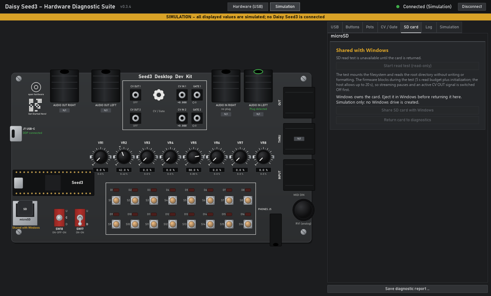

# USB SD card reader

## Status and firmware choice

**0.3.2 update, 31 October 2026 (GEMESSEN):** the review fixes passed normal
file I/O/eject tests and one physical card removal during writing, with CDC
remaining alive and explicit recovery after reinsertion. R9 is therefore partial;
not all removal timings or independent-reader checks were performed. Windows
requested a scan after the interruption; CHKDSK /F cleared the dirty flag.
[Detailed evidence and limits](HARDWARE_CARD_READER_0.3.2_2026-10-31.md).

The optional USB Mass Storage (MSC) card reader uses the Desktop carrier's J7 port.
The **0.3.1 basic hardware test passed on 31 October 2026**: FAT32 Windows access,
small-file operations, matching hashes after eject/remount and eject with the app
running. Full acceptance remains open; see the dated results below and the
[hardware record](HARDWARE_CARD_READER_2026-10-31.md). The older H1–H10 results
do not cover this feature.

| Image | Behaviour |
| --- | --- |
| `DaisyDiagnostic.bin` | Strictly read-only diagnostics; linked-symbol check bans all SD write/erase/lock paths; card-reader controls unavailable |
| `DaisyDiagnostic-CardReader.bin` | Diagnostics plus CDC/MSC; can write card sectors after explicit sharing; still no FatFs write/format APIs |

Use the Windows application from the same build. Manual firmware installation
is described in [FLASHING.md](FLASHING.md). Neither image installs a bootloader.
The reader starts **unexported on every power cycle**. It uses J7; no USB host
adapter or USB host mode is involved.

## Operation (basic hardware test passed; full acceptance pending)

1. Connect the board through J7 and insert a disposable test card.
2. In the microSD panel, select **Share SD card with Windows**. The firmware
   initializes the card and hands exclusive access to Windows. A drive letter
   depends on a Windows-readable partition/filesystem and Windows mounting policy;
   an unformatted card need not appear as an Explorer drive.
3. Use Explorer to copy, edit or delete files. The diagnostic SD read test is
   disabled while Windows owns the card. Other diagnostics remain on CDC.
4. Close open card files and **eject the drive in Windows**. Do not use closing the
   Diagnostic App as eject. The app waits for firmware confirmation of the host
   eject and completed card programming.
5. When **Return card to diagnostics** becomes available, select it. A later
   diagnostic read test mounts the filesystem afresh.

If access is interrupted, the application reports INTERRUPTED or ERROR and keeps
the SD diagnostic test disabled. Close card files/applications before selecting
**Acknowledge interrupted access**. This returns the inaccessible medium to the
local side; it is not a clean eject or recovery of unsaved Windows data. Card
removal and reinsertion never automatically restart sharing.

The app may reconnect to CDC without ending an existing Windows card-reader
session. A USB bus/BOT reset revokes the exported medium and requires explicit
acknowledgement before another share. Windows may need a rescan/reconnect after
an error; verify this during the physical test.

## Simulation

`windows\run.cmd --sim` models the ownership states and DDP messages. Insert the
simulated card, share it, and use **Simulate Windows eject** or **Simulate USB bus
reset**. The simulation **does not create a Windows drive** and does not emulate
the USB class driver, SCSI initiator, Windows filesystem cache or physical media.
The C++ tests separately execute the real BOT/SCSI code and USB adapter against
fake blocks/HAL.

## Manual hardware acceptance procedure

Status on 31 October 2026, **GEMESSEN with 0.3.1**: R3 and R7 passed on the
recorded FAT32 setup. R4 is partial (1 MiB only; hashes matched after remount).
R5 is partial (scripted create/edit/rename/delete, persisted after remount;
not every Explorer/recreate operation). R6 is partial (two Windows ejects,
including one with the EXE running, with successful return/reshare; ten cycles
not tested). R12 has only a short CDC observation during the small-file probe;
no sustained-load or physical control-timing measurement. R1, R2 and R8–R11
remain **NICHT GEMESSEN** in this session. These results do not validate CV/gate.

Perform this only with explicit hardware-test authorization and a disposable
card whose contents are backed up. Record board, bootloader, firmware and EXE
commit/hash, Windows version, card model/capacity/filesystem and each result.

| ID | Procedure | Required observation |
| --- | --- | --- |
| R1 | Install protected image; start new EXE | Existing diagnostics work; no MSC interface; reader controls unavailable |
| R2 | Install reader image; connect J7 without card | CDC and removable MSC enumerate without custom driver; no usable card medium; GUI explains state |
| R3 | Insert FAT32 test card; share | Card becomes a Windows disk/Explorer drive; CDC stays connected; SDTEST blocked |
| R4 | Copy small files and a file larger than 100 MiB both ways | `Get-FileHash -Algorithm SHA256` agrees with source and after eject/reinsert; no truncated file or changed unrelated files |
| R5 | Edit, rename, delete and recreate files/directories in Explorer | Changes persist after Windows eject and a fresh mount; local read test sees new contents |
| R6 | Eject using Explorer, then return in app | EJECTED only after host eject/programming complete; return enables a fresh local read test; repeat share/eject ten times |
| R7 | Close/reopen app and serial port while shared, without eject | Card remains Windows-owned; new app queries SHARED; no implicit local mount |
| R8 | On disposable media, unplug during a copy; repeat with external board power if available | Power cycle starts unexported; externally powered disconnect/reset quarantines; app never claims successful eject; check media on independent reader |
| R9 | Remove/reinsert card while shared and during transfer | No crash/reboot loop; no automatic resharing; pending operations fail, acknowledgement required; inspect media independently |
| R10 | Reboot board, reset USB, suspend/resume Windows, use Windows safe removal | No stale transfer submitted after reset; document enumeration and CDC/MSC recovery and any Windows rescan requirement |
| R11 | Repeat with no card, unformatted card and a Windows-supported exFAT card | Accurate medium/error status; no automatic formatting; raw MSC does not depend on firmware FatFs support for the filesystem |
| R12 | Run sustained transfers while operating all controls | Control sampling remains stable; assess CDC gaps, SD timeouts, interrupt timing and polling throughput |

Record failures as failures, including timeout or forced-disconnect corruption.
This firmware cannot recover writes still cached only by Windows or guarantee
filesystem integrity after interrupted power/card removal.

> Since 2026-11-01 the card-reader sources (`card_reader`, `msc_bot`, `reader_usb`,
> `reader_dma.h`, `reader_abort.h`, `reader_ctlreq.c`) live in
> [`common/sd/reader/`](../../common/sd/reader/), shared with Nebulae on Daisy 0.2.0.
> They were moved unchanged; both Diagnostics images rebuild byte-identical
> (SHA256 `0564de97…f577` protected, `0be6f55c…4ea2` CardReader).
