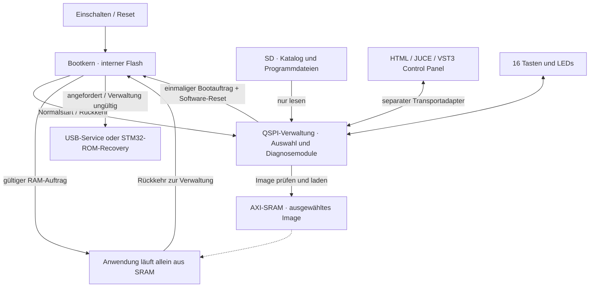

# SD-Programme, RAM-Start und Diagnose als Geräteverwaltung

**Entwurf vom 31.10.2026 · zur unabhängigen Prüfung durch Claude Code.**

Keine Implementierung, keine Freigabe für Builds oder Hardwareeingriffe. Der
Prüfauftrag steht in [SD_RAM_BOOT_REVIEW.md](SD_RAM_BOOT_REVIEW.md). Alle Aussagen
über das neue System sind Entwurfsentscheidungen oder offene Annahmen. Hardware:
**NICHT GEMESSEN**. Insbesondere sind Ladezeit, Reset-Verhalten und elektrische
Ausgangszustände noch nicht geprüft.

## 1. Ziel und Grenzen

Auf einem Seed3 Desktop Kit stehen bis zu 16 eigenständige Instrument-, Effekt-,
Sequencer- oder Diagnoseprogramme bereit. Die SD-Karte ersetzt das wiederholte
Flashen der Anwendungen. Auswahl über die Tasten oder ein Control Panel in HTML,
JUCE Standalone beziehungsweise VST3. Ein PC ist für den normalen Start unnötig.

Ein kleiner Bootkern bleibt im internen Flash. Eine dauerhaft installierte
Verwaltung mit optionaler Diagnose liegt im externen QSPI-Flash. Das ausgewählte
SD-Programm wird ausschließlich ins interne SRAM geladen. Es läuft anschließend
allein; Verwaltung und Diagnose verbrauchen währenddessen keine CPU-Zeit und
belegen keinen dauerhaft reservierten Audio-Arbeitsspeicher. Ein kleiner gemeinsamer
Boot-Auftragsbereich im Backup-SRAM bleibt reserviert.

Es gibt weder nahtlosen Klangwechsel noch mehrere gleichzeitig laufende Images.
Audio-, CV-/Gate- und MIDI-Ausgaben werden beim Wechsel unterbrochen. Kombinierte
Produkte wie Toy Piano mit Reverb bleiben eigene Images. Der weitergehende
[modulare DSP-Kern](MODULAR_KERNEL_IDEA.md) ist ein anderes Vorhaben.

**Voraussetzung für spätere Umsetzung:** Die Diagnose muss zuerst SD sowie die
vorhandenen CV-/Gate-Buchsen zuverlässig behandeln und am Kit geprüft werden.
Dieser Entwurf ersetzt diese Arbeit nicht und bestätigt deren Abschluss nicht.

## 2. Nachweisbarer Ausgangspunkt

Quelltextbasis: Repository-Commit `3f475477dc9e39559a98be71d816f0387eb3da09`,
lokal auf `claude/ambient-reverb-memory-experiments`; libDaisy
`f715e4875b2d28445d0c11a0a17f064a248f69d0`, DaisySP
`2c72eaf9eac5fc0dca1919d65d606da907832618`. Eine spätere Umsetzung muss den dann
aktuellen Integrationsstand erneut prüfen. Die genannten Abhängigkeiten werden
durch diesen Entwurf nicht aktualisiert.

| Befund aus Dateien, am 31.10.2026 gelesen | Konsequenz |
| --- | --- |
| [common/desktop.mk](../common/desktop.mk) und [Diagnose-Makefile](../diagnostics/firmware/Makefile): `BOOT_SRAM` | Bestehende Anwendungen sind eine gute Ausgangsbasis für RAM-Start, aber damit noch nicht für den neuen Loader freigegeben. |
| [FLASHING.md](FLASHING.md): Anwendung heute in QSPI bei `0x90040000`, Ausführung aus SRAM bei `0x24000000` | Das heutige Updateziel kollidiert mit einer dort installierten Verwaltung. |
| libDaisy `core/STM32H750IB_sram.lds`: 480 KiB Imagebereich, `.data`-Initialwerte ebenfalls dort | Der Loader muss das vollständige Ladeimage einschließlich Dateninitialwerten erhalten. |
| libDaisy `core/STM32H750IB_qspi.lds`: `.data` und `.bss` im AXI-SRAM | Nur `BOOT_QSPI` für die Verwaltung einzustellen genügt nicht: deren Daten würden das SD-Ladeziel überlappen. Ein eigener Linkerplan ist nötig. |
| [Toy-Piano-Linker](../instruments/toy-piano/ld/toy_piano_axi.lds), [Physical-Modeling-Linker](../instruments/physical-modeling/ld/physical_modeling_axi.lds): zusätzliche AXI-NOLOAD-Puffer nach dem Image | Dateigröße allein beschreibt den Laufzeitspeicherbedarf nicht. Puffer müssen beim Anwendungsstart korrekt initialisiert werden. |
| [common/bootloader](../common/bootloader/README.md): S9+S16 und BL-SysEx führen heute in DFU | Der bestehende Updatebefehl darf nicht unbemerkt zum Programmauswahlbefehl werden. |
| [Diagnose](../diagnostics/README.md), [DDP](../diagnostics/protocol/PROTOCOL.md): CDC, Windows/PySide6 | HTML/JUCE/VST3 für die Diagnose sind neue Arbeit, keine bereits vorhandenen Diagnose-Frontends. |
| [Editoren](../editors/mod-on-daisy/README.md): HTML und JUCE/VST3 benutzen USB-MIDI; MD und SQ vorhanden | Gemeinsame Darstellung und semantische Befehle sind möglich, aber CDC und MIDI sind verschiedene Transporte. |
| [common/sd](../common/sd/README.md): separater Read-only-FatFs-R0.16-Treiber mit FAT32/exFAT, noch kein Firmwareanwender laut README | Geeigneter Kandidat nach erfolgreicher Integration und Hardwareprüfung; nicht bereits bewiesene Grundlage. |

Der offizielle [DaisyBootloader-Quelltext](https://github.com/electro-smith/DaisyBootloader/blob/main/shared/bootloader.cpp)
zeigt einen verwandten Ablauf: QSPI-Inhalt nach SRAM kopieren, Bootauftrag im
Backup-SRAM setzen, Software-Reset und anschließender Sprung. Der bestehende
SD-Pfad schreibt dagegen nach QSPI und legt ein SD-Log an. Beides darf im normalen
neuen SD-Startpfad nicht übernommen werden. Die
[offiziellen Boot-Linkerbereiche](https://github.com/electro-smith/DaisyBootloader/blob/main/bootloader/boot_linker.lds)
trennen 480 KiB SRAM-Ziel und 32 KiB Hilfsbereich.

Die öffentlich gelesenen Quellen beziehen sich auf `main`, Abruf 31.10.2026;
vor Implementierung ist eine konkrete Upstream-Revision festzulegen und gegen
unsere gepinnte Seed3-Unterstützung zu vergleichen. Sie sind Referenzmaterial,
keine Aufforderung zum Austausch des installierten Bootloaders.

## 3. Architekturentscheidung: Bootkern plus QSPI-Verwaltung

**Bevorzugter Entwurf B:** Der interne Bootkern kennt kein FAT-Dateisystem und
kein vollständiges Diagnoseprotokoll. Er startet eine fest installierte
QSPI-Verwaltung. Diese besitzt SD-Zugriff, Programmkatalog und optional Diagnose.
Sie läuft direkt aus QSPI (Execute in Place, XIP), während sie das nächste
Anwendungsimage ins AXI-SRAM schreibt.



Der Bootkern prüft nach einem passenden Software-Reset den vorbereiteten
RAM-Auftrag und springt in das Image, bevor ein normaler Startpfad den Zielbereich
beschreiben kann. Nach Power-on, Brownout, Watchdog-Reset oder ungültigem Auftrag
startet er grundsätzlich die Verwaltung; kein blindes Wiederanspringen alter
RAM-Inhalte.

Warum diese Aufteilung: Der STM32H750 hat dokumentiert nur 128 KiB internen Flash.
Das [Upstream-Buildbeispiel](https://github.com/electro-smith/DaisyBootloader#customization)
belegt davon bereits 127.044 Bytes. Das ist ein fremder Beispielbuild, keine
Messung unseres künftigen Bootkerns. Es widerlegt aber die Annahme, Diagnose,
exFAT, USB und komfortable Verwaltung hätten dort selbstverständlich Platz.

Die Verwaltung in QSPI ist nicht bloß eine Sicherungskopie: Sie ist der normale
Startpunkt. Sie funktioniert bei fehlender SD weiterhin für Diagnose und Service.
Sie wird bei Programmwechseln weder gelöscht noch neu geschrieben.

## 4. Speichervertrag

### 4.1 Dauerhafte Bereiche

Adressen aus dem bestehenden libDaisy-Speicherplan; die QSPI-Aufteilung darunter
ist ein Vorschlag. Endadressen sind exklusiv. Größen in KiB/MiB sind binär.

| Bereich | Adresse / Größe | Vorgesehene Nutzung |
| --- | --- | --- |
| Interner Flash | `0x08000000`–`0x08020000`, 128 KiB | Bootkern, Vektoren, eng begrenzter Service; keine Instrumente. |
| QSPI, bisher ausgesparter Anfang | `0x90000000`–`0x90040000`, 256 KiB | Unberührt lassen; nicht ohne eigene Entscheidung als Metadatenspeicher beanspruchen. |
| QSPI-Verwaltung, Vorschlag | `0x90040000`–`0x90140000`, 1 MiB | Feste XIP-Verwaltung einschließlich Diagnose und begrenztem Integritätsdeskriptor. Tatsächlicher Bedarf offen. |
| Übriger QSPI | `0x90140000`–`0x90800000`, 6,75 MiB | Vorerst unbenutzt/reserviert; keine normalen Programmwechsel. |
| SD | keine feste Kapazitätsanforderung im Entwurf | Programme, Katalog und davon getrennte Samples/Benutzerdaten. |

Für das Verwaltungsimage muss der spätere Linker einen festen Vektorstart und
eine nicht überlappende Position des Deskriptors vorgeben. Ein Header darf nicht
einfach vor ein bereits absolut gelinktes Image geschoben werden. Speicherlayout
und Headerformat werden gemeinsam versioniert. Der 1-MiB-Vorschlag ist keine
gemessene Anforderung und noch kein endgültiger Partitionsvertrag.

### 4.2 Flüchtige Bereiche und Eigentum

| Bereich | Adresse / Größe | Während der Auswahl / beim Laden | Während der Anwendung |
| --- | --- | --- | --- |
| AXI-SRAM, Imageziel | `0x24000000`–`0x24078000`, 480 KiB | Ausschließlich Ziel des nächsten Images; keine Verwaltungsobjekte, Stacks, Heaps oder DMA-Ziele darin. | Anwendungscode, Initialwerte und gegebenenfalls anschließend initialisierte NOLOAD-Puffer gemäß ihrem Linker. |
| AXI-SRAM, Hilfsbereich | `0x24078000`–`0x24080000`, 32 KiB | Kandidat für frühen Boot-Stack/-Daten und SD-Bounce-Puffer; getrennte Unterbereiche nachweisen. | Nach Übergabe frei gemäß Anwendungslinker; keine weiterlaufenden Bootdienste. |
| DTCM | `0x20000000`–`0x20020000`, 128 KiB | Kandidat für Verwaltungsdaten und Stack; genaue Aufteilung offen. Kein SDMMC-IDMA-Ziel. | Daten/Stack der Anwendung. |
| D2-SRAM | `0x30000000`–`0x30048000`, 288 KiB | Verwaltungsdaten/USB/DMA gemäß Linker und Erreichbarkeit. | Alleiniger Besitz der Anwendung. |
| D3-SRAM | `0x38000000`–`0x38010000`, 64 KiB | Optionaler Arbeitsspeicher, nicht als dauerhafte Ablage zugesichert. | Alleiniger Besitz der Anwendung. |
| ITCM | `0x00000000`–`0x00010000`, 64 KiB | Kein separates SD-Codesegment in Version 1. | Nur nach geprüftem Anwendungsstartvertrag. |
| Externes SDRAM | `0xC0000000`–`0xC4000000`, 64 MiB | Optionale Verwaltungs-/Diagnosepuffer nach Initialisierung. Kein über Reset benötigtes Image-Staging. | DSP-, Sample- und Loop-Puffer der Anwendung; diese initialisiert SDRAM selbst. |
| Backup-SRAM | `0x38800000`–`0x38801000`, 4 KiB | Kleiner versionierter Bootauftrag; libDaisy-BootInfo separat erhalten. | Gemeinsamer reservierter Auftrag/Zustand, ansonsten keine Verwaltung aktiv. |

Diese Bereiche werden im lokalen Linkerplan beschrieben; grundlegende Chipdaten
stehen im [STM32H750-Datenblatt](https://www.st.com/resource/en/datasheet/stm32h750vb.pdf).
64 MiB SDRAM vergrößern den 480-KiB-Codebereich nicht. Version 1 bietet kein
Ausführen beliebiger großer Programme direkt von SD oder SDRAM.

**Zwingend:** Alle aktiven Code-, Daten-, Stack-, Heap- und DMA-Bereiche der
QSPI-Verwaltung müssen außerhalb des 480-KiB-Ziels liegen. Das gilt auch für
libDaisy-Globals, C++-Konstruktoren, Fehlerpfade, FatFs-Fenster und USB-Puffer.
Ein späterer ELF-/Map-Check muss dies prüfen. Die Standard-BOOT_QSPI-Linkerdatei
erfüllt diese Forderung nicht.

Der frühe Bootpfad braucht ebenfalls einen nachgewiesenen Stack außerhalb des
Images. Nach dem letzten Setzen des Anwendungs-MSP darf kein normaler
C++-Funktionsrücksprung mehr erfolgen; die letzte Übergabe braucht einen
kontrollierten Assemblerpfad. Anwendungseinstieg ist der Reset-Handler, nicht
`main()`.

### 4.3 Schreibregeln

| Vorgang | Interner Flash | QSPI-Flash | SD |
| --- | --- | --- | --- |
| Einschalten, Katalog lesen, Programm laden, Rückkehr | nur lesen | nur lesen | nur lesen |
| Laufender Synth/Effekt/Sequencer | keine Boot-Schreibzugriffe | keine Boot-Schreibzugriffe | Nur die eigenen, bereits vorgesehenen Speicherfunktionen, z. B. Looper; nicht Aufgabe des Loaders. |
| Bootkern installieren/aktualisieren | gesonderter Serviceeingriff | keine automatische Änderung | unerheblich |
| Verwaltung/Diagnose aktualisieren | unverändert | gesonderter Serviceeingriff | gegebenenfalls Updatequelle, niemals Auto-Update beim normalen Boot. |
| Karte am PC bearbeiten | unverändert | unverändert | PC schreibt nach exklusiver Übergabe oder bei entnommener Karte. |

Keine Startzähler, Programmauswahl oder Bootlogs in Flash schreiben. Version 1
merkt den letzten Platz höchstens bis zum nächsten Stromverlust im Backup-SRAM.
Ein späteres Speichern auf SD wäre eine separate, optionale Schreibfunktion;
Mod-on-Daisy-Flashspeicherung wird durch diesen Entwurf nicht freigegeben.

## 5. Boot- und Wechselabläufe

### 5.1 Kaltstart

1. Bootkern erfasst Resetursache, priorisiert einen physischen Servicewunsch und
   verwirft nicht zulässige oder alte RAM-Aufträge.
2. Er initialisiert nur das für QSPI-Start erforderliche System, prüft die feste
   Verwaltung und richtet QSPI speicherabgebildet ein.
3. Er startet die QSPI-Verwaltung über deren Vektoren. Die Sequenz muss zu
   `SystemInit`, `DaisySeed::Init()` und der Seed3-Erkennung der gepinnten libDaisy
   passen. Kein blindes Übernehmen eines anderen Board-Templates.
4. Verwaltung initialisiert Bedienung/USB/SD und zeigt Auswahl; Diagnose ist
   verfügbar. Ohne Karte bleibt sie mit verständlichem Status bedienbar.
5. Standardmäßig kein zeitgesteuerter Autostart. Ein Neustart soll nicht
   überraschend ein Instrument oder aktive CV-Testsignale starten.

### 5.2 SD-Programm starten

1. Tastenwahl oder expliziter Hostauftrag benennt einen Eintrag der aktuellen
   Kataloggeneration. Doppelte, veraltete und inkompatible Aufträge ablehnen.
2. Die Verwaltung benötigt exklusiven lokalen Kartenbesitz. Bei MSC-Freigabe an
   Windows wird der Start mit `BUSY` abgewiesen; weder heimliches Zurückholen noch
   paralleles Dateisystemlesen.
3. Diagnose-Testsignale beenden, Audio stumm, Ausgänge in den **zuvor am Kit
   geprüften** inaktiven Zustand bringen. DAC-Code 0 ist kein Beweis für 0 V.
   Menüauswahl und Tasten-/CV-Test dürfen nicht gleichzeitig dieselben Tasten
   als Startbefehl interpretieren; ein expliziter Betriebsmodus trennt sie.
4. Paket begrenzt öffnen, Header/Board/ABI/Länge prüfen. Einmaligen Startauftrag
   zunächst ungültig halten. Nutzdaten in begrenzten Schritten über einen
   isolierten DMA-Bounce-Puffer in das SRAM-Ziel kopieren und dabei hashen.
5. Exakte Leselänge und Hash prüfen; danach Vektortabelle, Stack und Einstieg
   prüfen. Bei Fehler bleibt die Verwaltung aktiv, zeigt den Grund und erlaubt
   eine neue Auswahl. Ein halb geladenes Image wird nie angesprungen.
6. Alle SD-/USB-/LED-DMA-Schreibzugriffe beenden. Karte schließen und aushängen,
   Peripherie geordnet stilllegen. Zielimage und Bootauftrag müssen aus dem
   Daten-Cache tatsächlich ins RAM geschrieben sein; passende Barrieren gehören
   zum Vertrag. Erst danach einen vollständigen `RAM_READY`-Auftrag festschreiben.
7. Kontrollierter Software-Reset. Früher Bootpfad akzeptiert nur die passende
   Resetursache plus gültigen Auftrag, feste Zieladresse, zulässige Länge und
   passende RAM-Integrität. Er verbraucht den Auftrag **vor** dem Sprung.
8. Cache-/MPU-/VTOR-/MSP-Zustand gemäß geprüftem Übergabevertrag herstellen,
   Anwendungs-Reset-Handler starten. Anwendung initialisiert eigene Hardware,
   Speicher, Interrupts und Ausgänge. Erfolg erst nach eigener Identifikation
   beziehungsweise lokalem Startsignal melden, nicht bereits nach `ACK`.

**Kritische Annahme A1:** AXI-SRAM bleibt beim genau verwendeten Software-Reset
erhalten und wird vom frühen Bootpfad nicht überschrieben. Der Daisy-Vorgänger
liefert dafür ein Vorbild, aber keinen Nachweis für diese neue Kombination.
Resetflags können kumuliert sein; Auswerten und Löschen gehören zu einer explizit
geprüften Sequenz. Ein beliebiger Reset mit gesetztem alten Flag genügt nicht.
Nach Power-on darf auch wegen SRAM/ECC kein uninitialisierter Zielbereich nur
wegen eines zufällig passenden Mailboxwortes gelesen werden. Die zulässige
Resetursache wird vor dem RAM-Integritätslesen geprüft. SDRAM-Erhalt wird nicht
vorausgesetzt. A1 ist vor Umsetzung anhand ST RM0433 und anschließend am Kit zu
prüfen. Ohne Nachweis kein RAM-Start nach Reset.

### 5.3 Rückkehr und direkter Wechsel

Anwendungen brauchen nur einen kleinen gemeinsamen Rückkehrdienst, keine
vollständige Diagnose und keinen zweiten SD-Loader:

1. Rückkehrwunsch aus Tasten oder Host in der Hauptschleife verarbeiten.
2. Audio ausblenden/stoppen, MIDI-Noten und Gate-Ausgaben gemäß Produktvertrag
   beenden, laufende Speicherung geordnet abschließen; bei Fehler bleiben oder
   explizit abbrechen. Kein Reset aus dem Audio-Callback.
3. `OPEN_MANAGER` in die Mailbox schreiben und kontrolliert neu starten.
4. Bootkern startet Verwaltung. Host verbindet sich neu; der Nutzer wählt dort.

Version 1 braucht keinen Direktstart eines anderen Images aus einer laufenden
Anwendung. Dafür wäre später ein Auftrag mit erwartetem Programmhash möglich,
den erst die Verwaltung erneut auf der Karte auflöst und prüft. Niemals rohe
Sprungadressen oder beliebige Pfade als Hostbefehl akzeptieren.

Die bisherige Kombination S9+S16 (5 s), DDP `BOOT` und BL-SysEx bleiben
**Service/DFU**. Ein neuer Rückkehrbefehl und eine andere, auf Konflikte geprüfte
Tastenkombination sind erforderlich; deren konkrete Belegung bleibt offen.
Beim Start gedrückt gehaltene Auswahltasten müssen vor normalen Spiel-/Step-
Aktionen freigegeben werden, damit die Auswahl keinen Ton oder Sequencerstart
auslöst.

### 5.4 Fehler und Stromverlust

| Situation | Vorgesehenes Verhalten |
| --- | --- |
| Karte fehlt / Mount oder Lesen scheitert | Verwaltung und Diagnose ohne Karte; keine Startschleife. |
| Datei beschädigt, falsches Board, falscher ABI, zu groß | Grund anzeigen, Auswahl erhalten, kein Sprung. |
| Karte beim Laden entfernt / Timeout | Auftrag ungültig, Ladevorgang abbrechen; erneute Initialisierung vor dem nächsten Versuch. |
| Strom weg beim SD-Laden | Kein Flash verändert; nächster Kaltstart führt in die Verwaltung. |
| Reset zwischen Mailboxschritten | Unvollständiger Auftrag wird verworfen. |
| Anwendung stürzt ab | Nach Reset Verwaltung; kein automatischer Wiederholungsstart. Ein Hänger benötigt ohne separat entworfenen Watchdog einen manuellen Reset. |
| Verwaltung hängt oder ist beschädigt | Physischer Boot-/Reset-Rettungsweg; optional eigenständiger J7-Service im Bootkern. |
| Verwaltung fehlt oder Integrität stimmt nicht | Bootkern springt nicht in die Verwaltung; Servicezustand. |
| QSPI-Update durch Stromverlust abgebrochen | Ein einzelner Verwaltungsslot ist möglicherweise unbrauchbar; Wiederherstellung über unabhängigen Service/STM32-ROM, keine behauptete automatische Rückrollfunktion. |

Audio-/CV-/Gate-Zustände externer Bauteile sind durch MCU-Reset nicht automatisch
bewiesen. Die Übergänge einschließlich Stromverlust müssen am Kit geprüft werden.
Eine Status-LED ist kein Nachweis eines elektrisch sicheren Ausgangszustands.

## 6. Bootauftrag und Übergabevertrag

Versionierter, fester und begrenzter Datenblock im Backup-SRAM. Vorschlag:
`0x38800100`–`0x38800300` (512 Byte), getrennt von libDaisys ersten 12 Byte
`BootInfo`. Die Belegung muss in **allen** betroffenen Linkern fest reserviert
werden; die Adresse ist bis zu dieser Prüfung nur ein Vorschlag.

Semantische Felder, noch kein binär festgelegtes C-Struct:

| Feld | Zweck |
| --- | --- |
| Magic, Formatversion, Blocklänge, Prüfsumme | Zufall, Teil-Schreibvorgänge und inkompatible Versionen erkennen. |
| Aktion | `OPEN_MANAGER`, `RAM_READY`, `ENTER_SERVICE`; kein freier Codezeiger. |
| Sequenz / Zustand / Fehlergrund | Auftrag einmalig abarbeiten und Diagnose nach Rückkehr erlauben. |
| Imageprofil, Bytezahl, Payload-Integrität | Nur das feste SRAM-Ziel aus dem Bootkern verwenden; Bytezahl begrenzen. |
| Programm-ID und erwarteter Imagehash | Identität für Anzeige und spätere Hostverifikation; kein Dateipfad als Startberechtigung. |

Schreibfolge: alten Auftrag invalidieren, Felder schreiben, Prüfsumme bilden,
Cache-/Speicherbarrieren, Commit-Markierung zuletzt. Lesefolge: Resetursache und
Marker prüfen, Felder lokal sichern und validieren, Auftrag verbrauchen,
RAM-Integrität prüfen, dann springen oder begründet in Verwaltung zurückfallen.
Die genaue atomare Wortfolge und Cachebehandlung sind Reviewgegenstand.

Der Bootkern kann für RAM-Übertragungsfehler beispielsweise CRC32 prüfen; die
Verwaltung prüft den Paketinhalt mit SHA-256. Algorithmus, Polynom und Bytebereich
müssen im ABI eindeutig sein. CRC beziehungsweise ein Hash neben der Datei
beweisen keine vertrauenswürdige Herkunft. Version 1 behandelt SD-Firmware als
bewusst vom Betreiber ausgewählten nativen Code, nicht als isolierte Plugins.

Den vorhandenen libDaisy-BootInfo-Werten wird kein neuer, vermeintlich
abwärtskompatibler Sinn gegeben. `INF_TIMEOUT` bleibt Service. Das bisherige
`JUMP`-Verhalten darf nicht ungeprüft einen beliebigen alten RAM-Zeiger ausführen.
Alte Anwendungen ohne neuen Rückkehrdienst können höchstens als ausdrücklich
geprüfte Legacy-Images laufen; Rückkehr dann gegebenenfalls nur über Reset.

Auch `BootInfo.version` ist relevant: `DaisySeed::Init()` entscheidet anhand der
Bootloadergeneration über Teile seiner Initialisierung. Der neue Bootkern braucht
einen ausdrücklich geprüften Kompatibilitätswert für diesen bestehenden Code und
eine davon getrennte eigene Loader-ID/-Version in der Fähigkeitsabfrage. Er darf
sich im Panel nicht als unveränderter offizieller Daisy-Bootloader ausgeben.
Ein leerer oder beliebig gewählter Versionswert ist kein definierter Startvertrag.

## 7. SD-Katalog und Imageformat

Vorschlag für die Karte:

```text
/DAISY/catalog.json
/DAISY/PROGRAMS/toy-piano/<image-id>.dsy
/DAISY/PROGRAMS/torus/<image-id>.dsy
/DAISY/PROGRAMS/looper/<image-id>.dsy
/DAISY/PANELS/                 optional, nur Daten; siehe Abschnitt 9
/NEBULAE/...                  bestehende Samplepfade unverändert
...                           vorhandene Looper-Daten unverändert
```

Ein `.dsy`-Paket enthält einen kleinen versionierten Header und das vollständige
native `BOOT_SRAM`-Ladeimage. Das Headerformat ist neu zu spezifizieren; in Version
1 genau ein zusammenhängender Payload für das feste SRAM-Ziel, keine Relokation,
Kompression oder frei wählbaren Speichersegmente. Paketierung kann den BIN-Payload
unverändert lassen, falls dessen ELF-Prüfung die Eignung bestätigt.

Benötigte Paketangaben: Format-/Loader-ABI, Hardware-ID `seed3-desktop`,
Imageprofil `axi-sram-480k-v1`, stabile Produkt-ID, Variante/Version, Payloadlänge
und SHA-256. Heap-/Stack-/NOLOAD-Bedarf und externe Speicherabhängigkeiten werden
beim Paketieren aus ELF/Map gegen das Profil geprüft; ein beliebiges BIN allein
kann das nicht belegen. Vorhandene COMPONENTS-Manifeste können Produkt-/Versions-
und Revisionsinformationen zuliefern, ersetzen diesen Speichercheck aber nicht.

Vorgeschlagene Parsergrenzen: höchstens 16 Plätze, Katalog höchstens 16 KiB,
Anzeigenamen höchstens 64 UTF-8-Bytes, relative Pfade höchstens 160 Bytes.
Unbekannte Pflichtformate, doppelte Plätze/IDs, Überläufe, Pfade außerhalb des
Programmordners und uneindeutige Daten werden abgewiesen. Ein 16-KiB-Katalog muss
nicht vollständig in den 32-KiB-Hilfsbereich passen; Daten können in DTCM/D2 liegen.
Die konkreten Grenzen sind im Review gegen Puffer- und Bedienbedarf zu prüfen.

Ein Katalogeintrag enthält Platz 1–16, stabile ID, Namen, Kategorie, Version,
Paketpfad, erwarteten Paket-/Payloadhash und Profil. Die reservierten Begriffe
und Hashbereiche müssen vor Implementierung eindeutig definiert werden. Ein
Hash eines vollständigen Pakets darf nicht mit seinem Payloadhash verwechselt
werden. Die Verwaltung liefert dem Panel eine Kataloggeneration, mit der jeder
Startauftrag verknüpft ist.

**Zwei Prüfstellen:** Paketwerkzeug prüft ELF/Map, Laufzeitloader prüft Header,
Längen, Hash und Vektoren unabhängig. MSP muss im erlaubten Stackbereich liegen
und passend ausgerichtet sein, Resetvektor muss Thumb wählen und im tatsächlich
geladenen ausführbaren Payload liegen. Eine vollständige Board-Vektortabelle ist
erforderlich; nur acht gültige Anfangsbytes genügen nicht. Interner Flash und
QSPI-Ausführung werden als SD-Profil in Version 1 abgewiesen. Keine nicht leeren
externen QSPI-Code-/Daten-Ladesegmente oder versteckten Abhängigkeiten von der
bisher geflashten Anwendung zulassen.

Die SD-Karte wird nur gelesen: keine Umbenennung nach Start, kein Log und kein
automatisches Speichern der letzten Auswahl. FAT32 und exFAT sollen nach bewährter
Integration von `common/sd` denselben Weg nutzen. Pro Firmware nur eine FatFs-
Implementierung; kein gleichzeitiges R0.12c und R0.16. Der Bounce-Puffer muss
IDMA-erreichbar und cachekonform sein, nie in DTCM. Ende-zu-Ende-Zeitbudgets gelten
auch bei defekten Clusterketten; nur ein Timeout je Block reicht dafür nicht.

Kartenupdate in Version 1 am PC: neues eindeutig benanntes Paket vollständig
kopieren und prüfen, danach Katalog aktualisieren, Karte auswerfen. FAT/exFAT
bieten hier keinen pauschalen Transaktionsschutz. Unvollständige Updates müssen
als ungültig erkannt werden und dürfen keinen Teilstart verursachen. Andere
gültige Plätze und die residente Diagnose bleiben nutzbar; bei strukturell
defektem Katalog gegebenenfalls nur Diagnose. Keine `.bin`-Dateien ins Wurzel-
verzeichnis legen, solange noch ein alter Daisy-Bootloader installiert ist: der
kann sie als Flashupdate interpretieren.

## 8. Diagnose als austauschbare Schicht der Verwaltung

Die Verwaltung enthält einen kleinen obligatorischen Kern: Bedienung,
Katalog, Loader und Bootaufträge. Diagnose wird darüber als klar abgegrenztes
Modul angebunden: Hardwareadapter, Diagnosezustand, Tests und Deskriptoren.

Die vorhandenen portablen Diagnosebausteine `diag_app`/`diag_core` sind Kandidaten
für Wiederverwendung. Bestehende Firmware, DDP, Simulator und PySide6-App bleiben
zunächst eigenständig nutzbar. Nicht die gesamte Diagnoseimplementierung in jeden
Synth kopieren und keine neue Laufzeit-Binärplugin-ABI für Diagnosemodule einführen.
Die Modularität entsteht zuerst im Quelltext und beim Bauen der Verwaltung.

Bedienmodi: `PROGRAM_SELECT`, `DIAGNOSTICS`, optional `CARD_READER`, `LOADING`.
Nur `PROGRAM_SELECT` interpretiert einzelne Tasten als Programmwahl. In Diagnose
werden Tasten lediglich getestet; ein ausdrücklich vorgesehener Moduswechsel
führt zurück. Testsignale an CV-/Gate-Ausgängen benötigen eine aktive Freigabe
und enden vor Programmwechsel oder Sitzungsende. Keine automatischen
Ausgangstests bei jedem Boot.

Falls Platz 16 Diagnose heißen soll, kann dieser Eintrag auf das residente Modul
verweisen; dann bleiben 15 SD-Anwendungen. Alternativ ist Diagnose über einen
separaten Modus erreichbar und alle 16 Plätze bleiben Anwendungen. Im ersten
Ausbau bevorzugt: Platz 16 Diagnose, passend zur ursprünglichen Bedienidee;
keine endgültige Tastenbelegung vor Hardware-/Bedienreview.

QSPI-XIP dürfte für Verwaltung/Diagnose eher geeignet sein als für zeitkritischen
DSP; das ist eine Entwurfseinschätzung, keine Laufzeitmessung. Cacheabhängigkeit,
1-kHz-Steuerung und USB/SD müssen geprüft werden. Gegebenenfalls ändern sich
Diagnose-Timings, die erneut validiert werden müssen.

## 9. Control Panel in HTML, JUCE und VST3

Das gemeinsame Modell umfasst Geräteidentität, Fähigkeiten, Programmkatalog,
Ladezustand, Fehler, aktives Produkt und optionale Diagnosebeschreibungen.
Firmware/Betriebsmodus liefern die Wahrheit; ein Panel darf fehlende Programme
nicht aus einer eigenen veralteten Liste als startbar darstellen.

| Baustein | HTML | JUCE Standalone / VST3 |
| --- | --- | --- |
| Gemeinsame Semantik | Gleiche IDs, Zustände, Befehle, Fehler und Testvektoren. | Gleiche IDs, Zustände, Befehle, Fehler und Testvektoren. |
| Diagnose/Verwaltung zuerst | CDC über Web Serial als vorgeschlagener erster Transport; konkrete Browserunterstützung und Berechtigungen später prüfen. | Separater serieller CDC-Adapter wäre neu zu implementieren, plattformweise zu prüfen. |
| Bestehende Instrumente | Web MIDI für vorhandenes MD/SQ und später separaten Rückkehrdienst. | Bestehender MIDI-Adapter plus gemeinsamer Rückkehrdienst. |
| Nach Programmwechsel | Erwartetes Trennen anzeigen, neue Schnittstelle entdecken, Produkt/Hash soweit unterstützt verifizieren. | Ebenso; COM-Nummer oder MIDI-Portindex sind keine stabile Geräteidentität. |

CDC und MIDI bleiben im ersten Konzept getrennte Adapter. Ein immer gleiches
USB-Composite-Gerät mit CDC+MIDI wäre eine mögliche Alternative, aber eine
zusätzliche Firmware-, Deskriptor- und Treiberaufgabe. Die vorhandene
CDC+MSC-Kartenleservariante beweist diese neue Kombination nicht.

Semantische Befehle, **noch keine Erweiterung bestehender Wire-Protokolle**:
`GetCapabilities`, `ListPrograms`, `StartProgram(id, hash, generation, requestId)`,
`GetLoadStatus`, `OpenManager`, `EnterService`. Bevorzugt führt `OpenManager` aus
Instrumenten zunächst nur zurück; das Panel startet danach über die Verwaltung.
`Accepted`, `Loading`, `Restarting` und `RunningVerified` sind verschiedene Zustände.
Wenn das Zielimage keinen Hash melden kann, nur Produkt-/Versionsidentifikation
anzeigen und keine exakte Hashbestätigung behaupten.

Eine neue abgegrenzte Dienstfamilie ist gegenüber einer stillen Bedeutungsänderung
von MD, SQ, BL oder DDP zu bevorzugen. Vor Implementierung müssen Framing,
Namensraum, Limits, Wiederholungsschutz und Fähigkeitsaushandlung festgelegt
werden. Alle betroffenen Firmware-/Hostadapter und Prüfwerkzeuge gemeinsam
aktualisieren; bestehendes Mod-on-Daisy-Protokoll nicht beiläufig ändern.

Wichtige Regeln für das Plugin: niemals SD lesen, USB blockierend bedienen oder
einen Neustart aus dem DAW-Audio-Callback auslösen. Steuerung über UI/Worker.
Ein Song darf erwartete Produkt-ID/Version/Hash speichern, aber beim Laden,
Transportstart, Wiederverbinden oder durch MIDI-Program-Change **keinen**
Firmwarewechsel automatisch auslösen. Mehrere Instanzen bekommen einen einzigen
Steuerungsbesitzer beziehungsweise ein klares `BUSY`; keine gegenseitigen
Wechselschleifen. Hardware-Start nicht mit PC-Audioverarbeitung verwechseln.

Version 1 benötigt keine ausführbaren Panels von SD. Optional können begrenzte,
versionierte Datenbeschreibungen später Panels bestimmen. Beliebiges HTML/JS von
SD mit Gerätezugriff ist nicht Teil des Entwurfs. Bei HTML und C++/JUCE wird das
Verhaltensmodell samt Tests geteilt; identischer UI-Quelltext ist nicht zugesagt.

## 10. Service, Schutz und Migration

**Die heutige Adresse `0x90040000` wird für die Verwaltung beansprucht.** Alte
`program-dfu`-Abläufe oder der Web Flasher für normale Instrument-BINs würden sie
überschreiben. Der neue Aufbau darf deshalb erst nach eigener Migrationsanleitung
installiert werden. Standard-Upstream-DFU mit freiem Schreibzugriff ist kein
passender Schutz für diese neue Partitionierung.

Bootkern-Service muss Schreibzugriffe auf die ausdrücklich freigegebene
Verwaltungspartition begrenzen und ungültige Ziel-/Längenangaben abweisen.
Der normale Loader enthält keinen Flash-Schreibpfad. Falls ein unabhängiger
J7-DFU-Service in 128 KiB nicht nachgewiesen unterzubringen ist, muss vor einer
Installationsentscheidung der STM32-ROM-Recoveryweg über den Modul-USB als
zugänglicher Pflichtweg akzeptiert sein. Ein nur von der defekten Verwaltung
angebotener Service wäre keine unabhängige Wiederherstellung.

Keine automatische Selbstaktualisierung. Ein späteres Verwaltungsupdate darf
nicht denselben QSPI-Chip löschen/programmieren, aus dem gerade Code ausgeführt
wird. Dafür braucht es einen separat nachgewiesenen Servicepfad aus internem
Flash beziehungsweise RAM und eine klare Behandlung von Stromausfällen. Ein
zweiter QSPI-Slot wäre möglich, verlangt bei absolutem XIP-Code aber eine
Strategie für Linkadressen/Relokation oder zwei passend gelinkte Builds. Deshalb
keine unbegründete A/B-Zusage in Version 1.

„Geschützt“ bedeutet hier begrenzte Loader-/Servicezugriffe und einen
überschreibungsfreien Ablauf, nicht einen Sicherheitsmechanismus gegen beliebigen
nativen Anwendungscode. Eine fehlerhafte privilegierte Firmware kann Flash und
Peripherie weiterhin beschädigen. Hardware-Schreibschutz/MPU/Signaturen wären
gesonderte Entscheidungen, keine still vorausgesetzten Garantien.

Für bestehende Anwendungen: ELF/Map und Initialisierung prüfen, BOOT_SRAM-
Payload paketieren, Rückkehrdienst ergänzen, nötige gemeinsame Linkerreservierung
übernehmen. Keine Klangänderung beabsichtigt. Vorhandene Hash-/Golden-Regeln
gelten weiter; identischer Payload allein beweist keine identische Hardware-
Initialisierung oder Laufzeit. Experimentelle Images bleiben ausdrücklich als
solche gekennzeichnet. Versionssprünge oder Änderungen an gepinnten Libraries
sind kein Bestandteil dieses Konzepts.

## 11. Alternativen und Entscheidungskriterien

| Entwurf | Vorteil | Offener Preis / Risiko | Urteil dieses Entwurfs |
| --- | --- | --- | --- |
| A: interner Bootloader mit SD, Dateisystem, Tastenmenü; Diagnose separat | Direktes SD→SRAM, kein XIP-Verwaltungslinker nötig. | 128-KiB-Codebudget mit FAT32/exFAT, Hash, USB und Bedienung nachweisen; Pflege des gesamten SD-Pfads im Bootloader. | Ernsthafter, möglicherweise einfacherer Gegenvorschlag, falls ein kleiner realer Build ausreichend Reserve zeigt. |
| B: interner Bootkern + QSPI-XIP-Verwaltung | Diagnose ohne Karte, Dateisystem/Panel außerhalb des knappen Bootkerns; direktes Laden in freies SRAM. | Neuer Verwaltungslinker, QSPI-/Resetstart, Partition und Service müssen bewiesen werden. | Bevorzugt zur Prüfung, nicht als fertig tragfähig erklärt. |
| C: Verwaltung aus SRAM, Image in SDRAM vorladen, dann Kopiertrampolin | Bestehende Diagnose näher an heutiger Ausführung. | Selbstüberschreiben vermeiden; externe SDRAM-/Reset-/Trampolinabhängigkeiten und gesicherte Kopierphase. | Reserve, falls B nicht tragfähig ist; derzeit komplexer. |
| D: SD-Auswahl flasht nur bei geändertem Programm nach QSPI | Nahe am heutigen Daisy-Verfahren, Anwendung ohne Karte startbar. | Flash-Schreiben und Ladeunterbrechung pro tatsächlichem Programmwechsel; Verwaltung darf nicht überschrieben werden. | Funktionaler Rückfallentwurf, erfüllt das Ziel „kein Flashen beim Wechsel“ nicht. |

Der wichtigste Vergleich ist A gegen B. B ist nicht automatisch einfacher, nur
weil der Bootkern kleiner ist. Die zusätzlichen XIP- und Startverträge müssen
gegen den möglichen Platzgewinn eines stark reduzierten Bootloaders abgewogen
werden. Claude soll diese Präferenz ausdrücklich verwerfen dürfen.

## 12. Offene Nachweise und spätere Prüfstufen

Aktuell sind nur Quelltext-/Dokumentbefunde erhoben. Für das neue System wurde
nichts gebaut oder getestet. Sämtliche folgenden Kriterien sind **Planung**,
keine bestandenen Tests.

| ID | Erforderlicher Nachweis | Aktueller Stand |
| --- | --- | --- |
| R1 | Software-Reset erhält genau das AXI-Image; früher Bootcode/Stack/ECC/Cache/Resetflags sind korrekt. | OFFEN; Hardware NICHT GEMESSEN. |
| R2 | Bootkern passt inklusive notwendiger Recovery und Prüfungen in 128 KiB mit definierter Reserve. | OFFEN; kein Größenbuild. |
| R3 | QSPI-Verwaltung funktioniert mit gepinnter Seed3/libDaisy-Initialisierung und eigenem Linker. | OFFEN; kein ELF und kein Hardwaretest. |
| R4 | Kein Verwaltungs-/Boot-Daten-, Stack- oder DMA-Zugriff überschneidet das vorbereitete Image. | OFFEN; künftiger Map-/ELF-Check erforderlich. |
| R5 | SD-Treiber und Diagnose behandeln FAT32/exFAT, Entfernung und exklusive MSC-Nutzung zuverlässig. | Voraussetzung; aktueller Hardwarestand separat prüfen. |
| R6 | Audio/CV/Gate sind während aller Übergänge im geprüften Zustand. | NICHT GEMESSEN; keine Spannungswerte voraussetzen. |
| R7 | Rückkehrdienst, USB-Neuanmeldung und Produktidentität funktionieren in allen drei Panelvarianten. | OFFEN; Schnittstellenentwurf. |
| R8 | Jede zu unterstützende Anwendung hat ein vollständiges kompatibles RAM-Image und korrekte NOLOAD-/SDRAM-Initialisierung. | OFFEN; Profilprüfung pro Produkt/Variante. |
| R9 | Recovery funktioniert ohne SD und bei defekter Verwaltung; Updategrenzen und Stromverlust sind behandelt. | OFFEN; kein Flashversuch. |

Vorgeschlagene Reihenfolge nach Freigabe der eigentlichen Umsetzung:

1. Diagnose/SD/CV/Gate zuerst fertigstellen und getrennt am Kit abnehmen.
2. Unabhängiges Architekturreview dieses Dokuments; A gegen B entscheiden,
   Speicher-/Mailbox-/Resetvertrag schriftlich schließen.
3. Hostprüfbare Parser, Profile, Zustandsautomat und Paketierung entwickeln:
   Überläufe, falsche Header/Vektoren, Teilreads, falsche Hashes, doppelte Aufträge,
   Kartenwechsel, defekte Kataloge, MSC-Besitz und Timeouts gezielt prüfen.
4. Minimalen Bootkern und minimale Verwaltung ohne Voll-Diagnose untersuchen;
   ELF-/Map-Grenzen, Größen und Disassembly des Übergangs prüfen. Das wäre ein
   später eigens freigegebener Build, nicht Teil der jetzigen Konzeptarbeit.
5. Menschlich autorisierter Hardwareversuch: erstes triviales RAM-Programm,
   wiederholte Wechsel, Reset-/Cache-/Stromverlustfälle, Wiederherstellung.
6. Diagnosemodule integrieren; dann ein Instrument und ein Effekt, anschließend
   Sequencer/Looper mit Speicherabschluss und Ausgängen. Golden-/Komponententests
   gezielt, Hardwarebefunde datiert dokumentieren.
7. CDC-Verwaltung und HTML/JUCE/VST3-Anbindung; Plugin-Sitzungen, mehrere Instanzen,
   USB-Abbrüche und Wiederverbindung prüfen. Keine automatische DAW-Umschaltung.

Alle Hardwareergebnisse bleiben bis zu berichteten Beobachtungen
**NICHT GEMESSEN**; danach **GEMESSEN (Datum, Aufbau, tatsächliches Ergebnis)**.
Keine neuen breiten CI-Matrizen, automatischen ARM-Builds oder Releases. Ein
späterer Codeauftrag folgt Branch/PR und den gezielten Prüfungen aus AGENTS.md.

## 13. Quellen und noch zu lesende Primärreferenzen

Lokale Quellen sind in Abschnitt 2 und im Text verlinkt. Zusätzlich gelesen:

- [DaisyBootloader README und Anpassungsmöglichkeiten](https://github.com/electro-smith/DaisyBootloader)
- [DaisyBootloader Start-/SD-Implementierung](https://github.com/electro-smith/DaisyBootloader/blob/main/shared/bootloader.cpp)
- [DaisyBootloader Linker](https://github.com/electro-smith/DaisyBootloader/blob/main/bootloader/boot_linker.lds)
- [STM32H750-Datenblatt DS12556 Rev. 8](https://www.st.com/resource/en/datasheet/stm32h750vb.pdf)

Für R1 noch detailliert auszuwerten:
[ST RM0433](https://www.st.com/resource/en/reference_manual/rm0433-stm32h742-stm32h743753-and-stm32h750-value-line-advanced-armbased-32bit-mcus-stmicroelectronics.pdf),
insbesondere Resetdomänen, SRAM/ECC, RCC-Resetflags und Cache-/Speicherzugriffe.
Der Volltext wurde bei dieser Recherche wegen des Größenlimits des Webwerkzeugs
nicht ausgelesen; diese entscheidende Quellenprüfung bleibt ausdrücklich offen.
Für die konkrete Sprungsequenz sind außerdem die gepinnten CMSIS-Definitionen und
Arm-Cortex-M7-Start-/Cachevorgaben heranzuziehen. Keine unbewiesene Resetgarantie
aus dem groben Daisy-Ablauf ableiten.
