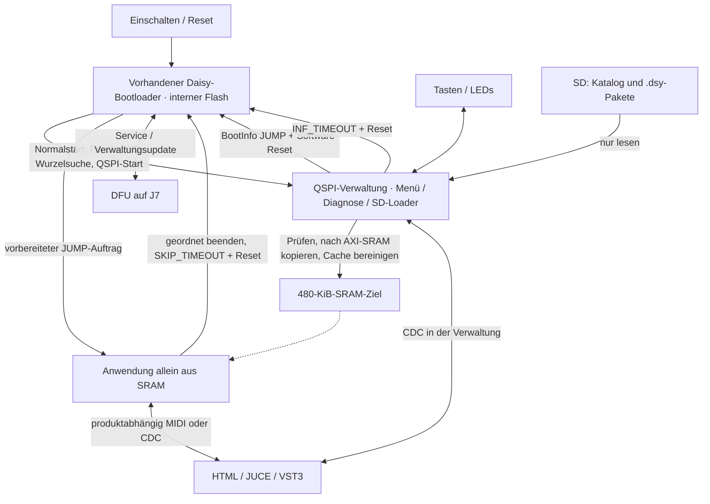

# SD-/RAM-Programmverwaltung – Konzept v2 nach Claude-Review

**31.10.2026 · Autorenempfehlung: Entwurf E · nur Konzept.**

**Aktueller Auftrag:** Die anschließende lokale Entwicklung durch Claude Code
ist im [Entwicklungsauftrag](SD_RAM_BOOT_CLAUDE_AUFTRAG.md) beauftragt. Die unten
stehenden Freigabeaussagen dokumentieren den früheren Konzeptstand; Flashen und
Hardwaretests sind weiterhin keine automatisch erlaubten Entwicklungsschritte.

Diese Fassung verarbeitet den [unabhängigen Claude-Code-Review](SD_RAM_BOOT_REVIEW_CLAUDE.md).
Der [erste Entwurf](SD_RAM_BOOT_CONCEPT.md) bleibt unverändert als Reviewgrundlage.
Die nächsten Arbeitsschritte und Abschlusskriterien stehen im
[vorbereiteten Arbeitsauftrag](SD_RAM_BOOT_WORK_ORDER.md).
Eine Implementierung, ein Build oder ein Hardwareeingriff ist damit nicht
freigegeben. Für dieses Dokument wurde nur Quelltext/Dokumentation gelesen.
Neue Hardwareergebnisse: **NICHT GEMESSEN**.

## 1. Entscheidung und Nutzen

**Für die erste Version den vorhandenen Daisy-Bootloader weiterverwenden.**
Darauf läuft eine neue, dauerhaft installierte QSPI-Anwendung: Verwaltung mit
Programmauswahl, SD-Loader und modularer Diagnose. Sie lädt das gewählte Programm
von SD ins interne SRAM und lässt es vom bestehenden Bootloader starten.

| Ebene | Dauerhafter Ort | Aufgabe |
| --- | --- | --- |
| Bestehender Daisy-Bootloader | Interner Flash | Bereits vorhandene Boot-/Sprungmechanik und DFU-Service; in Version 1 nicht verändern. |
| Verwaltung mit Diagnosemodulen | QSPI-Standardslot ab `0x90040000` | Auswahltasten/LEDs, SD-Katalog, Prüfung und RAM-Laden, Diagnose/CDC. Ausführung direkt aus QSPI (`BOOT_QSPI`, eigener Linker). |
| Instrument/Effekt/Sequencer | Paketdatei auf SD | Bei Auswahl ins AXI-SRAM geladen, läuft dort anschließend allein (`BOOT_SRAM`). |
| Control Panel | PC: HTML, JUCE Standalone oder VST3 | Gleiche Geräte-/Programmsemantik über passende CDC- und MIDI-Adapter. |

Damit braucht es voraussichtlich **keine neue Bootloaderinstallation**, sondern
einmalig die neue QSPI-Verwaltung als Anwendung. Das setzt einen nachgewiesen
kompatiblen installierten Bootloader voraus (Abschnitt 2). Normale Programmwechsel
schreiben weder internen Flash noch QSPI; für den unveränderten SD-Autoupdater
des Bootloaders gilt allerdings zwingend die Kartenregel aus Abschnitt 6.

Die QSPI-Verwaltung bleibt ohne Karte für Diagnose und Service verfügbar. Sie
läuft während eines gestarteten Instruments nicht im Hintergrund. Es gibt immer
nur ein aktives Programm; kein nahtloser Wechsel, keine parallel geladenen
Firmwaremodule und keine automatisch zusammengesteckte DSP-Kette.

**Reihenfolge bleibt:** Diagnose, SD-Zugriff und CV-/Gate-Eingänge beziehungsweise
CV-Ausgänge zuerst verlässlich fertigstellen und am Kit prüfen. Die Arbeiten
an Fehlern der Diagnose laufen in einem anderen Chat/Branch. Dieses Konzept
erklärt sie nicht für abgeschlossen.

## 2. Befunde, die die Entscheidung tragen

Quellstand bleibt `3f475477dc9e39559a98be71d816f0387eb3da09`, libDaisy
`f715e4875b2d28445d0c11a0a17f064a248f69d0`. Der Konzept-Worktree enthält keine
initialisierten Submodule; die gepinnten Quellen wurden im Hauptcheckout gelesen.

| Befund | Einordnung |
| --- | --- |
| `libDaisy/core/Makefile` kompiliert `startup_stm32h750xx.c`; die `.s`-Variante ist auskommentiert. | Korrektur zu v1. Maßgeblich ist der C-Startcode. |
| Dessen `Reset_Handler` überspringt bei `BOOT_APP` `SystemInit()` und setzt im regulären BOOT_APP-Pfad MSP nicht selbst. | Der Aufrufer muss mehr als eine gültige Adresse liefern; Übergabevertrag in Abschnitt 4. |
| Upstream v6.4.0 kennt den SRAM-Sprung über `BootInfo::JUMP` und Software-Reset bereits. | Ein neuer Bootkern ist für diese Funktion unnötig. |
| Diagnose und Instrumente laufen heute bereits als BOOT_SRAM hinter dem Daisy-Bootloader. Vorhandene datierte Hardwareberichte dokumentieren erfolgreiche Starts. | Der grundlegende Reset-/SRAM-Pfad ist auf diesem Kit erprobt. Das beweist noch nicht die neue SD-/Cache-/XIP-Kombination. |
| Die vom Build ausgewählte Datei `dsy_bootloader_v6_4-extdfu-2000ms.bin` hat lokal genau 127044 Bytes. | Die 4028 Byte Rest bis 128 KiB sind kein belastbares Budget für zusätzliche exFAT-/Hash-/Menüfunktionen. Die Zahl in v1 war zu Unrecht nur als fremdes Beispiel eingeordnet. |
| BOOT_QSPI ist in der gepinnten libDaisy vorgesehen. Der Standardlinker belegt aber AXI ab `0x24000000` mit Verwaltungsdaten. | XIP wiederverwenden, Sektionsplatzierung projektspezifisch korrigieren. |

Die lokal ausgewählte Bootloaderdatei hat SHA-256
`868c1e5ca2e8a6a3971fc3db202e7013d5ab2d82775443cf114ab6ffaec0b451`.
**Dateigröße und Buildauswahl sind keine Auslesung des auf dem Kit installierten
Flashs.** Die dort gemeldete BootInfo-Version `v6_1` bedeutet „v6.1 oder neuer“;
sie identifiziert nicht eindeutig v6.4 oder ein bestimmtes Binary. Der genaue
installierte Stand und die Zuordnung der Binärdatei zum Upstream-Tag sind offen.
Nicht vorsorglich neu flashen: zunächst bestehenden Stand und Verhalten klären.

Grundlage für den geerbten Ablauf ist der
[Upstream-Startcode v6.4.0](https://github.com/electro-smith/DaisyBootloader/blob/v6.4.0/shared/bootloader.cpp).
Der [Bootloader-Einstieg](https://github.com/electro-smith/DaisyBootloader/blob/v6.4.0/bootloader/main.cpp)
ruft die Auftragsprüfung vor der Hardwareinitialisierung auf; der normale
Ladepfad arbeitet dort mit abgeschaltetem D-Cache. Im neuen SD-Ladepfad ist
Cache-Kohärenz deshalb eine zusätzliche Pflicht.

## 3. Aufbau und Speicherbesitz



### 3.1 Dauerhafter Speicher

Alle Endadressen sind exklusiv. Das ist eine projektspezifische Planungsgrenze,
kein durch den unveränderten Bootloader erzwungener Partitionsschutz.

| Bereich | Verwendung in E |
| --- | --- |
| Interner Flash `0x08000000`–`0x08020000` (128 KiB) | Bestehender Bootloader; keine neue Software dort. |
| QSPI `0x90000000`–`0x90040000` (256 KiB) | Bisherige Bootloaderreserve unberührt lassen. |
| QSPI ab `0x90040000`, Ende des Verwaltungsimages kleiner als `0x907E0000` | Verwaltung einschließlich Diagnose, Vektortabelle am Standardslot. Keine künstliche 1-MiB-Partition. Wachstum wird durch einen späteren ELF-/Paketcheck begrenzt. |
| QSPI `0x907E0000`–`0x90800000` | In [STORAGE.md](../modules/mod-on-daisy/docs/STORAGE.md) vorgesehene Mod-on-Daisy-Blöcke freihalten. Damit wird deren Nutzung/Flashspeicherung nicht freigegeben. |
| SD | Katalog, austauschbare Programmdateien und getrennte Anwendungsdaten. |

Die Verwaltung darf keine Lösch-/Schreibvorgänge am QSPI-Chip ausführen, aus dem
sie läuft. Der libDaisy-Treiber weist solche Aufrufe aus QSPI-Ausführung zurück;
das ist eine Treiberregel, kein Schutz gegen beliebigen nativen Anwendungscode.

### 3.2 RAM während Verwaltung, Laden und Anwendung

| Bereich | Verwaltung und SD-Laden | Nach dem Programmstart |
| --- | --- | --- |
| AXI `0x24000000`–`0x24078000` (480 KiB) | Für das neue Image reserviert; keine Verwaltungsdaten, Stacks, Heaps oder fremden DMA-Ziele. | Anwendungscode, Initialwerte und ihre geprüften NOLOAD-Bereiche. |
| AXI `0x24078000`–`0x24080000` (32 KiB) | Kandidat für isolierten SD-Bounce-Puffer; in der Bootloaderphase auch dessen `.data/.bss`. Kein darüber benötigter Übergabezustand. | Frei entsprechend dem Anwendungsprofil; kein Verwaltungsdienst bleibt aktiv. |
| DTCM `0x20000000`–`0x20020000` (128 KiB) | Verwaltungs-`.data/.bss` und Stack; MSP gemäß Imagevektor/Linker. FatFs-/Katalogobjekte möglich, solange IDMA nie direkt hineinschreibt. | Eigene Daten und Stack der Anwendung. |
| D2 `0x30000000`–`0x30048000` (288 KiB) | Heap und die dafür vorgesehenen libDaisy-USB/LED/ADC-Puffer. Nicht als SDMMC1-IDMA-Ziel einplanen. | Daten/Heap/Peripheriepuffer der Anwendung. |
| SDRAM `0xC0000000`–`0xC4000000` (64 MiB) | Optionale Diagnosepuffer, alternativ SD-Bounce nach SDRAM-Init. Kein über Reset benötigtes Staging. | DSP-/Sample-/Loop-Speicher; Anwendung initialisiert ihn selbst. |
| Backup-SRAM `0x38800000`–`0x38801000` (4 KiB) | Vorhandene 12 Byte `boot_info`; optional separat definierte Verwaltungsmetadaten. | BootInfo für Rückkehr/Service, optionale Metadaten nach Vertrag. |

Ein eigener Verwaltungslinker muss Code, Rodata, Vektoren und Init-Arrays nach
QSPI legen, `.data` nach DTCM mit Ladeadresse im QSPI, `.bss`/Stack nach DTCM,
Heap nach geeignetem D2-Bereich und Peripheriepuffer in deren zulässige Regionen.
Die genaue Größenreserve ist noch nicht gebaut/nachgewiesen. Der gesamte
Verwaltungs-Datenfluss einschließlich Bibliotheks-Globals muss das 480-KiB-Ziel
beim Laden freihalten. Der spätere Check prüft belegte Speicherintervalle und
ihre LMA/VMA, nicht allein Symbolnamen.

**Präzisierung zu Review F4:** Mit `common/sd/ro_sd.c` ist ausschließlich der
separate Bounce-Puffer das DMA-Ziel; danach folgt ein CPU-`memcpy` ins FatFs-Ziel.
FatFs-Fenster/Katalog müssen deshalb nicht pauschal AXI oder SDRAM belegen.
Logische Lesepuffer dürfen etwa in DTCM liegen. Direktes IDMA in DTCM ist
weiterhin unzulässig; D2 wird ohne passende Primärquelle ebenfalls nicht dafür
freigegeben. Diese Unterscheidung gilt nur bei konsequenter Nutzung des
Bounce-Treibers, nicht automatisch für alte libDaisy-FatFs-Pfade.

## 4. Geerbter Startvertrag und neue Ladepflichten

### 4.1 Aufträge des vorhandenen Bootloaders

| Fall | Mechanismus | Wichtige Grenze |
| --- | --- | --- |
| Kaltstart / gewöhnlicher Reset | Normaler Bootloaderpfad startet die QSPI-Verwaltung. | SD-Wurzelsuche und DFU-Fenster passieren davor. |
| Verwaltung → SRAM-Anwendung | `boot_info.data = 0x24000000`, `status = JUMP`, dann direkter Software-Reset. | Der Bootloader prüft das neue Paket/den RAM-Hash nicht erneut. |
| Anwendung → Verwaltung | Bestehendes `ResetToBootloader(DAISY_SKIP_TIMEOUT)`. | Upstream setzt den Timeoutwert auf 100 ms, durchläuft aber weiter den normalen Start mit SD-/DFU-Prüfung. |
| Service / Verwaltungsupdate | `DAISY_INFINITE_TIMEOUT`, heute S9+S16/BL-SysEx/DDP BOOT. | Bedeutet weiterhin Updatebereitschaft, nicht Menüauswahl; SD-Suche wird dadurch nicht deaktiviert. |

Die 100 ms beziehungsweise 2 s sind konfigurierte Fensterwerte, keine gemessenen
Ende-zu-Ende-Startzeiten und keine garantierte Obergrenze einschließlich SD-Init.
Bei normalem QSPI-Start benutzt der Bootloader selbst einen weiteren Reset für
den QSPI-Sprung. Zwischen Anwendung und Verwaltung kann daher vorübergehend ein
DFU-Gerät erscheinen; der Host darf dessen Sichtbarkeit/Dauer nicht voraussetzen.

Der neue SRAM-Start kann **nicht** einfach nach Setzen von `JUMP` noch
`System::ResetToBootloader(...)` rufen: diese Hilfsfunktion würde `status`
entsprechend ihrem Modus überschreiben. Der Loader benötigt einen kleinen
Hauptschleifenpfad für Commit plus direkten Software-Reset. Die Anwendung soll
für Rückkehr und Service weiterhin die vorhandene Hilfsfunktion benutzen.

### 4.2 Zustand beim SRAM-Eintritt

Als Vertrag gilt der bestehende Upstream-JUMP-Pfad: Vektorbasis gesetzt, MSP aus
Imagewort 0, Einstieg über Resetvektor, FPU-Zugriff über CPACR freigegeben,
Backup-SRAM zugänglich und BootInfo-Version passend gesetzt. Der Bootloader
verbraucht den JUMP-Status vor dem Sprung. BOOT_APP startet anschließend ohne
erneuten `SystemInit()`; `main()` direkt anzuspringen wäre falsch.

Die Verwaltung baut diesen Zustand nicht mit einem eigenen Sprungtrampolin nach.
Sie verwendet den vorhandenen Reset-/JUMP-Weg. Das genaue Start-/Cache-/MPU-
und Taktverhalten ist an dessen geprüften Versionsstand gebunden. Für den neuen
QSPI-Verwaltungsstart mit Seed3 bleiben die Taktumschaltung während XIP und die
tatsächliche Chipkonfiguration am Kit zu prüfen.

### 4.3 Vollständiger Ablauf eines SD-Starts

1. Im Modus `PROGRAM_SELECT` den Eintrag mit ID, erwartetem Hash und aktueller
   Kataloggeneration auswählen; keine freien Adressen oder Host-Dateipfade.
2. Lokalen Kartenbesitz voraussetzen. Version 1 integriert kein MSC in die
   Verwaltung; der bestehende Reader bleibt eine separate Anwendung.
3. Diagnose-Testsignale beenden, Audio stumm, CV-Ausgänge auf einen vorher am Kit
   geprüften Ruhezustand bringen. Das ist eine zusätzliche Anforderung; der
   bisherige Diagnose-BOOT-Pfad erfüllt sie nicht nachweislich.
4. BootInfo-Status ungültig halten, Header/Profil/Länge prüfen. Das SRAM-Ziel
   kontrolliert vorbereiten und Nutzdaten über den Bounce-Treiber kopieren.
5. Exakte Payloadlänge, Hash, Vektortabelle, MSP und Resetvektor prüfen. Bei
   jedem Fehler bleibt die Verwaltung aktiv, der Auftrag ungültig.
6. Karte schließen/aushängen, ausstehende SD-/LED-/USB-Zugriffe geordnet beenden.
   Ab hier darf kein Interrupt/DMA den Zielinhalt oder Bootauftrag ändern.
7. Alle schmutzigen D-Cache-Zeilen des vorbereiteten Ziels ins physische RAM
   schreiben, mit auf volle 32-Byte-Zeilen gerundetem Bereich; passende
   Speicherbarrieren. Ein bloßes Invalidate würde Daten verlieren. Genaue
   Sequenz muss später gegen CMSIS und den verwendeten Treiber geprüft werden.
8. Optional gültige Metadaten schreiben, BootInfo-Ziel setzen, `JUMP` erst
   zuletzt festschreiben; Speicherbarriere und unmittelbarer Software-Reset.
   Keine weiteren Dateizugriffe, UI-Aktionen oder blockierenden Funktionen.
9. Der bestehende Bootloader übernimmt den SRAM-Sprung. Die Anwendung führt
   ihren eigenen Startcode und ihre Hardware-/Speicherinitialisierung aus.
10. Lokal beziehungsweise im Panel erst nach Geräteantwort „gestartet“ melden.
    Produkt-/Versionsidentifikation ist keine bestätigte Imagehashmessung.

Noch festzulegende, bevorzugte Regel: Vor dem Laden das gesamte 480-KiB-Ziel
kontrolliert nullen und beim Cache-Clean mit berücksichtigen. Damit wird kein
Rest einer älteren Anwendung als zufälliger Startzustand übernommen. Das ersetzt
nicht die produktbezogene Initialisierung aller NOLOAD-, D2-, ITCM- oder
SDRAM-Bereiche und ändert nicht den Hash des tatsächlichen BIN-Payloads.

Eine letzte unvollständige Dateigruppe wird nur mit ihrer gültigen Bytezahl
kopiert/gehasht. SD-Sektoren haben 512 Byte; daraus folgt keine Pflicht, dass die
Image-Dateilänge ein Vielfaches von 512 sein muss. Kein Lesen oder Kopieren über
Payload-/Zielgrenzen. Bei 480-KiB-Grenze darf auch Cache-Rundung nicht überlaufen.

### 4.4 Rückkehr und Fehler

Rückkehr immer in der Hauptschleife: Audio beenden, notwendiges MIDI-Note-Off,
CV-Ausgänge in geprüften Zustand, laufende Kartenspeicherung abschließen,
`DAISY_SKIP_TIMEOUT`. Auf diesem Desktop gibt es **zwei CV-Ausgänge und keine
dedizierten Gate-Ausgänge**. Gate IN 1/2 sind Eingänge. Ein künftig aus einem
CV-Ausgang erzeugtes Gate wäre separat als DAC-basierte Funktion zu beschreiben.

Rückkehr ist ein Neustart der Verwaltung, kein Fortsetzen ihres alten RAM-Zustands.
Für die neue Tastenkombination ist eine andere Belegung als S9+S16 nötig.
Gehaltene Auswahltasten vor normalen Instrument-/Step-Aktionen freigeben lassen.

Bei Lesefehler, Kartenentnahme, Hashfehler oder Timeout: kein Commit, Anzeige in
der Verwaltung. Bei Stromverlust während RAM-Laden: kein geplanter Flashzugriff;
nach Wiederkehr startet regulär der Bootloader (mit seinen unten genannten
Restrisiken). Ein HardFault ist ohne gesonderten Watchdog ein Hänger; automatische
Rückkehr zur Verwaltung wird nicht zugesagt. Nach manuellem Reset folgt wieder
der normale Bootpfad. Ein externer Ruhezustand wird nicht allein aus MCU-Reset
oder DAC-Code 0 abgeleitet.

## 5. SD-Format und Read-only-Regeln

```text
/DAISY/catalog.json
/DAISY/PROGRAMS/toy-piano/<image-id>.dsy
/DAISY/PROGRAMS/torus/<image-id>.dsy
/DAISY/PROGRAMS/looper/<image-id>.dsy
... vorhandene Sample-/Loop-Verzeichnisse getrennt und unverändert ...
```

Ein `.dsy` enthält einen versionierten Header und genau einen zusammenhängenden
BOOT_SRAM-Payload für das feste Ziel `0x24000000`. Angaben: Hardware-ID,
Profilversion, Produkt-ID, Variante/Version, Länge und Payload-SHA-256. Kein ELF-
Loader auf dem Gerät, keine Relokation, Kompression oder freien Zielsegmente.
Header-/Katalog-Wireformat und Pflichtfelder sind noch zu spezifizieren.

Vor Paketierung hostseitig ELF/Map prüfen: Größe bis 480 KiB, vollständige
Vektortabelle und zulässiger MSP/Resetvektor, keine externen QSPI-Code-/Daten-
Ladesegmente, korrekte `.data`-LMA, alle Laufzeit-/NOLOAD-Grenzen und deren
Initialisierung pro Produkt. Vorhandene BINs können als unveränderter Payload
geeignet sein; Eignung ist pro Variante zu belegen. Dateihash, Golden-Audiohash
und Runtime-Identifikation bleiben drei verschiedene Nachweise.

Kataloggrenzen aus v1 bleiben Vorschlag: 16 Plätze, 16 KiB Katalog, 64 UTF-8-Bytes
Anzeigename, 160 Byte relativer Pfad. Keine doppelten Plätze/IDs, Pfade außerhalb
des Programmordners, Zahlenüberläufe oder unbekannten Pflichtprofile. Alle
Hostaufträge beziehen sich auf eine Kataloggeneration. Hash eines Gesamtpakets
und Payloadhash eindeutig trennen. Native Images gelten als bewusst ausgewählte
Programme; ein daneben abgelegter Hash bietet keine Herkunftsauthentifizierung.

`common/sd` ist der Kandidat nach abgeschlossener Integration und Hardwareprüfung:
Read-only-FatFs R0.16 mit vorhandenen Patches, FAT32/exFAT, einziger FatFs-Build in
der Verwaltung. `USE_FATFS=0` verhindert die zusätzliche alte libDaisy-FatFs.
`FF_FS_READONLY=1`, Disk-Schreibschutz und Symbolprüfung ersetzen im neuen
Verwaltungsprodukt das historische pauschale Diagnoseverbot von `f_open`.
Die geschützte bestehende Diagnose wird dadurch nicht still umgestellt.

Der Verwaltungspfad hat Block- und Gesamtzeitbudgets, Kartenprüfung und eindeutige
Fehlerzustände. Auch alle aufgerufenen HAL-Fehler-/Abbruchpfade sind einzubeziehen;
eine äußere Frist beweist deren Begrenzung nicht. Kein SD-/Hash-/USB-I/O im
Audio-Callback. Keine Startlogs, Auswahlzustände oder Zähler auf SD/Flash
schreiben. Anwendungsdaten wie Looper-Aufnahmen folgen weiter deren eigener
Speicherlogik. Kartenupdate zunächst am PC, neues Paket vollständig schreiben,
Katalog danach ändern und Karte auswerfen; Teilupdates erkennen statt starten.

## 6. Bewusste Grenzen des unveränderten Bootloaders

Diese Punkte sind Teil der Architekturentscheidung E, keine bereits gelösten
Eigenschaften. Wer sie nicht akzeptiert, braucht einen anderen Bootloaderentwurf.

1. **SD-Autoflash bleibt aktiv.** Vor der Verwaltung kann der Stock-Bootloader
   im Kartenwurzelverzeichnis eine Datei auswählen, deren Name `.bin` oder
   `.BIN` enthält. Er kann damit die Verwaltung überschreiben und ein SD-Log
   schreiben. Konservative Kartenregel: keinerlei Dateiname mit `.bin` in
   beliebiger Groß-/Kleinschreibung im Root; Programme ausschließlich als `.dsy`
   in Unterordnern. Das gilt für jeden späteren Start mit dieser Karte, auch im
   Service. Eine Warnung der Verwaltung käme für den aktuellen Boot zu spät.
   Ein späteres PC-Paket-/Kartenprüfwerkzeug soll die Regel vor Einlegen prüfen.
2. **Kein pauschaler Flash-Schreibschutz.** Die Aussage „Programmwechsel ohne
   Flashen“ gilt bei konformer Karte und ohne DFU-Übertragung. Es gibt keinen
   hardwaregeschützten Verwaltungsslot und keinen isolierten Sicherheitsbereich
   gegen fehlerhafte privilegierte Anwendungen.
3. **Keine Prüfung nach dem Reset.** Der Bootloader verwendet seinen bestehenden
   JUMP-Auftrag ohne neue Paket-/Hash-/Resetursachenprüfung. Prüfung vor Commit,
   korrektes Cache-Clean und Status zuletzt sind daher Pflicht; die von v1
   geforderte zusätzliche Commit-Prüfsumme wird nicht nachträglich vom Stock-
   Bootloader ausgewertet. Dessen vorhandene Restrisiken bleiben bestehen.
4. **Stock-SD-Pfad bleibt getrennt.** FAT32/exFAT-Fähigkeit der Verwaltung
   bedeutet nicht dieselbe Fähigkeit des vorgeschalteten Bootloaders. Laut
   gelesener v6.4.0-Quelle führt Mountfehler normal weiter; Verhalten des real
   installierten Binarys bei exFAT und defekten Karten ist noch zu prüfen.
   exFAT ist kein Ersatz für die Root-Dateiregel.
5. **DFU-Fenster bleibt.** Zeitwerte aus Abschnitt 4 sind nicht entfernbar,
   ohne den Bootloader zu ändern. Ein sichtbar dauerhaftes Auswahlmenü beginnt
   erst in der Verwaltung; der Bootloader kann davor seine LED zeigen.
6. **Single-Slot-Update.** Ein abgebrochenes Verwaltungsupdate kann deren Inhalt
   zerstören. Wiederherstellung über den physischen DFU-Zugang zum vorhandenen
   Bootloader; ROM-DFU am Modul bleibt der letzte Rettungsweg. Der Stock-
   Bootloader erkennt nicht jede beschädigte Anwendung: gültig wirkende Vektoren
   können trotz beschädigtem Rest zu einem Sprung/Hänger führen. Deshalb nicht
   zusagen, er bleibe bei jedem Defekt automatisch im DFU-Modus.

Diese Regeln dürfen nicht nur in Implementierungsnotizen stehen. Die spätere
SD-Paketierung und Bedienungsanleitung müssen den Kartenvertrag und den
zugänglichen manuellen Wiederherstellungsweg konkret vermitteln.

## 7. Verwaltung und modulare Diagnose

Obligatorisch: Bedienmodi, Katalog, Loader, Fehleranzeige, Bootdienst. Diagnose
als Module für Eingaben, LEDs, SD-Tests, CV-Ein-/Ausgänge und Gate-Eingänge
darüber aufbauen; keine neue binäre Plugin-ABI. Bestehende portable
`diag_app`-/`diag_core`-Teile wiederverwenden, Hardwareadapter getrennt halten.

Version 1: `PROGRAM_SELECT`, `DIAGNOSTICS`, `LOADING`, `SERVICE_PENDING`.
Kartenleser/MSC bleibt eigenes Image. Diagnose-Tastentest darf nie zugleich
Programme starten. Testsignale sind ausdrücklich freizugeben und enden vor
Wechsel/Sitzungsende. Kein CV-Testsignal beim Einschalten. CV-Ruhecode und
elektrische Übergänge müssen gemessen werden.

Vorschlag bleibt: Plätze 1–15 SD-Anwendungen, Platz 16 residente Diagnose;
Diagnose braucht dann keine SD-Datei. Alternativ separates Diagnosemenü mit
16 SD-Plätzen – noch keine vom Nutzer festgelegte Belegung.

Eine optionale Zusatzstruktur im Backup-SRAM kann Rückkehrgrund, Programm-ID
oder erwarteten Hash vermitteln. Sie ist **nicht** die Startmailbox des
Bootloaders. Vor Verwendung Grenze/Linker reservieren und Format, Magic,
Gültigkeit und Prüfsumme festlegen. Auf Stromerhalt ohne passende Versorgung
nicht verlassen. Für einen ersten Minimalnachweis kann diese Struktur entfallen.

## 8. HTML, JUCE und VST3

CDC-Verwaltung bevorzugt mit bestehendem DDP-Framing und CRC, `HELLO`/`caps`
für Fähigkeitsaushandlung, neuen begrenzten Befehlen für Katalog, Startauftrag,
Ladestatus und Service. Bestehende DDP-Befehle nicht umdeuten. Die Semantik wird
zwischen HTML und C++ geteilt, nicht zwingend der UI-Quelltext.

HTML: neuer CDC-Adapter, beispielsweise Web Serial; konkrete Browser-/OS-
Unterstützung später prüfen. JUCE Standalone/VST3: neuer, plattformweise zu
prüfender serieller Adapter. Die aktuelle Diagnose besitzt eine PySide6-App;
HTML-/JUCE-Diagnosepanels sind neue Arbeit. Instrumente können ihre bisherigen
USB-MIDI-/MD-/SQ-Schnittstellen behalten. Ein separater gemeinsamer
Rückkehrdienst kann dort `DAISY_SKIP_TIMEOUT` auslösen; S9+S16 und BL bleiben
DFU. Ein neuer SysEx-Namensraum darf vorhandene Parser nicht voraussetzungslos
als kompatibel erklären: Weitergabe, Echo, Unterbrechung und negative Antworten
gezielt prüfen.

Gemeinsame Zustände: `Connected`, `Accepted`, `Loading`, `Restarting`,
`Identified`, optional `ImageHashVerified`. Ein gewöhnliches MD/SQ-IDENTIFY oder
DDP-HELLO belegt keine exakte Firmwarehash-Identität. Ein Hash in einem vom
Loader beschriebenen Backup-Metadatenblock ist ebenfalls keine unabhängige
Hashmessung des laufenden Programms. Ohne passenden Nachweis nur Produkt/Version
anzeigen. Alte Images bleiben gegebenenfalls ohne neue Rückkehr-/Hashfunktion.

Panel darf beim Wechsel CDC/MIDI verschwinden und kurz DFU auftauchen sehen.
Nach Wiederkehr Produkt, Fähigkeiten und soweit vorhanden stabile Geräte-ID
neu abfragen; COM-Nummer/Portindex sind keine Identität. Bestehende alte
Geräte-Firmware ohne eindeutige ID benötigt explizite Gerätewahl, keine
behauptete sichere automatische Zuordnung mehrerer Kits.

VST3-Steuerung über UI/Worker, niemals im DAW-Audio-Callback. Ein Song kann eine
gewünschte Produkt-/Image-ID speichern, aber Songladen, Transportstart,
Wiederverbinden, MIDI-Program-Change oder Patchabruf dürfen keinen Gerätewechsel
auslösen. Nur explizite Nutzeraktion. Mehrere Instanzen brauchen einen
Steuerungsbesitzer beziehungsweise `BUSY`. Keine ausführbaren HTML-/JS-Panels
von SD in Version 1; allenfalls später begrenzte deklarative Paneldaten.

## 9. Updates und Migration

Die Verwaltung wird künftig als BOOT_QSPI-Anwendung über den bestehenden
Bootloader nach `0x90040000` installiert/aktualisiert. **Kein `program-boot`**
als Bestandteil von E. Ein späterer eigener Verwaltungs-Build muss die richtige
Anwendung und ihren Linker explizit auswählen; hier werden noch keine neuen
Make-Ziele oder Flashbefehle eingeführt.

Der heutige DFU-Weg ist für **Verwaltungsupdates** weiter verwendbar und läuft
aus internem Flash statt aus dem zu schreibenden QSPI. Gleichzeitig ist es eine
bewusste Bedienänderung: Wer wie früher ein Instrument-BIN an diesen Slot
flasht, ersetzt die Verwaltung. Instrumentupdates erfolgen nach der Migration
über SD-Pakete. Die Anleitung muss beide Vorgänge klar benennen; Bootloader-
Updates bleiben ein gesonderter menschlich autorisierter Vorgang.

Ein Verwaltungsupdate darf die in Abschnitt 3 ausgesparten QSPI-Bereiche nicht
berühren. Ein hostseitiger Image-/Löschbereichscheck begrenzt das Paket; der
Stock-DFU-Server erzwingt die projektspezifische Grenze nicht. Keine automatische
Selbstaktualisierung, kein A/B-Versprechen. Ein späterer Schutz-/Hash-Bootkern
(Entwurf B) wäre eine neue Architekturentscheidung mit eigenem Aufwand.

## 10. Verarbeitung der Reviewbefunde

| Claude-ID | Umsetzung in dieser Fassung |
| --- | --- |
| F1 | Bestehenden Reset-/SRAM-Weg anerkannt; neue SD-, Cache- und XIP-Kombination weiterhin gezielt nachzuweisen. |
| F2 | Lokale Bootloaderdatei/Größe geprüft; E bevorzugt. Dateigröße nicht mit installierter Binary-Identität gleichgesetzt. Ein stark anderer Minimalbootloader ist nicht logisch unmöglich, aber kein plausibler einfacher Ausbau des bestehenden Images. |
| F3 | Tatsächlich verwendete C-Startdatei und erweiterter Übergabevertrag aufgenommen. |
| F4 | Eigener QSPI-Linker; IDMA nur AXI/SDRAM. Bounce-DMA und logische FatFs-/Katalogpuffer präzise getrennt. |
| F5 | Unterstützter libDaisy-XIP-Pfad, aber Seed3-/Takt-/Chipprüfung bleibt offen. |
| F6 | SKIP/INF wiederverwenden; DFU wird Verwaltungsupdate. Zeitwert nicht mit gemessener Startdauer verwechselt. |
| F7 | Harte Root-Dateiregel, einschließlich Risiko vor dem Start der Verwaltung. Keine nur nachträgliche Warnung als Schutz behauptet. |
| F8 | Zwei CV-Ausgänge, keine dedizierten Gate-Ausgänge; CV-Abschaltung vor Reset neue Anforderung. |
| F9 | `common/sd`, einzige Read-only-FatFs und Ersatz des historischen `f_open`-Verbots beschrieben. |
| F10 | Zusatzblock optional, kein neuer vom Stock-Bootloader gelesener Startauftrag. |
| F11 | Payloadprüfung, NOLOAD-Vertrag und kontrollierter freier Rest; Dateilänge unabhängig von Sektorgröße. |
| F12 | DDP-Framing wiederverwenden; CDC-Adapter und Diagnosepanels sind neu. Bestehende Protokolle nicht still ändern. |
| F13 | Seed3-Bestandsnachweise vom neuen XIP-Test getrennt; keine bestätigte Tag-/Installationsidentität behauptet. |
| F14 | HardFault ohne Watchdog bleibt Hänger; Reset/Rückkehr nicht automatisch zugesagt. |
| F15 | 1-MiB-Partition verworfen; Standardslot und obere Mod-Reservierung berücksichtigt. |
| F16 | MSC in Version 1 separates Image; neuere Diagnosebefunde aus anderem Branch hier nicht als integrierte Abnahme behandelt. |
| F17 | Erwartete USB-Wechsel inklusive möglichem DFU-Zwischenzustand berücksichtigt. |
| F18 | Autostart der Verwaltung; kein automatischer Start des letzten Instruments. |

Weitere Präzisierungen gegenüber dem Review: Erhalt/Sprung im bisherigen Betrieb
beweisen keine beliebigen Resetfälle; `JUMP` ist keine neue Integritätsprüfung.
Ebenso erkennt der Bootloader nicht jede beschädigte Verwaltungsdatei. Ein
minimaler neuer Loader ist aus einer vollen Bestandsdatei nicht mathematisch
ausgeschlossen, wird für Version 1 aber nicht benötigt. Und ein einfacher
IDENTIFY-Dialog wird nicht als `ImageHashVerified` ausgegeben.

## 11. Offene Nachweise vor späterer Umsetzung

| ID | Nachweis / Entscheidung | Stand |
| --- | --- | --- |
| V2-1 | E und dessen unvermeidliche Stock-SD-/DFU-/Integritätsgrenzen ausdrücklich als Architektur wählen; Karten-/Serviceanleitung festlegen. | Autorenempfehlung, keine Implementierungsfreigabe. |
| V2-2 | Installierten Bootloaderstand und SKIP-/INF-Verhalten klären; Quelltag/Binary-Beziehung sauber dokumentieren. | Teilweise Bestandsbelege, neue Verifikation offen. |
| V2-3 | Linker-/Paket-/Katalog-/Cache-Commit-Vertrag schriftlich vervollständigen, ELF-Prüfkriterien festlegen. | Spezifikation offen, kein Build. |
| V2-4 | Diagnose-SD-Fehlerpfade und CV-/Gate-Funktionen abschließen und integriert am Kit abnehmen. | Andere Aufgabe; kein Abschluss hier behauptet. |
| V2-5 | Später minimaler QSPI-Verwaltungsnachweis: LED/CDC, eigene Datenbereiche, XIP unter Taktumschaltung und QSPI-Chipidentität. | NICHT GEMESSEN. |
| V2-6 | SD-Paket→SRAM, Cache-Clean/Commit, wiederholte Wechsel, Fehler/Entnahme/Stromverlust, NOLOAD pro Anwendung. | NICHT GEMESSEN; später zuerst ein bekanntes kleines Image. |
| V2-7 | Rückkehr/Speicherabschluss und elektrische CV-Ausgangszustände über alle Übergänge. | NICHT GEMESSEN; Loopbackwerte sind keine unabhängige Spannungsmessung. |
| V2-8 | Single-Slot-DFU-Update und physische Wiederherstellung bei abgebrochener/defekter Verwaltung. | NICHT GEMESSEN; kein Unterbrechungstest ohne menschliche Freigabe. |
| V2-9 | HTML/JUCE/VST3-Neuverbindung, alte Images, mehrere Geräte/Instanzen und explizite Startaktionen. | Noch keine Implementierung. |

Bei einer späteren Umsetzung zuerst Hostparser/-Zustandsautomat und ELF-Grenzen,
dann minimale Verwaltung, dann genau ein RAM-Image, danach Diagnosemodule und
Panels. Tests gezielt gemäß AGENTS.md; keine neue breite CI, keine automatische
Release-/Bootloaderaktion. Golden-Audioregeln gelten unverändert.

Vor Hardwaretests offene Primärquellen aus Claudes §5.3 schließen: ST RM0433
zu Resetdomänen, SRAM/ECC, Backup-SRAM/Resetflags und SDMMC1-Busmatrix;
passende CMSIS-/Cortex-M7-Cachevorgaben für den Commit. Der Volltext von RM0433
wurde weder in v1 noch in Claudes Review erfolgreich ausgewertet. Hier werden
dafür keine erfundenen Abschnittsnummern oder Garantien eingesetzt. Board-
Bootoptionen/ROM-Recovery nach tatsächlichem Kitstand belegen, statt aus einer
allgemeinen Speicheradresse auf dessen Bootfähigkeit zu schließen.

## 12. Quellen und Dokumentstatus

- [Unveränderte Konzeptfassung v1](SD_RAM_BOOT_CONCEPT.md)
- [Ursprünglicher Prüfauftrag](SD_RAM_BOOT_REVIEW.md)
- [Unverändertes Claude-Review mit F1–F18](SD_RAM_BOOT_REVIEW_CLAUDE.md)
- [Bootloader-Einstieg im Projekt](../common/bootloader/README.md), [Flashablauf](FLASHING.md)
- [Gemeinsamer SD-Treiber](../common/sd/README.md), [SD-Plan](../common/sd/PLAN.md)
- [Diagnose](../diagnostics/README.md), [DDP](../diagnostics/protocol/PROTOCOL.md)
- [Editoren](../editors/mod-on-daisy/README.md), [Mod-Storage-Spezifikation](../modules/mod-on-daisy/docs/STORAGE.md)
- Gepinnte libDaisy-Dateien: `core/Makefile`, `core/startup_stm32h750xx.c`,
  `core/STM32H750IB_{sram,qspi}.lds`, `src/sys/system.{h,cpp}`,
  `src/sys/system_stm32h7xx.c`, `src/daisy_seed.cpp`, `src/per/qspi.cpp`,
  `src/desktop_devkit.{h,cpp}`; Builddatei `core/dsy_bootloader_v6_4-extdfu-2000ms.bin`.

Die neue Fassung, ihre lokalen Verweise und die Speicherbereichsrechnung können
rein dokumentarisch geprüft werden. Das ist kein Ersatz für einen Compilerlauf,
einen ELF-Nachweis oder Hardwareergebnisse. Reviewgrundlage und Originalreview
bleiben für die Nachvollziehbarkeit unverändert.
