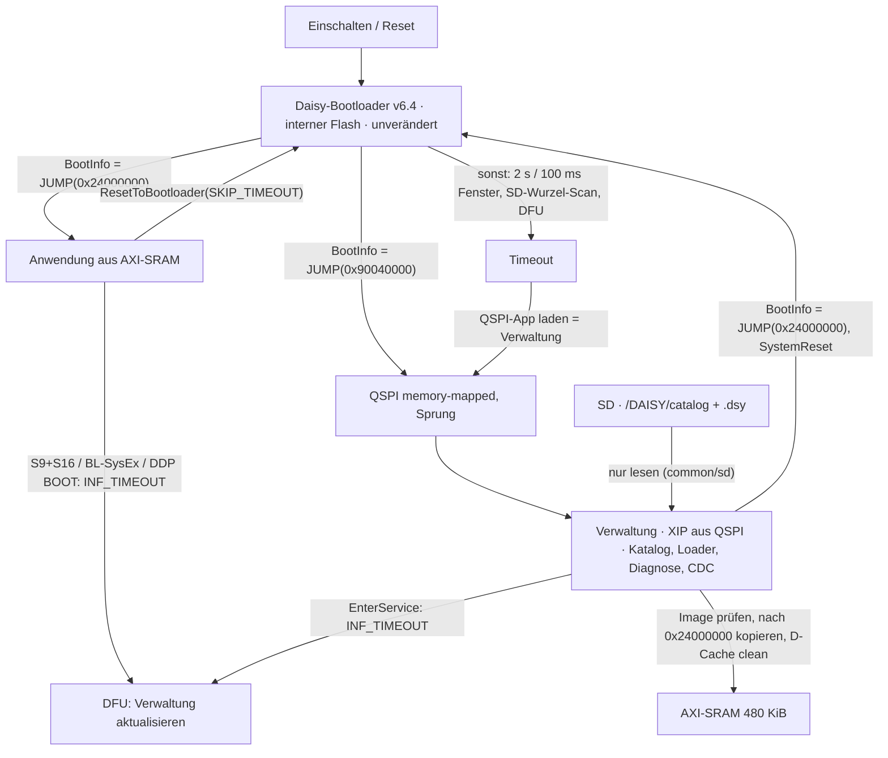

# Unabhängiges Review: SD-/RAM-Bootkonzept (Claude Code)

**Review vom 31.10.2026** zu [SD_RAM_BOOT_CONCEPT.md](SD_RAM_BOOT_CONCEPT.md)
nach dem Prüfauftrag in [SD_RAM_BOOT_REVIEW.md](SD_RAM_BOOT_REVIEW.md).

Nur Dokumentation. Es wurde nichts gebaut, geflasht, getestet oder an
Abhängigkeiten geändert. Alle Hardwareaussagen unten sind, soweit nicht als
`GEMESSEN (Datum, Quelle)` aus vorhandenen Testberichten zitiert,
**NICHT GEMESSEN**.

## 0. Urteil

| Frage | Antwort |
| --- | --- |
| Konzept als Ganzes | **Tragfähig mit Änderungen.** Die Kernidee – feste QSPI-Verwaltung, SD-Image direkt ins freigehaltene AXI-SRAM, Übergabe über Backup-SRAM-Auftrag plus Software-Reset – ist richtig und wird auf diesem Kit heute schon bei jedem Start benutzt (Befund F1). |
| Bevorzugter Entwurf B („neuer Bootkern im internen Flash“) | **Verwerfen für Version 1.** Der Teil „eigenen Bootkern schreiben und installieren“ ist unnötig: der installierte Daisy-Bootloader v6.4 liefert genau die geforderte Bootkern-Funktion (RAM-Auftrag → VTOR/MSP → Sprung, Rückkehr, DFU-Service) bereits. Gegenvorschlag **E** in Abschnitt 4. |
| Entwurf A („interner Bootloader mit SD/FAT/Menü“) | **Nicht tragfähig** mit libDaisy-Basis: der installierte Bootloader mit SD, FatFs, USB-DFU und QSPI belegt schon 127.044 von 131.072 Byte (F2). |
| Implementierungsfreigabe | **Weiterhin nicht erteilt.** Vor jedem Build sind die Entscheidungen aus Abschnitt 5 zu treffen; vor jedem Hardwareversuch die dort genannten Nachweise. |

Was das Konzept richtig sieht: Speicherbesitz (480-KiB-Ziel frei halten), eigener
Linkerplan für die Verwaltung, Prüfung vor dem Auftrag, Karte nur lesen, kein
Flash-Schreiben im Alltag, getrennte Betriebsmodi, keine Autostarts aus dem
Plugin, DAC-Code 0 ≠ 0 V. Was es überschätzt: die Unsicherheit des Reset-Pfads
(bereits täglich in Gebrauch) und den Nutzen eines eigenen Bootkerns. Was es
unterschätzt: Die Größe eines libDaisy-basierten internen Bootloaders, den
Übergabezustand, den heutige BOOT_SRAM-Images stillschweigend voraussetzen (F3),
und die Cache-Kohärenz beim Schreiben des Images (F1).

## 1. Reviewstand und Quellen

| Gegenstand | Stand |
| --- | --- |
| Repository | Commit `3f475477dc9e39559a98be71d816f0387eb3da09`, identisch in Hauptcheckout und Konzept-Worktree `codex/sd-ram-boot-concept`. Konzeptdateien sind dort untracked; `README.md` dort um drei Zeilen erweitert (nicht angetastet). |
| Submodule | Im Worktree nicht ausgecheckt. Gelesen im Hauptcheckout: libDaisy `f715e4875b2d28445d0c11a0a17f064a248f69d0` (v9.0.0-5), DaisySP `2c72eaf9eac5fc0dca1919d65d606da907832618` – identisch mit den Angaben im Konzept. |
| Upstream DaisyBootloader | `shared/bootloader.cpp`, `shared/bootloader.h`, `bootloader/main.cpp`, `bootloader/boot_linker.lds`, README, Releases – Abruf 31.10.2026 über ein Textwerkzeug (Zitate daher kurz). `bootloader.cpp` auf `main` **und** Tag `v6.4.0` gelesen; in den geprüften Punkten (JUMP-Pfad, SD-Suche, Timeout-Bedingung, Kopierlänge) gleichlautend. Ob die installierten Binärdateien exakt aus `v6.4.0` stammen, ist nicht belegt; sie heißen `v6_4` und melden `v6_1` als BootInfo-Version, was zur Quelle passt. |
| ST RM0433 | **Nicht gelesen.** Der Abruf des PDF scheiterte am Zeitlimit des Werkzeugs. Alles, was unten als „RM0433 (zu belegen)“ markiert ist, ist Wissensstand des Reviewers, keine zitierte Fundstelle. Liste der offenen Fundstellen in Abschnitt 5.3. |
| Hardwarebefunde | Nur aus vorhandenen Berichten zitiert: `diagnostics/docs/TEST_REPORT.md`, `HANDOVER.md`, `README.md`, `common/bootloader/README.md`. |
| Nicht gelesen | Vollständiger Quelltext von Looper, Step Seq, Nebulae, Editoren; nur die vom Prüfauftrag genannten Stellen und gezielte Greps. |

Zusätzlich zu den im Konzept genannten Quellen gelesen: `libDaisy/core/startup_stm32h750xx.c`
(die tatsächlich kompilierte Startdatei; `startup_stm32h750xx.s` ist im Makefile
auskommentiert, [core/Makefile:52-60](../libDaisy/core/Makefile)),
`libDaisy/src/sys/system_stm32h7xx.c`, `libDaisy/src/sys/system.{h,cpp}`,
`libDaisy/src/daisy_seed.cpp`, `libDaisy/src/desktop_devkit.{h,cpp}`,
`libDaisy/src/per/qspi.cpp`, `libDaisy/src/hid/fatfs.h`, `libDaisy/src/sys/ffconf.h`,
`libDaisy/src/usbd/usbd_conf.c`, die vier `dsy_bootloader_v6_4-*.bin` (Größen),
`common/bootloader/*`, `common/sd/*`, `diagnostics/firmware/Makefile`,
`diagnostics/firmware/src/main.cpp`, `diagnostics/protocol/PROTOCOL.md`,
`diagnostics/docs/{TEST_REPORT,SD_CARD_READER_REVIEW,FIRMWARE}.md`,
`scripts/check-firmware.py`, `scripts/check-sd-symbols.py`, `modules/mod-on-daisy/docs/STORAGE.md`,
`docs/FLASHING.md`, `components/README.md`, Protokolldokumente MD/SQ.

## 2. Befundtabelle

Schweregrad: **Fehler** = belegte falsche oder fehlende Aussage im Konzept;
**Risiko** = richtig erkannt oder plausibel, aber nicht nachgewiesen;
**Offen** = Entscheidung oder Quelle fehlt; **Hinweis** = redaktionell/ergänzend.

| ID | Grad | Konzept | Quelle | Befund und Begründung | Korrektur | Verifikation |
| --- | --- | --- | --- | --- | --- | --- |
| F1 | Fehler (zugunsten des Konzepts) | §5.2 A1, §12 R1 | Upstream `startup_process`, `LoadProgramAndJump`, `FillTargetMemory`; `bootloader/main.cpp`; [common/desktop.mk:9](../common/desktop.mk); [diagnostics/firmware/Makefile:8](../diagnostics/firmware/Makefile); [TEST_REPORT.md:116-126](../diagnostics/docs/TEST_REPORT.md) | Der Daisy-Bootloader startet jede BOOT_SRAM-Anwendung so: QSPI→SRAM kopieren (480 KiB), `boot_info.status = JUMP`, `boot_info.data = 0x24000000`, `HAL_NVIC_SystemReset()`; nach dem Reset prüft `startup_process` **vor** jeder Hardware-Initialisierung den Auftrag, setzt ihn auf `INVALID`, setzt `SCB->VTOR`, `__set_MSP`, ruft den Reset-Handler des Images – ohne erneutes Kopieren. Alle Projekte dieses Repos sind BOOT_SRAM; Diagnose H1–H10 **GEMESSEN 2026-10-17**, Toy Piano v0.2 abgenommen 2026-10-17. A1 (AXI-SRAM-Erhalt über SYSRESETREQ, kein Überschreiben durch den frühen Bootpfad) ist damit auf diesem Kit täglich ausgeübte Praxis, nicht bloß „Vorbild“. Nicht abgedeckt ist nur ein Unterschied: der Bootloader kopiert mit **abgeschaltetem D-Cache** (`SCB_DisableDCache()` in `main.cpp`); eine libDaisy-Verwaltung läuft mit eingeschaltetem D-Cache. | R1 umformulieren: „Verwaltung muss das Zielimage vor dem Auftrag aus dem D-Cache zurückschreiben (`SCB_CleanDCache_by_Addr` über 0x24000000–Ende oder D-Cache deaktivieren) und Barrieren setzen.“ Das ist Softwarepflicht, kein Hardwareunbekanntes. | Ein später freigegebener Hardwaretest mit Hash-Prüfung des geladenen Images bleibt sinnvoll, hat aber niedriges Risiko. |
| F2 | Fehler | §3, §11 (A), §12 R2 | [common/desktop.mk:14](../common/desktop.mk); Dateigrößen `libDaisy/core/dsy_bootloader_v6_4-extdfu-{10,2000}ms.bin` = 127.044 B, `-intdfu-{10ms,2000ms}.bin` = 130.180/130.188 B; Upstream README („127044 B / 128 KB, 96.93 %“) | Die „127.044 Bytes“ sind kein fremder Beispielbuild, sondern exakt die Datei, die dieses Repo als `BOOT_BIN` installiert. Dieser Bootloader enthält `DaisySeed::Init(true)` (inkl. Audio), USB-DFU, FatFs R0.12c, SD, QSPI-Treiber. Verbleibende Reserve: 4.028 Byte. Damit ist Entwurf A (zusätzlich exFAT, SHA-256, Tastenmatrix, LED-Treiber, Katalogparser) mit libDaisy nicht glaubhaft; und für Entwurf B ist der „neue Bootkern“ überflüssig, weil die benötigte Bootkern-Funktion bereits im installierten Bootloader steckt. | §3/§11 so umschreiben; R2 streichen (kein neuer Bootloader-Build in Version 1). | Ohne Build belegbar; Größen sind Dateilängen. |
| F3 | Fehler | §5.2 Schritt 8, §6 | [startup_stm32h750xx.c:1535-1558](../libDaisy/core/startup_stm32h750xx.c); [core/Makefile:229-241](../libDaisy/core/Makefile); [system_stm32h7xx.c:145-249](../libDaisy/src/sys/system_stm32h7xx.c) | Für `BOOT_APP` (BOOT_SRAM und BOOT_QSPI) ruft der kompilierte C-Reset-Handler **kein** `SystemInit()` auf (Zeile 1550-1552) und setzt den Stackzeiger **nicht** (nur unter `sram_layout`, Zeile 1539-1541). Ein heutiges Image setzt also voraus, dass der Aufrufer bereits VTOR auf die Imagebasis gesetzt, MSP aus Wort 0 geladen, den FPU-Koprozessorzugriff (CPACR) freigegeben, das Backup-SRAM eingeschaltet und `boot_info.version` gesetzt hat. Genau das tut `startup_process` (sein eigener Startcode läuft `SystemInit` mit CPACR). Das Konzept nennt VTOR/MSP, aber nicht CPACR, nicht den RCC-Zustand (nach SYSRESETREQ: HSI 64 MHz, Caches aus, MPU aus) und nicht die BootInfo-Version als Teil des Übergabevertrags. | Übergabevertrag wörtlich als „Zustand des Upstream-JUMP-Pfads“ definieren (Abschnitt 3.3). Wer diesen Vertrag selbst implementiert (Entwurf B), muss CPACR setzen, sonst UsageFault beim ersten FPU-Befehl (`-mfloat-abi=hard`). | Bei Entwurf E automatisch erfüllt (der Bootloader bleibt der Aufrufer). |
| F4 | Fehler (teilweise) | §2 Zeile 4, §4.2, §7 | [STM32H750IB_qspi.lds:108-137, 241-250](../libDaisy/core/STM32H750IB_qspi.lds); [STM32H750IB_sram.lds:107-137, 239-248](../libDaisy/core/STM32H750IB_sram.lds); [fatfs.h:21-25](../libDaisy/src/hid/fatfs.h); [diagnostics main.cpp:111-112, 189-190](../diagnostics/firmware/src/main.cpp); [common/sd/README.md:46-47](../common/sd/README.md) | Richtig: der Standard-QSPI-Linker legt `.data`, `.bss` und Heap ab 0x24000000 ab und ist unbrauchbar. Die Korrektur ist aber klein: Sektionsplatzierung des SRAM-Linkers übernehmen (`.data`/`.bss` → DTCM, Heap → RAM_D2, `.sram1_bss` → RAM_D2_DMA, `_estack = 0x20020000`), Code/Rodata/Init-Arrays → QSPIFLASH. Dann aber Folgeproblem: `.bss` in DTCM ist für SDMMC1-IDMA **nicht** erreichbar; libDaisy und die Diagnose legen FATFS/Puffer deshalb explizit in AXI oder SDRAM. Das Konzept erlaubt in §4.2 D2-SRAM für „DMA gemäß Erreichbarkeit“ – für SDMMC1 ist D2 in diesem Repo nirgends belegt und libDaisy nennt nur AXI SRAM. | Regel: SD-Bounce-Puffer, FatFs-Fenster und Katalogpuffer der Verwaltung ausschließlich in den 32-KiB-AXI-Hilfsbereich (0x24078000–0x24080000) oder ins SDRAM; nie DTCM, nie D2 ohne RM0433-Nachweis. | Map-Check: kein Symbol der Verwaltung in 0x24000000–0x24078000; SD-Puffer-Adressen explizit prüfen. RM0433-Bus-Matrix-Tabelle nachschlagen (Abschnitt 5.3). |
| F5 | Risiko | §3, §8, §12 R3 | [daisy_seed.cpp:93-131](../libDaisy/src/daisy_seed.cpp); [system.cpp:216-246, 382-559](../libDaisy/src/sys/system.cpp); [qspi.cpp:173, 971-980](../libDaisy/src/per/qspi.cpp); Upstream README („run directly from QSPI … performance becomes more cache-dependent“); [STORAGE.md:11, 21-22](../modules/mod-on-daisy/docs/STORAGE.md) | XIP mit der gepinnten libDaisy ist ein vorgesehener Pfad (`BOOT_QSPI`): `DaisySeed::Init` überspringt `qspi.Init()` wenn das Programm aus QSPI läuft (Zeile 121), `QSPIHandle::CheckProgramMemory` verweigert Schreib-/Löschzugriff aus QSPI heraus (Nebeneffekt: die Verwaltung kann QSPI gar nicht beschreiben – gut). Aber `System::Init` fährt die Taktung von HSI 64 MHz auf 480 MHz hoch, während aus QSPI gelesen wird; der Bootloader hat QSPI mit `ClockPrescaler = 1` memory-mapped eingerichtet, der QSPI-Takt springt also von 32 auf 120 MHz mitten in der Ausführung. Upstream behandelt das als unterstützt; auf **diesem Kit** ist noch nie ein BOOT_QSPI-Image gelaufen. Ob Seed3 den IS25LP064A trägt, ist laut STORAGE.md OFFEN. | R3 beibehalten, präzisieren: „erstes triviales BOOT_QSPI-Image (LED + CDC) startet und bleibt stabil“. Keine libDaisy-Änderung nötig; nur ein projektlokaler Linker wie `toy_piano_axi.lds`. | Hardwaretest nach menschlicher Freigabe; JEDEC-ID des QSPI-Chips auslesen (Diagnose kann das nicht, Verwaltung könnte es). |
| F6 | Fehler | §5.3, §6 (`INF_TIMEOUT`), §10 | [system.h:76-94, 158-168](../libDaisy/src/sys/system.h); [system.cpp:301-353](../libDaisy/src/sys/system.cpp); [bootloader_daisy.h:25](../common/bootloader/bootloader_daisy.h); Upstream `startup_process` (`SKIP_TIMEOUT` → 100 ms, `INF_TIMEOUT` → `UINT32_MAX`); [docs/FLASHING.md:44-69](FLASHING.md) | Rückkehr und Service existieren schon als ABI: `ResetToBootloader(DAISY_SKIP_TIMEOUT)` lässt den Bootloader nach 100 ms die QSPI-Anwendung starten; `DAISY_INFINITE_TIMEOUT` (heute S9+S16, BL-SysEx, DDP `BOOT`) hält DFU offen. Ist die QSPI-Anwendung die Verwaltung, ist `SKIP_TIMEOUT` der Rückkehrdienst und `INF_TIMEOUT` der Verwaltungs-Update-Pfad – exakt der dokumentierte Ablauf aus FLASHING.md, nur dass an 0x90040000 künftig die Verwaltung statt eines Instruments liegt. Die Sorge in §10, `program-dfu`/Web Flasher „überschreiben die Verwaltung“, kehrt sich um: das ist ihr vorgesehener Updateweg, ausgeführt vom Bootloader aus internem Flash, also ohne Schreiben während XIP vom gleichen Chip. | §5.3: Rückkehrdienst = `DAISY_SKIP_TIMEOUT`, kein neues Mailbox-Kommando nötig. §10: Abweichung ausdrücklich markieren – keine „geschützte Partition“, sondern Status quo (DFU-Fenster 2 s nach jedem Einschalten, Schreibzugriff auf QSPI im Fenster). | Ob der installierte Bootloader `SKIP_TIMEOUT`/`INF_TIMEOUT` tatsächlich beachtet, ist laut [common/bootloader/README.md:108](../common/bootloader/README.md) **NICHT GEMESSEN** (B1–B14 offen). Das ist der erste Hardwarenachweis für E. |
| F7 | Risiko | §5.1, §7 (Kartenupdate) | Upstream `SearchBin` (`strstr(fname, ".bin") \|\| strstr(fname, ".BIN")`, nur Wurzelverzeichnis, `AM_DIR/AM_HID` übersprungen), `LoadFAT` (Erase+Write ab `kQspiBootloaderOffset`), `UpdateLog` (`daisy_boot_log.txt`); v6.4.0: `f_mount`-Fehler → `ABSENT` → normaler Weiterlauf; [libDaisy ffconf.h:225](../libDaisy/src/sys/ffconf.h) `_FS_EXFAT 0` | Der installierte Bootloader hängt bei jedem Start mit eingelegter Karte das Wurzelverzeichnis ein (FAT, kein exFAT) und flasht die **erste** Datei, deren Name „.bin“/„.BIN“ enthält, nach 0x90040000, wenn sie vom QSPI-Inhalt abweicht – und schreibt danach ein Logfile auf die Karte. Eine solche Datei würde die Verwaltung ersetzen. Ohne Treffer: kein Schreibzugriff, kein Log. exFAT-Karte: Mount scheitert, Bootloader läuft normal weiter (nach v6.4.0-Quelle). | Harte Kartenregel in §7: keine Datei mit „.bin“ im Namen im Wurzelverzeichnis; Programme als `.dsy` unter `/DAISY/PROGRAMS/`. Zusatz: die Verwaltung kann beim Start selbst das Wurzelverzeichnis prüfen und vor solchen Dateien warnen. | Welche FatFs-Konfiguration im v6.4-Binary steckt (exFAT), ist aus dem Binary nicht abgelesen; Verhalten mit exFAT-Karte am Kit NICHT GEMESSEN. |
| F8 | Fehler | §1, §2, §5.2 Schritt 3, §9 | [desktop_devkit.h:8-11, 29-30, 50](../libDaisy/src/desktop_devkit.h); [desktop_devkit.cpp:81-87](../libDaisy/src/desktop_devkit.cpp); [TEST_REPORT.md:26-31](../diagnostics/docs/TEST_REPORT.md); `diag_app.cpp`/`main.cpp` (BOOT-Pfad) | Das Kit hat 2 CV-Eingänge, 2 Gate-Eingänge und 2 CV-Ausgänge (DAC, 12 Bit, Polling); **keinen Gate-Ausgang**. „CV-/Gate-Buchsen … Ausgänge“ im Konzept ist ungenau. CV-OUT-Spannungen (H14/H15) sind NICHT GEMESSEN. Die Diagnose setzt CV OUT vor `BOOT` heute **nicht** auf einen definierten Wert; nur LEDs an und ACK-Flush, dann Reset. | Begriff korrigieren („CV-Ausgänge“). §5.2 Schritt 3 als neue Pflicht für Diagnosemodul und Verwaltung aufnehmen (Testsignal aus, definierter DAC-Code, dann Reset) – heute nicht implementiert. | H14/H15 und ein Reset-Übergang mit Messgerät am CV OUT: Hardware, menschlich. |
| F9 | Hinweis | §2 Zeile 8, §7, §8 | [diagnostics/firmware/Makefile:43-56](../diagnostics/firmware/Makefile); [common/sd/ffconf.h:20, 125, 255](../common/sd/ffconf.h); [common/sd/sd.mk:8-13, 18-27](../common/sd/sd.mk); [common/sd/PLAN.md:99-100](../common/sd/PLAN.md); [ff.h:22](../libDaisy/Middlewares/Third_Party/FatFs/src/ff.h) | Bestätigt: Diagnose nutzt libDaisy-FatFs R0.12c (schreibfähig gebaut, `_FS_READONLY 0`), daher das `f_open`-Verbot im Diagnose-Makefile; `common/sd` ist R0.16 + Patch-2, `FF_FS_READONLY 1`, FAT32+exFAT, LFN, ohne Firmwareanwender. `sd.mk` bricht ab, wenn `USE_FATFS=1` gesetzt ist – „nur eine FatFs pro Firmware“ ist bereits werkzeuggestützt. Das `f_open`-Verbot wird in einer Read-only-Firmware durch `FF_FS_READONLY 1` (Schreibpfade existieren nicht im Objektcode), `STA_PROTECT` im Disk-Layer und die `sd-check`-Symbolliste ersetzt; PLAN.md sagt das bereits. | Konzept §7 um diesen Ersatz der Regel ergänzen. | `make -C common/sd arm-check` (verlangt `f_open` als Symbol und prüft Erkennung von `HAL_SD_WriteBlocks`). |
| F10 | Offen | §6 Mailbox | [system.cpp:19-20, 355-361, 548-556](../libDaisy/src/sys/system.cpp); Grep `.backup_sram` im Repo (nur libDaisy `boot_info`, keine App) | Keine Kollision: libDaisys `boot_info` (12 Byte) ist das einzige `.backup_sram`-Objekt; keine Anwendung reserviert dort etwas. Ein Zusatzblock bei 0x38800100 ist frei – aber bei Entwurf E vom Bootloader **nie gelesen**; er dient nur Verwaltung↔Anwendung (Rückkehrgrund, Programm-ID). Backup-SRAM ist unter libDaisy per MPU nicht cachebar; im frühen Bootloader (MPU aus, Caches aus) ebenfalls unkritisch. Ohne VBAT ist der Inhalt nach Stromverlust zufällig; Magic+Prüfsumme nötig – gilt auch für den Bootloader selbst (Trefferwahrscheinlichkeit eines zufälligen `JUMP` plus gültiger Adresse ist ein Restrisiko des Stock-Mechanismus, das heute schon besteht). | Zusatzblock als absolute Adresse je Linker/Pointer; kein Teil des Startvertrags. | Keine Hardwareprüfung nötig vor der Entscheidung. |
| F11 | Offen | §7 Imageprofil | [STM32H750IB_sram.lds:197-237](../libDaisy/core/STM32H750IB_sram.lds) (QSPI-Sektionen im SRAM-Linker erlaubt); [toy_piano_axi.lds:262-272](../instruments/toy-piano/ld/toy_piano_axi.lds); [scripts/check-firmware.py:125-129](../scripts/check-firmware.py); `instruments/granular/src/memory.ld` | Der heutige BIN-Payload (`objcopy -O binary -S`) ist genau das, was der Bootloader heute nach QSPI schreibt und nach SRAM kopiert; er startet unverändert, wenn der Übergabezustand stimmt (F3). Unterschied zur Bootloader-Kopie: die Verwaltung kopiert nur die Dateilänge, nicht 480 KiB; der Rest des Zielbereichs behält alten Inhalt. Das ist nur sicher, wenn NOLOAD-Puffer explizit initialisiert werden (Toy Piano/PM: ja, laut Linkerkommentar; Nebulae `.neb_sd`: zu prüfen). `.bss` liegt in DTCM und wird vom Reset-Handler genullt. Zusätzliche ELF/Map-Prüfungen: `.qspiflash_*` leer, `.axi_bss`-Ende ≤ 0x24078000, Entry im Payload, SP in DTCM, Größe ≤ 480 KiB (die letzten drei prüft `check-firmware.py` bereits). | Paketwerkzeug auf `check-firmware.py` aufsetzen und um Map-Prüfungen erweitern; je Projekt dokumentieren, welche NOLOAD-Bereiche nach Start initialisiert werden. | Hostseitig prüfbar. |
| F12 | Hinweis | §9 | [mod-on-daisy PROTOCOL.md:18-59](../modules/mod-on-daisy/docs/PROTOCOL.md); [step-seq PROTOCOL.md:24-50](../sequencers/step-seq/docs/PROTOCOL.md); [diagnostics PROTOCOL.md:20-55, 131](../diagnostics/protocol/PROTOCOL.md); Grep Editoren (kein Serial/CDC-Code) | SysEx-Namensräume `MD`, `SQ`, `BL` nach Hersteller-ID 0x7D; fremde Namensräume werden weitergereicht – ein neuer Namensraum berührt bestehende Parser nicht. DDP hat keine separate Fähigkeitsabfrage, `caps=` kommt im HELLO und ist ohne Versionssprung erweiterbar. HTML/JUCE-Diagnosepanels existieren nicht; es gibt die Windows-PySide6-App. | Für CDC-Verwaltung DDP-Framing (`$…*CRC16`) mit neuen Kommandos wiederverwenden statt ein drittes Framing einzuführen; `caps` erweitern. Für den Rückkehrdienst in Instrumenten neuer SysEx-Namensraum oder neue Nachricht in MD/SQ mit Minor-Version. | — |
| F13 | Hinweis | §2, §13 | Abschnitt 1 dieses Reviews | Upstream README nennt Seed, Seed2 DFM, Patch SM, nicht Seed3; das installierte v6.4-Image läuft dennoch auf dem Kit (`bl=v6_1`, DFU `0483:DF11` auf J7, H1 GEMESSEN 2026-10-17). libDaisy erkennt Seed3 über PH6 ([daisy_seed.cpp:349, 357, 369-370](../libDaisy/src/daisy_seed.cpp)); QSPI-Pins und -Chip sind für alle Seed-Versionen gleich konfiguriert (Zeile 240-251). RM0433 wurde auch in diesem Review nicht gelesen. | §13: Fundstellenliste aus Abschnitt 5.3 übernehmen. | — |
| F14 | Risiko | §5.4 | [system.cpp:125-200](../libDaisy/src/sys/system.cpp) | `HardFault_Handler` endet in `BKPT` und `while(1)`: ein Anwendungsabsturz ist ein Hänger, kein Reset. „Nach Reset Verwaltung“ gilt erst nach manuellem Reset. Konzept erwähnt das sinngemäß. | Satz präzisieren; Watchdog bleibt separate Entscheidung. | — |
| F15 | Hinweis | §4.1 | [STORAGE.md:24-42](../modules/mod-on-daisy/docs/STORAGE.md); Upstream README („~7.75 MB“) | Die Verwaltung gehört in den Standardslot 0x90040000 (Bootloader erwartet die Vektortabelle genau dort). Eine 1-MiB-Grenze ist unnötig; die Reservierungen 0x907E0000/0x907F0000 aus STORAGE.md sind frei zu halten. | Tabelle §4.1 vereinfachen. | — |
| F16 | Hinweis | §5.2 Schritt 2 | `diagnostics/firmware/src/card_reader.cpp:15-68`; [SD_CARD_READER_REVIEW.md:54-74](../diagnostics/docs/SD_CARD_READER_REVIEW.md); unmerged `codex/diagnostics-reader-hardware` (0.3.1) | Besitzzustandsautomat LOCAL/SHARED mit `ERR e=BUSY` existiert bereits (separates Reader-Image). Hardwarebefunde dazu (GEMESSEN 31.10.2026, FAT32 Schreiben/Lesen) liegen nur auf einem nicht gemergten Branch. | Konzept kann auf diese Automatik verweisen; MSC bleibt in Version 1 ein separates Image oder kommt später in die Verwaltung. | Merge-Stand abwarten. |
| F17 | Risiko | §9 | Upstream `startup_process` (DFU-Enumeration im Fenster) | Zwischen Anwendung und Verwaltung erscheint auf J7 für 100 ms bzw. 2 s ein DFU-Gerät `0483:DF11`, dann die Verwaltung (CDC). Panels müssen diese Abfolge tolerieren. | §9 „erwartetes Trennen“ um „kurzes DFU-Gerät“ ergänzen. | USB-Beobachtung am Host. |
| F18 | Hinweis | §5.1 Schritt 5 | Upstream `CHECK_TIMEOUT` | Bei Entwurf E startet nach dem Einschalten automatisch die **Verwaltung** (nach 2 s), kein Instrument. Das ist mit „kein überraschender Instrumentenstart“ vereinbar. Ein „letztes Programm automatisch starten“ wäre eine spätere Verwaltungsfunktion. | — | — |

## 3. Korrigierter Architekturvorschlag (Entwurf E)

**E = Entwurf B ohne neuen Bootkern.** Bootkern ist der unveränderte,
installierte Daisy-Bootloader v6.4 (extdfu-2000ms). Verwaltung ist eine
`BOOT_QSPI`-Anwendung mit eigenem Linker im Standardslot 0x90040000. Startauftrag
ist libDaisys vorhandenes `BootInfo` (`JUMP`, `data = 0x24000000`). Rückkehr ist
`DAISY_SKIP_TIMEOUT`, Service/Update ist `DAISY_INFINITE_TIMEOUT`.

Legende: **[B]** = belegt aus Quelltext/Upstream-Quelle; **[P]** = Praxis auf dem
Kit (GEMESSEN-Einträge anderer Berichte); **[A]** = Annahme, zu beweisen.

### 3.1 Speicherplan nach Phasen

| Phase | Wer läuft woher | 0x24000000–0x24078000 (480 KiB) | 0x24078000–0x24080000 (32 KiB) | DTCM 0x20000000 (128 KiB) | D2 0x30000000 (288 KiB) | SDRAM | Backup-SRAM |
| --- | --- | --- | --- | --- | --- | --- | --- |
| 0 Bootloader-Fenster | Bootloader aus internem Flash [B: boot_linker.lds] | Kopierpuffer `sram_program` (NOLOAD, nur im DFU-/SD-Pfad beschrieben) | Bootloader `.data`/`.bss` (SRAM_SPARE) | Bootloader Heap/Stack | `.sram1_bss` des Bootloaders | ungenutzt | `boot_info` 0x38800000 (12 B) [B] |
| 0' JUMP-Pfad nach Reset | Bootloader, vor jeder Init [B] | **unangetastet** | wie 0 | wie 0 | — | — | `status` → `INVALID`, `version` = v6_1 [B] |
| 1 Verwaltung | XIP aus 0x90040000 [B: Mechanismus; A: auf Seed3] | **frei; kein Symbol, kein Stack, kein DMA** (Map-Check) | SD-Bounce (≥512 B, 32-Byte-ausgerichtet), FatFs-Fenster, Katalogpuffer ≤16 KiB [A: Platz reicht] | `.data`/`.bss`/Stack der Verwaltung (`_estack = 0x20020000`) | Heap (RAM_D2), libDaisy-DMA-Puffer LED/ADC/MIDI (`.sram1_bss`, MPU nicht cachebar) [B]; **nicht** für SD | optional Diagnosepuffer nach `sdram_handle.Init()` (läuft in `DaisySeed::Init` für v6_1) [B] | optionaler Zusatzblock 0x38800100 (Rückkehrgrund, Programm-ID) [A] |
| 2 Laden | Verwaltung | Ziel des `.dsy`-Payloads, Dateilänge; danach `SCB_CleanDCache_by_Addr`, `__DSB(); __ISB()` [B: Cache-Pflicht; A: genaue Sequenz] | Bounce aktiv | — | — | — | zuletzt: `boot_info.status = JUMP`, `data = 0x24000000` |
| 3 Übergabe | Bootloader JUMP-Pfad [B] | Image | — | MSP aus Wort 0 | — | — | konsumiert |
| 4 Anwendung | aus AXI-SRAM, wie heute [P] | Code, Rodata, `.data`-Initialwerte, danach NOLOAD-Puffer nach Linker | frei (Anwendungslinker) | `.data`/`.bss`/Stack | Heap/DMA | DSP/Samples | nur `ResetToBootloader` |

Zustand, den eine Anwendung beim Eintritt in `Reset_Handler` vorfindet (Phase 3,
[B] aus Upstream-Quelle und `system_stm32h7xx.c`): RCC im Reset-Zustand (HSI),
SysTick aus, NVIC geleert durch Reset, D-/I-Cache aus, MPU aus, CPACR CP10/11
freigegeben, `SCB->VTOR = 0x24000000`, MSP = Wort 0 des Images, Backup-SRAM
eingeschaltet (DBP, BKPRAM-Takt), `boot_info.version = v6_1`,
`boot_info.status = INVALID`. QSPI **nicht** memory-mapped (Anwendung ruft
`qspi.Init` selbst). Das ist identisch mit heute.

### 3.2 Ablauf Programmstart (ersetzt Konzept §5.2)

1. Auswahl in `PROGRAM_SELECT` (Taste 1–15 oder CDC `StartProgram(id, hash, generation)`); Katalogeintrag und Generation prüfen.
2. Kartenbesitz lokal (Version 1 hat kein MSC in der Verwaltung; Reader bleibt separates Image).
3. Diagnose-Testsignale beenden; DAC auf den später am Kit geprüften Ruhecode setzen; Audio stumm (F8).
4. `.dsy` öffnen, Header (Format, `seed3-desktop`, `axi-sram-480k-v1`, Länge ≤ 480 KiB, SHA-256) lesen. `boot_info.status` bleibt `INVALID`.
5. Payload in 512-Byte-Vielfachen über Bounce-Puffer (AXI-Hilfsbereich) nach 0x24000000 kopieren, dabei hashen; Gesamtzeitbudget und `sd_detect` (D7) überwachen.
6. Länge und Hash prüfen; Wort 0 in `(0x20000000, 0x20020000]`, Wort 1 ungerade und in `[0x24000000, 0x24000000+Länge)` (wie `check-firmware.py`). Fehler → Anzeige, zurück zu 1.
7. SD aushängen, USB-CDC geordnet trennen, LED-DMA beenden; `SCB_CleanDCache_by_Addr(0x24000000, Länge)` (oder `SCB_CleanDCache()`), `__DSB()`.
8. Optional Zusatzblock schreiben (Programm-ID, Hash), dann `boot_info.data = 0x24000000; boot_info.status = JUMP;` `__DSB()`; `RCC->CIER = 0; HAL_NVIC_SystemReset();`
9. Bootloader-JUMP-Pfad startet das Image (3.1 Phase 3). Panel meldet `RunningVerified` erst nach Identifikation durch das Image (MD/SQ `IDENTIFY`, DDP `HELLO`).

Rückkehr (ersetzt §5.3): Anwendung beendet Audio/MIDI/Gates, schließt laufende
Speicherung ab (Looper wartet heute schon auf Abschluss des Kartenschreibens,
`instruments/looper/src/main.cpp:444-448`), schreibt optional den Zusatzblock,
ruft `System::ResetToBootloader(DAISY_SKIP_TIMEOUT)`. Bootloader: 100 ms Fenster
(inkl. SD-Wurzel-Scan, F7), dann QSPI-App → zweiter Reset → Verwaltung. Service
(ersetzt §10): unverändert `DAISY_INFINITE_TIMEOUT` über S9+S16, BL-SysEx,
DDP `BOOT`; Verwaltungs-Update per `make program-dfu`/Web Programmer nach
0x90040000 wie in FLASHING.md.

### 3.3 Was E gegenüber dem Konzept aufgibt (ausdrückliche Abweichungen)

* Keine Prüfung der Resetursache und keine RAM-Integritätsprüfung **nach** dem
  Reset – der Stock-Bootloader springt bei `JUMP` ungeprüft. Ersatz: Prüfung vor
  dem Commit, Commit als letzter Schritt, Cache-Clean. Restrisiko wie heute.
* `boot_info.data` ist im Stock-Bootloader ein freier Zeiger in SRAM_D1/QSPI.
  Nur die Verwaltung darf `JUMP` schreiben; Anwendungen nie.
* Kein geschützter Verwaltungsslot: Im Bootloader-Fenster ist QSPI per DFU
  beschreibbar, und eine `.bin`-Datei im Kartenwurzelverzeichnis wird geflasht
  (F7). Das ist der heutige Zustand; Kartenregel und Warnung durch die Verwaltung.
* 2-s-Fenster nach jedem Einschalten (heute ebenso).
* Keine Verwaltungs-Diagnose im Bootloader-Fenster; ohne gültige QSPI-App bleibt
  der Bootloader im DFU-Fenster stehen (`LoadProgramAndJump` prüft Wort 0) – das
  ist der unabhängige Wiederherstellungsweg; ROM-DFU am Modulport bleibt für den
  Bootloader selbst.

## 4. Vergleich und Empfehlung

| Kriterium | A: interner SD-Bootloader | B: neuer Bootkern + QSPI-Verwaltung | E: Stock-Bootloader + QSPI-Verwaltung | D: SD flasht nach QSPI |
| --- | --- | --- | --- | --- |
| Internen Flash neu schreiben | ja (ROM-DFU, Modulport) | ja | **nein** | nein |
| 128-KiB-Budget | nicht glaubhaft (F2) | offen, vermutlich machbar | nicht relevant | nicht relevant |
| R1 Reset/RAM-Erhalt | eigener Nachweis | eigener Nachweis | **in täglicher Nutzung (F1)**, nur Cache-Clean neu | nicht nötig |
| Übergabevertrag (F3) | selbst implementieren | selbst implementieren | **geerbt** | geerbt |
| Rückkehr/Service | selbst | selbst (neue Mailbox-Aktionen) | **vorhanden** (`SKIP`/`INF_TIMEOUT`; Hardwareprüfung B1–B14 offen) | vorhanden |
| XIP-Verwaltung mit libDaisy (F5) | entfällt | nötig | nötig | entfällt |
| Verwaltungs-Update ohne XIP-Schreibkonflikt | — | eigener Servicepfad nötig | **DFU aus internem Flash, wie heute** | wie heute |
| Diagnose ohne Karte | nur wenn im 128 KiB Platz | ja | **ja** | ja (als QSPI-App) |
| Kein Flash-Schreiben beim Wechsel | ja | ja | **ja** | **nein** |
| Neue unbekannte Bauteile | FAT+Hash+UI im Bootloader | Bootkern, Linker, Mailbox, Service | Verwaltungslinker, Loader, Panel | Loader + QSPI-Schreiben |
| Hauptrisiko | Größe, Pflege | Bootloader-Fehler = Kit nur über ROM-DFU rettbar | Abhängigkeit vom Upstream-JUMP-Verhalten (v6.4, undokumentiert, aber quelloffen und gepinnt) | Flash-Verschleiß, Zeit |

**Empfehlung:** E für Version 1. B nur dann, wenn später eine der Abweichungen aus
3.3 (Integritätsprüfung nach Reset, geschützter Slot) zwingend wird – dann als
Hardening, dessen Bootkern den Übergabevertrag des Stock-Bootloaders
bit-identisch nachbildet, damit Images und Verwaltung unverändert bleiben. A
verwerfen. D bleibt Rückfall nur, falls E am XIP-Nachweis (F5) scheitert; dann
wäre die Verwaltung eine BOOT_SRAM-Anwendung und müsste gewählte Programme per
QSPI-Schreiben installieren (Flash-Schreiben pro Wechsel, Ziel aufgegeben).

## 5. Nächste Entscheidungen und Nachweise

### 5.1 Vor jedem Build festzulegen (Dokumentation, kein Code)

1. Entscheidung E statt B; Konzept v2 mit den Korrekturen F1–F18 (Autor des Konzepts).
2. Startvertrag schriftlich = Zustand 3.1 Phase 3; Pflicht „D-Cache clean vor Commit“.
3. Verwaltungslinker: Sektionsplan wie SRAM-Linker, Text nach QSPIFLASH, SD-Puffer im AXI-Hilfsbereich oder SDRAM; Map-Check-Regel „kein Symbol in 0x24000000–0x24078000“.
4. `.dsy`-Header und Katalog (Grenzen aus Konzept §7 übernehmen) und Paketwerkzeug auf Basis von `scripts/check-firmware.py`.
5. Kartenregel (kein „.bin“ im Wurzelverzeichnis), Pfad `/DAISY/…`, Verhalten bei exFAT-Karte.
6. Rückkehrdienst der Anwendungen: `DAISY_SKIP_TIMEOUT` + Auslöser (Tastenkombination ≠ S9+S16, SysEx-Namensraum oder MD/SQ-Nachricht).
7. CDC-Protokoll der Verwaltung: DDP-Framing erweitern (F12).
8. Entscheidung, ob Diagnose Platz 16 belegt (Konzept bevorzugt ja).

### 5.2 Erst an Hardware klärbar (menschlich freigegeben, in dieser Reihenfolge)

| ID neu | Nachweis | Ersetzt |
| --- | --- | --- |
| E1 | Installierter Bootloader beachtet `SKIP_TIMEOUT` (100 ms) und `INF_TIMEOUT`; Test mit heutiger Diagnose-Firmware (`BOOT`) und einem Minimal-Image – entspricht B1–B14 aus `docs/HARDWARE_TEST_BOOTLOADER.md`. | F6 |
| E2 | Triviales `BOOT_QSPI`-Image (LED + CDC) startet aus 0x90040000 und läuft nach Taktumschaltung stabil; JEDEC-ID des QSPI-Chips auslesen. | R3, F5 |
| E3 | Verwaltung ohne Karte: Katalogfehler, Anzeige, keine Startschleife; mit FAT32- und exFAT-Karte: Mount, Katalog, Kartenentnahme während des Lesens. | R5 |
| E4 | Erster SD→SRAM-Start eines bekannten Images (Toy Piano v0.2-Hash) mit anschließender Hash-Meldung aus dem Image; wiederholte Wechsel; Reset während des Ladens; Strom weg während des Ladens. | R1, R4, R8 |
| E5 | CV OUT mit Messgerät über alle Übergänge (Verwaltung → Anwendung → Rückkehr), zuvor H14/H15. | R6 |
| E6 | USB-Abfolge CDC → DFU → CDC an Windows; Panel-Wiederverbindung. | R7 |
| E7 | Verwaltungs-Update per DFU, abgebrochen (Stecker ziehen), danach Wiederherstellung per erneutem DFU. | R9 |

Alle Ergebnisse als `GEMESSEN (Datum, Aufbau, Ergebnis)` oder `NICHT GEMESSEN`
in den Berichten der Diagnose/Bootloader-Testblätter.

### 5.3 Offene Primärquellen (RM0433, nicht gelesen)

Vor E4 nachzuschlagen und im Konzept v2 mit Abschnittsnummer zu zitieren:

* System-Reset-Quellen und was ein Software-Reset (SYSRESETREQ) **nicht**
  zurücksetzt (Backup-Domäne, RSR-Flags) – RCC-Kapitel.
* Aussage zum Erhalt des SRAM-Inhalts über System-Reset gegenüber Power-on –
  Speicherkapitel/Power-Kapitel.
* RCC_RSR-Flags (`SFTRSTF`, `PORRSTF`, `BORRSTF`, `PINRSTF`, `IWDG1RSTF`,
  `WWDG1RSTF`, `LPWRRSTF`, `CPURSTF`, `D1RSTF`, `D2RSTF`) und Löschen über `RMVF`
  – nur relevant, falls B doch gebaut wird.
* Boot-Adressbereich `BOOT_ADD0/1` (nach Kenntnis 0x0000 0000–0x3FFF 0000,
  QSPI 0x9000 0000 nicht bootfähig – Begründung, warum ein interner Bootloader
  zwingend bleibt).
* RAMECC: Verhalten beim Lesen uninitialisierten RAMs nach Power-on (Flags vs.
  Fault). Bei E nicht auf dem Pfad, da die Verwaltung vor dem Sprung schreibt.
* Bus-Matrix-Tabelle: erreichbare Speicher für SDMMC1-IDMA (AXI SRAM, D2-SRAM1–3,
  SRAM4, Backup-SRAM, QSPI, FMC) – entscheidet, ob D2 als SD-Puffer zulässig wäre.
  Bis dahin: nur AXI-Hilfsbereich oder SDRAM (F4).

## 6. Antworten auf die zehn Pflichtfragen (Kurzfassung)

1. **Board/Speicher:** STM32H750IB, 128 KiB Flash, AXI 512 KiB (480 + 32 Hilfsbereich), Backup-SRAM 4 KiB, QSPI 8 MiB angenommen (IS25LP064A, Chip auf Seed3 OFFEN), SDRAM 64 MiB – konsistent mit libDaisy-Linkern. Seed3-Unterschied zum Upstream-Bootloader: nicht in dessen README, läuft aber (F13). Ohne Build belegbar: Bootloader 127.044/131.072 B; Reader-Image ≈126 KiB SRAM-Image (`diagnostics/docs/FIRMWARE.md:34-36`) als Größenordnung einer libDaisy-Firmware mit USB+FatFs.
2. **XIP:** Vorgesehener libDaisy-Pfad; `qspi.Init` wird übersprungen, Schreiben aus QSPI heraus ist blockiert; Taktumschaltung unter XIP ist das Restrisiko (F5). Lokale Anpassung: nur ein projektlokaler Linker, keine libDaisy-Änderung.
3. **Ladeziel:** DTCM für `.data`/`.bss`/Stack, D2 für Heap und libDaisy-DMA, AXI-Hilfsbereich/SDRAM für SD-Puffer (F4, Tabelle 3.1). Reicht für Verwaltung mit Diagnose nach Erfahrungswert Reader-Image (DTCM 68 KiB belegt) – **Annahme**, Map-Check nötig.
4. **Reset/Einstieg:** Zustand in 3.1 Phase 3 belegt aus Startcode und Upstream; Erhalt des SRAM in täglicher Praxis (F1), RM0433-Fundstelle offen (5.3). Zerstörend wären nur eigene Schreibzugriffe der Verwaltung in den Zielbereich und fehlender Cache-Clean. SDRAM-Erhalt wird nicht benötigt.
5. **Mailbox:** `BootInfo` konfliktfrei, Zusatzblock optional (F10). Teilwrites: Status zuletzt. `JUMP` ist genau der genutzte Mechanismus; Einschränkung: ungeprüfter Zeiger (3.3).
6. **Imageprofil:** heutiger BIN startet unverändert; zusätzliche ELF/Map-Prüfungen in F11.
7. **SD:** `common/sd` passt (read-only, FAT32/exFAT, einzige FatFs erzwungen, IDMA-Bounce in AXI/SDRAM); `f_open`-Verbot wird durch `FF_FS_READONLY 1` + `sd-check` ersetzt (F9). Integrationsstand: Schritt 1 von 5, kein Firmwareanwender.
8. **QSPI-Service:** keine Inkompatibilität – DFU nach 0x90040000 wird zum Verwaltungs-Update; ausgeführt aus internem Flash, daher kein XIP-Schreibkonflikt; Single-Slot-Stromausfall → Bootloader bleibt im DFU-Fenster, erneut flashen; ROM-DFU für den Bootloader selbst (F6, 3.3).
9. **Ausgänge/Speicherabschluss:** 2 CV OUT (DAC), keine Gate-Ausgänge; CV OUT nie gemessen; Diagnose setzt CV vor Reset heute nicht zurück (F8); Looper wartet auf Schreibende (3.2). Konflikt S9+S16: bleibt INF_TIMEOUT; Rückkehr braucht eigene Kombination.
10. **Control Panel:** DDP erweitern, SysEx-Namensraum neu, CDC/MIDI getrennte Adapter, DFU-Gerät im Übergang tolerieren (F12, F17); keine HTML/JUCE-Diagnosepanels vorhanden; Plugin-Regeln des Konzepts §9 bleiben unverändert gültig.
