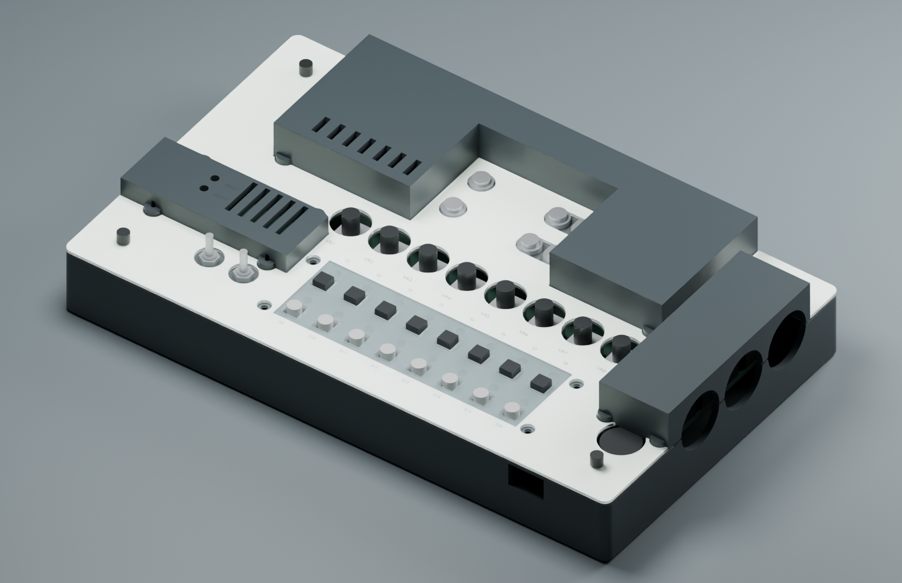
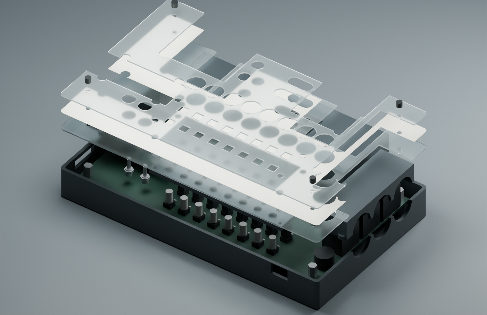

# Geschlossener Entwurf V2

**Korrigierter Export RH-2026-10-25:** Frühere Druckdateien sind wegen
Spiegelung zurückgezogen. [Ursache und unabhängiger Nachweis](ORIENTATION_FIX.md).

**Konstruktionsstand 24.10.2026. Hardware NICHT GEMESSEN.** Diese Fassung ist
eine konkrete CAD- und Passstudie, noch kein freigegebenes Fertigungspaket.
Sie berücksichtigt die gewünschten Metallpfosten, Knurlies, zwei Acrylplatten,
Buchsen-/Schaltermuttern und einen Führungsrahmen für die gekauften Kappen.



## Tragender Aufbau wie beim Abstandshalter-Sandwich

Die vier vorhandenen PCB-Bohrungen H1–H4 bestimmen die Befestigung. Der
Kraftpfad verläuft durch **Metall-Abstandshalter**, nicht durch gedruckte
Gewindepfosten. Die Potis werden lediglich freigestellt und tragen nichts.

Von unten nach oben, zunächst als Nennmaße:

| Schicht | Aufbau |
| --- | --- |
| Gehäuseboden | 2,8 mm, M3-Schrauben von unten, Kopfvertiefung 1,4 mm |
| Untere Metall-Abstandshalter | 10 mm, M3 Innen-/Innengewinde, SW 5,5 mm |
| Desktop-Platine | 1,6 mm, vorhandene Ø-3,5-mm-Bohrungen |
| Obere Metall-Abstandshalter | 9 mm, M3 Außen-/Innengewinde; alternativ 8 mm mit exakt 1 mm fester Distanz |
| Untere Trägerplatte | 1 mm Acryl, bei Buchsen/Schaltern mit passenden Muttern befestigt |
| Papier | ca. 0,15 mm, instrumentbezogen wechselbar |
| Obere Klarplatte | 1 mm Acryl, vier M3-Knurlies mit vorhandenen Kunststoffscheiben |

Die unteren Abstandshalter sind bewusst 10 statt 6 mm lang: Bei einem oberen
M3-Gewindestift von 6 mm und einer unteren M3×6-Schraube verbleibt im unteren
Pfosten rechnerisch **1 mm Abstand zwischen den Schraubenenden**. Ein kurzer
6-mm-Pfosten würde diesen Aufbau nicht aufnehmen. Tatsächliche Stiftlänge,
Gewindetiefe, Scheiben und Schraubenköpfe vor Montage prüfen.

Bei 9 mm oberer Distanz liegt die Acryloberfläche **11,15 mm über dem PCB**.
Das Gehäuse bleibt 215 × 129 mm groß. Bis zur hohen Buchsenhaube sind es im
Entwurf 39,8 mm über der Druckfläche, ohne Füße und vorstehende Bedienelemente.
Die aufeinanderliegenden Platten werden am Rand von der Wanne zusätzlich
abgestützt. Vier Metallpfosten und die zusätzlichen Buchsenbefestigungen
ersetzen jedoch keine gemessene Belastungsprüfung der 1-mm-Platten.



## Papierwechsel mit vier Knurlies

[Befaco](https://www.befaco.org/knurlies/) nennt M3×7 mm und Panels von 2–3 mm.
[Thonk](https://www.thonk.co.uk/shop/knurlies/) nennt 6 mm nutzbare Länge nach
der Kunststoffscheibe. Die CAD-Rechnung nutzt vorsichtig diese 6 mm:
**6 − 1 − 0,15 − 1 = 3,85 mm Gewindeeingriff**. Die weiblichen Gewinde der
oberen Metallpfosten benötigen mindestens 5 mm freie Tiefe. M2,5-Knurlies
gehören nicht in diese M3-Auslegung.

Die Buchsen- und Schaltermuttern sitzen ausschließlich auf der **unteren**
Platte. Die obere Platte umgeht die Muttern mit größeren Aussparungen. Die
nebeneinanderliegenden CV-In-/Gate-Muttern teilen sich je ein längliches
Fenster; dadurch entsteht kein brüchiger 0,9-mm-Acrylsteg zwischen zwei Löchern.
Die kleinen Schrauben der festen Hauben und des Rasters bleiben ebenfalls
unterhalb bzw. außerhalb der abnehmbaren Klarplatte zugänglich.

Zum Papierwechsel werden deshalb nur die vier Knurlies gelöst. Oben montierte
Potiknöpfe müssen durch die Ø-14-mm-Öffnungen passen; größere Knöpfe erfordern
Abziehen oder eine andere Schnittkontur. Die obere Platte wird über die Kappen
abgehoben; die Kappen selbst bleiben auf den vorhandenen TL1105-Tastern.
Das Papier behält ein gemeinsames Tasten-/LED-Fenster, damit es sich ohne
32 einzelne Ausschnitte wechseln lässt. Die beiden klaren Acrylplatten haben
Einzelöffnungen für die Kappen und überdecken die Zwischenräume sowie LEDs.

## Geschlossene Bereiche und Anschlüsse

Rückseite, DIN-Seite und Seed-Modul erhalten erhöhte, feste Druckhauben. Die
Bedienfläche liegt tiefer, passend zu Buchsen und Tastern. Die hintere und die
DIN-Haube sind **getrennte Teile**: Dazwischen führt eine schmale, zusammenhängende
Acrylbrücke zur hinteren rechten PCB-Bohrung. Ein äußerer Steg auf derselben
Höhe würde die horizontalen DIN-Stecker blockieren.

Die unteren Acrylkonturen öffnen die Wege zu 6,35-mm-Audio, DIN und Seed-USB
bis zum Gehäuserand. Nominale Stecker-Zugangsvolumen sind gegen beide
Acrylplatten geprüft. Die eigentlichen Stecker und die vollständige Bestückung
sind noch nicht als verlässliche 3D-Modelle geprüft. SD, Kopfhörer und beide
USB-Anschlüsse haben seitliche Zugänge. Lüftungsschlitze sind vorgesehen;
Temperatur und Schmutzeintrag sind NICHT GEMESSEN. Das Gehäuse ist nicht dicht.

Die [ausführliche Hersteller-BOM](https://daisy.nyc3.cdn.digitaloceanspaces.com/products/seed-3-desktop/Seed3-DevKit-Desktop_Rev4-bom.csv)
identifiziert die sechs senkrechten Mono-Buchsen als **QingPu WQP-WQP518MA**.
Die bei Thonk veröffentlichte
[Bauteilzeichnung](https://www.thonk.co.uk/wp-content/uploads/2018/07/Thonkiconn_Jack_Datasheet-new.jpg)
zeigt nominal 9 mm Gehäusehöhe und 4,5 mm Gewinde. Mit der unteren 1-mm-Platte
auf 9 mm verbleiben rechnerisch 3,5 mm bis zum Gewindeende. Eine 2,5-mm-Reserve
für Mutter/Scheibe ist eingeplant; die eigenen Muttern bleiben zu prüfen.
Nur passende Muttern verwenden und keine Höhendifferenz durch Anziehen
wegdrücken: Abweichungen benötigen angepasste Auflagen/Distanzscheiben.

Die BOM nennt **Dailywell 2MS1T1B1M2QE / 2MS3T1B1M2QE**. Das
[Hersteller-Datenblatt](https://lv.mouser.com/datasheet/2/979/dailywell_10012019_2M_Series-1660477.pdf)
weist B1 als 5,59-mm-Gewindehülse mit **10-48 UNS-2A** aus. Diese Gewinde sind
keine M5-Gewinde. Ø 5,2 mm unten und Ø 10 mm oben sind vorgesehen.
Die exakte Schulterhöhe im verlöteten Zustand, Scheiben und Muttern sind noch
zu bestätigen; deshalb ist diese zusätzliche Verschraubung noch nicht
freigegeben. Wenn die Höhen nicht zusammenpassen, wird die lokale Auflage
angepasst, nicht das PCB verspannt.

## Tastenhöhe und Raster

Die Kappen haben 9 mm Einzelteilhöhe. Entscheidend ist ihre **voll montierte
Höhe über dem PCB**, weil sie unterschiedlich tief auf dem Betätiger sitzen
können. Diese Höhe wurde nicht gemessen. Die Vorschau verwendet ausdrücklich
eine **13-mm-Annahme**, keine behauptete Messung.

Der [TL1105-Hersteller](https://www.e-switch.com/wp-content/uploads/2022/06/TL1105.pdf)
nennt 0,25 mm typischen Schaltweg. Für das aktuelle Sandwich gilt:

```text
gedrückter Kappenüberstand = montierte Kappenhöhe − 0,25 − 11,15 mm
```

Bei angenommenen 13 mm ergibt das 1,6 mm. Für einen Entwurfswert von mindestens
0,8 mm gedrücktem Überstand müsste die niedrigste Kappe mindestens **12,2 mm**
hoch sitzen. Das ist ein **Prüfkriterium**, keine zugesicherte Passform.
Bei zu niedrigen Kappen werden die Bedienebene und der Plattenaufbau angepasst;
die 9-mm-Buchsenauflage setzt dabei eine eigene Randbedingung.

Das separate Raster liegt von 6 bis 9 mm über dem PCB und wird mit vier M2×5
und vier M2-Muttern in 4,2-mm-Muttertaschen an der unteren Platte befestigt.
Es führt die Kappen seitlich mit Ø 5,8 mm beziehungsweise 5,8-mm-Quadraten.
Die Acrylöffnungen sind 6,4-mm-Quadrate, sodass beide Kappentypen passen.
Varianten: nur quadratisch, nur rund oder obere Reihe quadratisch / untere rund.
Es gibt keine Vorspannung und keinen zusätzlichen Anschlag auf dem
Tastergehäuse. Die originalen Kappen müssen trotzdem selbst auf ihren
Betätigern halten. Rückkehr, seitliches Reiben und vollständiger Hub:
NICHT GEMESSEN.

Die kleine **H2–S9-Höhenlehre** stellt die 11,15-mm-Oberfläche über S9 nach.
Sie liegt ausschließlich auf dem H2-Montagepad auf. Dafür muss H2 oben frei
sein; eine vorhandene Schraube bzw. ein oberer Pfosten wird für die Probe
entfernt. Am stromlosen Board
zunächst Auflage und freien Ausleger prüfen, dann vorsichtig auflegen; nicht
auf LEDs oder andere Bauteile drücken. Sie benötigt Druckstützen. Mit ihr
lässt sich der Kappenüberstand vor dem großen Gehäusedruck beurteilen.
Der separate Führungs-Coupon enthält runde und quadratische Öffnungen in
5,4 / 5,8 / 6,2 mm für die Drucktoleranzprobe.

## BOOT / RESET

Für die neue Seed3-Haube wurde das
[offizielle 3D-Modell](https://daisy.nyc3.cdn.digitaloceanspaces.com/products/seed3/Seed3-models.zip)
herangezogen. Der Desktop-KiCad-Footprint allein reicht dafür nicht: Er ist
noch als älteres Seed-Modul benannt. Im Seed3-Modell liegen zwei PTS815-Schalter
mit 6 mm Querabstand und gemeinsam 14,5 mm Längsposition. Die Übertragung auf
das Desktop-PCB sowie die tatsächliche Einsteckhöhe sind als vorläufig markiert.
Modelldatum und Zeichnung sind in `closed-mechanics.json` verlinkt.

Zunächst gibt es **zwei schmale Führungsbohrungen mit herausnehmbarem,
isolierendem Druckstift**. Der Stift wird nach Gebrauch entfernt und belastet
im normalen Betrieb keinen Taster. Sein STL ist nur eine Längen-Passstudie:
Vor Gebrauch müssen Lage, Modulhöhe und Anschlaglänge stimmen. Ein dauerhaft
gefangener Stößel mit Leerspiel bräuchte eine zusätzliche Rückstellung; diese
Mechanik wird nicht ohne Passprobe als funktionsfähig ausgegeben.

## Dateien und lokaler Stand

Die aktuelle Studie liegt unter [closed-v2/](closed-v2/):

| Gruppe | Dateien |
| --- | --- |
| Druckteile | `closed-tray.stl`, `rear-hood.stl`, `midi-hood.stl`, `seed-hood.stl` |
| Raster | `key-guide-mixed.stl`, `key-guide-square.stl`, `key-guide-round.stl`; nur die gewünschte Variante drucken |
| Passproben | `guide-clearance-coupon.stl`, `H2-S9-cap-height-gauge.stl` |
| Service-Werkzeug | `removable-service-tool-fit-study.stl`; Länge noch nicht bestätigt |
| Laserkonturen | `lower-acrylic-1mm.svg`, `upper-acrylic-1mm.svg`, `paper-overlay.svg` |
| Ansichtsgeometrie | die drei `*-reference.stl`; **nicht als Acryl-Ersatz drucken** |
| Prüfbogen | `sandwich-and-height-study-a4.pdf`, drei Seiten, 1:1 und Höhenbudget |
| Nachweis | `validation.json`, geschlossene Körper und dokumentierte Annahmen |

Die Hauptgewinde liegen in zu beschaffenden bzw. vorhandenen Metallteilen.
Die festen kleinen Hauben verwenden M2×4-Schrauben von unten durch die untere
Platte in Ø-1,6-mm-Pilotbohrungen ihrer Druckfüße. Diese Gewinde sind nicht für
den regelmäßigen Papierwechsel vorgesehen. Schraubenlängen und Slicereinstellungen
noch am Prototyp bestätigen. Hauben und Höhenlehre können Druckstützen benötigen;
V1-Druckempfehlungen nicht ungeprüft auf V2 übernehmen.

```powershell
.tools/case/Scripts/python.exe hardware/desktop-case/build_closed_case.py
& 'C:/Program Files/Blender Foundation/Blender 5.2/blender.exe' --background --python hardware/desktop-case/render_closed_preview.py
```

Quellen und Parametervorgaben liegen in `closed-mechanics.json`; Generatoren
bleiben im eigenen Branch. Die ursprünglichen V1-Dateien bleiben als Referenz.

**Digital geprüft am 24.10.2026:** 13 zusammenhängende geschlossene Körper,
konsistente Orientierung, beide Acrylschichten frei von den 16 Kappen-Hüllflächen,
sieben benannte Kollisionspaare ohne Überschneidung und beide Schichten frei
von den nominalen seitlichen Anschluss-Zugangsvolumen. Metallgewinde-Budget
und Abstand der beiden Schraubenenden im unteren Pfosten geprüft.
PDF und beide CAD-Vorschauen gerendert und visuell geprüft. Hardware,
vollständige Bauteil-/Steckerkollisionen, Kräfte und Temperatur:
**NICHT GEMESSEN**.
