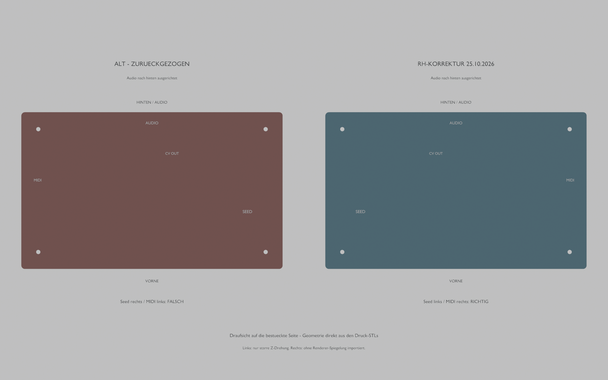

# Orientierungskorrektur RH-2026-10-25

**Die vor dem 25.10.2026 ausgelieferten Druck-STLs und ZIP-Pakete sind
zurückgezogen. Nicht zum Druck verwenden.** Betroffen waren die STL-Exporte
von V1, V2 und V3. Die Wannen und der einteilige Träger konnten so nicht
passend montiert werden. Geschlossene Netze und richtige Außenmaße hatten
diesen Fehler nicht erkannt.

## Ursache und Abhilfe

Die interne Konstruktion verwendete PCB-Koordinaten wie in einer KiCad-
Draufsicht: X nach rechts, Y zum Spieler. Zusammen mit Z nach oben ist das
kein rechtshändiges physisches System. Die STL-Schreiber übernahmen diese
Koordinaten unverändert. Die Blender-Importe spiegelten dagegen die Y-Achse.
Die Bilder stellten deshalb eine andere Orientierung dar als die Druckdateien.

Der Export geschieht jetzt zentral in `build_case.physical_mesh_of()`:

```text
Physischer Ursprung: hintere linke PCB-Ecke
+X = rechts, Richtung MIDI-Seite
+Y = hinten, Richtung Audioanschlüsse
+Z = oben, Richtung Bestückung

Quelle -> STL: X=x, Y=-y, Z=z
```

Beim negativen Achsenfaktor wird auch die Dreiecksreihenfolge korrigiert,
damit die Normalen nach außen zeigen. **Alle vier Renderer laden die
korrigierten Druck-STLs ohne weitere Spiegelung.** Die Umrechnung für direkt
aus PCB-Daten erzeugte elektronische Bauteile bleibt erforderlich; sie ist
kein nachträglicher Eingriff in die importierten Druckdateien.

Die SVG-/PDF-Konturen waren bereits als korrekte Draufsicht dargestellt.
Sie wurden nicht pauschal gespiegelt. Die drei PDFs tragen jetzt zusätzlich
die Orientierung „Bestückte Oberseite: Audio hinten, Seed links, MIDI rechts“
und die RH-Kennung.



Links wird das alte STL ausschließlich um die Z-Achse gedreht. Das ist eine
zulässige räumliche Drehung und zeigt den gemeldeten Fehler: Seed rechts,
MIDI links und vertauschte CV-Anordnung. Rechts wird das neue STL direkt
geladen. Beide Ansichten zeigen die bestückte Oberseite; eine Unterseiten-
oder Kameraverwechslung ist damit ausgeschlossen.

## Nachweise an den exportierten Dateien

`check_stl_orientation.py` importiert keine Generatorfunktionen. Seine
unabhängig festgelegten Prüfpunkte stammen aus Herstellermerkmalen und
wurden vom zweiten Codex-Agenten separat überprüft. Ein Solid-Angle-Integral
prüft jeweils einen freien Öffnungspunkt und einen benachbarten Materialpunkt.
Damit besteht ein außerhalb liegender Punkt eines gespiegelten Gehäuses den
Test nicht versehentlich.

- Wannen V1/V2/V3: Audio hinten, DIN rechts, USB links.
- V3-Träger: CV_OUT1, Taster S1, LED D1; ergänzend der vorläufige Seed-Zugang.
- Die alten Dateien scheitern: [vorher](orientation-audit/before-correction.json).
- Die neuen Dateien bestehen: [nachher](orientation-audit/after-correction.json).

Zusätzlich vergleicht `validate_realistic_case.py` die tatsächlichen fünf
V3-STL-Vertexmengen mit den tatsächlichen GLB-Vertices in beiden Richtungen.
Dabei wird **keine Spiegelung** angewendet, sondern nur eine echte räumliche
Rotation von glTF-Y-oben zu Z-oben und die Umrechnung Meter/mm. Die maximale
Format-Rundungsabweichung beträgt hier etwa 0,0000114 mm. Das ist ein
Dateivergleich, keine Aussage über Druck- oder Fertigungsgenauigkeit.

## Unabhängige Zweitprüfung

Ein zweiter Codex-Agent prüfte mit frischem Kontext und ausschließlich lesend
die Herstellerplatine, das Boardfoto und die Dateien. Seine Nachprüfung am
25.10.2026 ergab:

- Alle 24 neu exportierten V1/V2/V3-STLs entsprechen genau der einmaligen
  erforderlichen Y-Umrechnung; geschlossen, konsistente Normalen und
  positives, unverändertes Volumen.
- Eigene Öffnungs-/Materialprüfungen bestätigen die Wannen und den V3-Träger.
- Alle fünf korrigierten Gehäuse-/Schicht-STLs stimmen ohne Reflexion mit
  dem neuen GLB überein; Montage-STL und direkt geladene BLEND-Datei ebenfalls.
- Seed links, MIDI rechts, Audio hinten; CV_OUT links von CV_IN und Gate.
- Keine verbleibende Spiegelung im STL-Import der vier Renderer gefunden.

Die vom Nutzer angeregte Zweitprüfung war ein Codex-Agent. Ein Claude-Lauf
wird hier nicht behauptet. Die Hardware-Passung ist weiterhin
**NICHT GEMESSEN**; insbesondere bleiben Kappenhöhe und Seed-Einsteckhöhe
als Annahmen kenntlich.

Die Aussage zum unveränderten Volumen betrifft den reinen RH-Korrekturstand
`2efeaf8`. Danach wurden die Ausschnitte für Rad/Kopfhörer gezielt verändert;
dies ist die getrennte [ACCESS-Korrektur](RIGHT_ACCESS.md), kein weiterer
Orientierungswechsel. Die Vorher-/Nachher-Draufsicht oben zeigt nur den
RH-Korrekturschritt.

## Ersatzpaket und Rückzug der alten Pakete

Nur das neue Paket **`Daisy-Desktop-V3-RH-2026-10-25.zip`** verwenden.
Seine Druckdateien tragen zusätzlich `RH-2026-10-25` im Dateinamen.
Die alten ZIP-Links wurden zurückgezogen; lokale Beweiskopien liegen im
ausdrücklich mit `withdrawn` und `DO-NOT-PRINT` bezeichneten Ausgabeverzeichnis.
Die Hashes der vier alten Archive stehen in
[withdrawn-packages.json](orientation-audit/withdrawn-packages.json).

Vor dem Paketieren laufen alle drei Dateiprüfungen einschließlich des
Rad-/Kopfhörerzugangs. Die tatsächlich enthaltenen
STL-Bytes werden nochmals gegen ihre aktuellen Hashes geprüft. Das neue
Paket enthält den Vorher-/Nachher-Nachweis und die Prüfberichte.

```powershell
.tools/case/Scripts/python.exe hardware/desktop-case/check_stl_orientation.py
.tools/case/Scripts/python.exe hardware/desktop-case/check_right_access.py
.tools/case/Scripts/python.exe hardware/desktop-case/validate_realistic_case.py
.tools/case/Scripts/python.exe hardware/desktop-case/package_case_review.py
```
