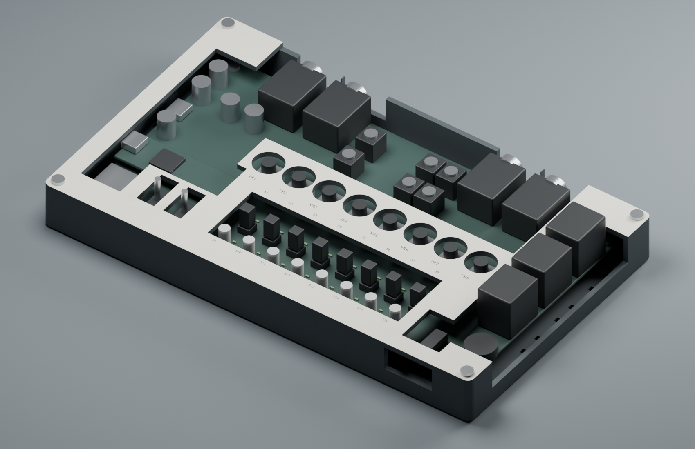

# Desktop-Gehäuse / Paper on Daisy

**Aktueller Stand, 26.10.2026:** [V4 als vollständiger erster Gehäusedruck](v4/full/V4.md),
auf ausdrücklichen Nutzerwunsch ohne vorgeschaltete Couponbestellung.
**Vier Druckteile**, zwei 1-mm-Acrylplatten und Papier; Originalkappen direkt
aufstecken und seitlich führen. [Druckpaket](v4/full/V4-KOMPLETTDRUCK.zip)
mit vier STLs, drei vorpositionierten 3MF-Platten, SVGs und Montage/Einkauf.
Digital geprüft; Hardware **NICHT GEMESSEN**.

## Fertigungsanbieter

Diese beiden Anbieter wurden bereits für das PreenFM2-Gehäuse genutzt;
am 26.10.2026 anhand der vorhandenen Auftragsbelege zugeordnet:

| Anbieter | Leistung | Früherer PreenFM2-Auftrag |
| --- | --- | --- |
| [Lazycut](https://lazycut.de/) | Laserzuschnitt der Acrylplatten | Auftrag AU-202609-10258 vom 08.09.2026 nennt „Plexiglas 1 mm klar“. |
| [3ddruck-express.de](https://3ddruck-express.de/) | FDM-Druck der Gehäuseteile | Bestellung 4431 vom 15.08.2026: PETG-CF schwarz, 0,12-mm-Schichten; Wanne 40 %, Rückblende 60 % Füllung. |

Für den neuen V4-Auftrag gelten die [aktuellen Druck- und Acrylvorgaben](v4/full/V4.md#fertigungsauftrag).
Die früheren Einstellungen dienen als Bestellhistorie. Die privaten Rechnungen
und Bestell-E-Mails bleiben außerhalb des Repositorys.

## Frühere Entwürfe und Prüfungen

Die folgenden Abschnitte dokumentieren ältere Entwürfe. Die frühere Empfehlung,
vor dem Komplettdruck Coupons zu bestellen, ist für V4 durch die neue
Nutzerentscheidung ersetzt. [Dreier-Lochprobe](v4/simple-guide/README.md)
und [Katalog C1–C7](v4/COUPONS.md) bleiben optionale historische Hilfen.

**Aktuelle Fehlerprüfung 25.10.2026:** Der [Vergleich von V3 und Claudes
Gegenentwurf](DESIGN_REVIEW_2026-10-25.md) findet offene Anschlussabstützung,
fehlende Kappenrückhaltung und weitere konkrete Maß-/Zugangsprobleme.
Die RH-/ACCESS-Prüfungen decken diese zusätzlichen Anforderungen nicht ab.
Die vorhandenen STLs sind weiterhin eine Konstruktionsstudie.

**25.10.2026: [Orientierungskorrektur RH](ORIENTATION_FIX.md). Frühere
Druck-STLs und ZIP-Pakete nicht verwenden.** Alle V1/V2/V3-STLs sind neu
exportiert und unabhängig geprüft. Render und Druckdateien benutzen jetzt
denselben physischen Koordinatenraum.

**Aktuelle V3 zusätzlich mit [seitlichem Radzugang und erweiterter
Kopfhöreröffnung](RIGHT_ACCESS.md)** (`ACCESS-2026-10-25`). Die frühere
10-mm-Höhenannahme für das Lautstärkerad ist korrigiert.

**Aktueller Entwurf: [durchgehender Druckträger V3](UNIFIED_V3.md).**
Ein Druckteil verbindet Bedienfläche, Seed-/Buchsenhauben und das angeformte
Tasterraster. Darauf liegen weiterhin zwei 1-mm-Acrylplatten mit Papier,
getragen von Metallpfosten und über vier M3-Knurlies lösbar. Buchsen- und
Schaltermuttern befestigen nur die untere Acrylplatte. Geometrie digital
geprüft; Kappenhöhe, Pfostentoleranzen, Festigkeit und Passung am Board
NICHT GEMESSEN. Noch keine Fertigungsfreigabe.

Eine [detaillierte Baugruppenansicht mit KiCad-Bestückung, Seed3-Modell,
Materialien und GLB-/STL-Export](REALISTIC_RENDER.md) ergänzt den CAD-Entwurf.

Die [V2 mit getrennten Hauben und Raster](CLOSED_V2.md) bleibt als frühere
Konstruktionsstudie erhalten.

## Erster Entwurf V1 (Referenz)

Ein **offener, verschraubter Prototyp** für das Seed3 Desktop Dev Kit: Wanne,
separater Oberrahmen und austauschbare Papierbeschriftung. Eine optionale
transparente 1-mm-Platte schützt das Papier auf dem Rahmen. Die Buchsen,
Seed-Servicefläche, BOOT/RESET und microSD bleiben ausgespart.

**Stand 24.10.2026: CAD digital geprüft; Druck, Passform am Board und
mechanische Anschlussentlastung NICHT GEMESSEN.** Die Dateien sind für einen
ersten Passprototyp vorgesehen. Vor einem kostenpflichtigen Komplettdruck
zuerst die Papierschablone und das kleine Prüfstück verwenden.



Die Elektronik in der Vorschau zeigt Anordnung und Freiräume; sie ist kein
vollständiges Hersteller-3D-Modell. Insbesondere ist die dargestellte montierte
Kappenhöhe nicht als Maßnachweis zu verwenden. Die transparente Schutzplatte ist
in der Vorschau weggelassen; die helle Fläche stellt das Papier dar.

## Dateien

Die direkt verwendbaren Dateien liegen in [prototype/](prototype/):

| Datei | Zweck |
| --- | --- |
| `tray.stl` | Wanne mit vier PCB-Auflagen, M3-Muttertaschen, Deckelpfosten und Kabelbinder-Schlitzen |
| `overlay-frame.stl` | Flach druckbarer Oberrahmen mit acht Potiöffnungen und zwei Schalterfenstern |
| `fit-coupon.stl` | Kleines Prüfstück, 62 × 24 mm, für Schrauben, Mutter und Öffnungen |
| `paper-master-a4.pdf` | A4 quer, 1:1; neutrale Passschablone mit 100-mm-Kontrollstrecke |
| `clear-cover-cut.svg` | Reine Schnittkonturen in mm für die optionale Klarplatte; keine Gravur |
| `case-preview.png` | Vorschau der tatsächlichen STL-Geometrie mit schematischer Elektronik |
| `validation.json` | Digitale Prüfergebnisse und SHA-256 der Quellen und Druckdateien |

Alle STL-Dateien verwenden **Millimeter**, liegen mit der Druckfläche auf Z=0
und werden einzeln, ohne Skalierung importiert. Die große Bauteilfläche beträgt
215 × 129 mm; bei einer Brim zusätzlich deren Breite auf beiden Seiten vorsehen.
Kein Firmware-Build und keine GitHub-Actions-Ausführung werden benötigt.

## Maßgrundlage und Entwurfsmaße

Die mechanischen Daten stammen aus den offiziellen
[KiCad-Dateien](https://github.com/daisyaudio/Seed3-DevKit-Desktop/tree/987297fb7c9a8c58721ef40abf6d6eedd1fcda2a/pcb),
nicht aus einem skalierten Produktfoto. Die vier veröffentlichten Revisionen
wurden mit KiCad 10.0.6 ausgelesen und für Konturabmessungen, PCB-Dicke,
Befestigungsbohrungen und die Mittelpunkte aller Bedienelemente verglichen.
Diese Werte sind für Rev1 bis Rev4 gleich. Das ist keine Aussage über die
vollständige elektrische oder dreidimensionale Gleichheit der Revisionen.

| Größe | Wert | Herkunft |
| --- | --- | --- |
| PCB-Kontur | 197 × 111 mm, Eckradius 2,5 mm | KiCad-Kantenmittellinien |
| PCB-Dicke | 1,6 mm | KiCad-Platinenaufbau |
| Bohrungen | 4 × Ø 3,5 mm | KiCad-Mounting-Pads |
| Lochabstand | 187 × 101 mm | Differenz der Pad-Mittelpunkte |
| Poti-Raster | 15,279 mm | KiCad VR1–VR8 |
| Taster-Raster | 12,285714 mm horizontal, 16 mm zwischen den Reihen | KiCad S1–S16 |
| Gehäusefläche | 215 × 129 mm | Entwurf |
| Boden / Seitenwand | 2,8 / 2,4 mm | Entwurf |
| PCB-Unterseite über Druckfläche | 8,8 mm; 6 mm über dem Innenboden | Entwurf |
| Rahmenunterseite über PCB-Oberseite | 9 mm | Einstellbarer Entwurf, Passprobe offen |
| Rahmen / Gesamthöhe | 2,4 mm / 21,8 mm ohne Füße und Klarplatte | Entwurf |
| Klarplatte und Papier | optional 1 mm + ca. 0,15 mm | Entwurf |
| Potiöffnungen | Ø 14 mm | Einstellbarer Entwurf, Knopfdurchmesser prüfen |

Nullpunkt in `board.json`: hinten links an der Platine; X nach rechts,
Y zur spielenden Person. Beispielsweise H1=(5,5), H2=(5,106), H3=(192,5),
H4=(192,106). Die 0,05 mm Zeichenstrichbreite von Edge.Cuts zählt nicht zum PCB.
Dateinamen, Commit und SHA-256 aller vier Quelldateien stehen in `board.json`.

Nicht alle Bauteile besitzen im Herstellerprojekt ein vollständiges 3D-Modell.
Die großzügigen Servicefenster und oben offenen Anschlussausschnitte vermeiden
deshalb eng passende, unbestätigte Buchsenkonturen. Die Höhe des Rahmens und die
Zugänglichkeit mit den tatsächlich montierten Knöpfen und Kabeln bleiben bei der
Passprobe zu bestätigen. Bei Knöpfen über etwa 13 mm Durchmesser muss die
Potiöffnung angepasst oder der Knopf zur Montage abgezogen werden. Die
gemeinsame Potiöffnung darf wegen der schmalen Zwischenstege nicht beliebig
vergrößert werden.

## Paper on Daisy und bestellte Kappen

Aus dem [bestehenden Konzept](https://chatgpt.com/share/6adce96c-8884-83ed-b405-74142ff307ea)
übernommen: **ein gemeinsames Fenster für alle 16 Taster und ihre LEDs**,
acht Potiöffnungen, zwei großzügige Schalteröffnungen, wechselbare Papierauflage
und optional eine klare Abdeckung. Die neutrale Schablone trägt zunächst nur
VR1–VR8, S1–S16 und SW17/SW18; instrumentbezogene Funktionsbeschriftungen können
auf derselben Geometrie aufgebaut werden.

Die Bestellung enthält jeweils 32 E-Switch **1SBLK** (schwarz, quadratisch) und
**1RLGR** (hellgrau, rund). Herstellerangaben:
[1S](https://www.e-switch.com/product/1s/) 5 × 5 × 9 mm,
[1R](https://www.e-switch.com/product/1r/) Ø 5 × 9 mm.
Die vorhandenen TL1105SPF250Q bleiben auf der Platine. Die Kappen werden auf die
Betätiger gesteckt; ein selbstgebauter Tastenmechanismus gehört nicht zu V1.
Die Kappenhöhe von 9 mm ist **nicht** die zusätzliche Höhe über dem vollständig
montierten Taster. Sitz, Hub und montierte Höhe am eigenen Board:
**NICHT GEMESSEN**.

Das 96 × 31,5 mm große Fenster lässt beide Kappenformen einschließlich
0,3 mm Freiraum je Seite sowie alle LEDs in der Draufsicht frei. Die Platte
führt oder hält die einzelnen Kappen nicht und liegt nicht auf den Tastern auf.
Papier und Klarplatte werden auf dem Oberrahmen mit dessen vier separaten
Schrauben gehalten. Zum Papierwechsel muss der Rahmen nicht von den
PCB-Schrauben gelöst werden. Ein Blatt kann am äußeren Rand geringfügig kleiner
geschnitten werden, damit es nicht übersteht.

## Anschlussentlastung

Vier PCB-Schrauben verbinden die Platine mit der Wanne. Zusätzlich befinden sich
neben den vier Audiobuchsen, den drei DIN-Buchsen, beiden USB-Zugängen und dem
Kopfhöreranschluss paarweise **2,6 mm breite Durchführungen für schmale
Kabelbinder** im Boden außerhalb der PCB-Kontur.

Die Kabel mit etwas Spiel an den jeweiligen Schlitzpaaren befestigen. Die
Schlaufe umfasst die Kabelummantelung hinter dem Stecker, ohne einen Stecker
seitlich zu verspannen oder auf die Platine zu drücken. Die Schlaufen dürfen
unter dem Boden verlaufen; Füße halten sie vom Tisch frei. Kabel vor dem
Abziehen lösen. Die Schlitze für den Service-USB bleiben optional.

**Die Ausschnitte allein entlasten die Buchsen nicht.** Die Konstruktion besitzt
keine kraftschlüssige Buchsenklemmung. Erst die befestigten Kabel können Zug in
die Wanne abgeben. Aufnahme von Zug, Steckkräften und seitlichen Hebelkräften:
**NICHT GEMESSEN**; V1 ist keine zertifizierte Kabelklemme. Die CV/Gate-Buchsen
oben haben keine individuellen Kabelbinderpunkte.

## Druck, Teile und Montage

Als erster Ansatz: normales PETG, 0,4-mm-Düse, 0,2-mm-Schichten, vier Außenlinien
und etwa 20–30 % Füllung. Das sind **Startwerte**, keine erprobten Druckparameter.
Beide Hauptteile flach drucken. Die kleinen Muttertaschen benötigen eine kurze
Brücke; deren Druckqualität am Prüfstück prüfen. Druckservice kann die
Parameter passend zu seinem Verfahren wählen.

| Teile | Menge / Zweck |
| --- | --- |
| Gedruckte Wanne und Rahmen | je 1 |
| M3×12 und normale M3-Muttern | je 4 für die PCB-Befestigung |
| M3×10, Linsenkopf | 4 für den Rahmen; vorsichtig in Ø-2,6-mm-Kunststoffbohrungen eindrehen |
| Kleine isolierende M3-Unterlegscheiben | 4 an der PCB, soweit nötig; Sitz auf dem Mounting-Pad prüfen |
| Gummifüße, mindestens 3 mm hoch | 4; Unterseite und Schraubenenden freihalten |
| Schmale Kabelbinder, maximal 2,5 mm breit | nach Kabelbelegung, möglichst wieder lösbar |
| Klarplatte 1 mm und Papier | optional; vorhandenes Material nach Passprobe verwenden |

Die unteren Muttertaschen haben 5,7 mm Schlüsselweite und 2,4 mm Tiefe. M3×12
ragen ohne Unterlegscheibe rechnerisch etwa 1,6 mm unter die Druckfläche; die
Füße sind deshalb Teil des Aufbaus. Vorhandene M3×14 nicht ungeprüft einsetzen.
Die Deckelschrauben greifen nur in die vier äußeren Kunststoffpfosten, nicht in
das Board. Keine Gewindeeinsätze und keine Verklebung erforderlich.

1. PDF in A4 quer mit **100 % / tatsächlicher Größe** drucken. Kontrollstrecke
   mit einem Lineal auf exakt 100 mm prüfen; erst dann ausschneiden und auflegen.
2. Prüfstück drucken. Die zwei kleinen runden Löcher sind Ø 3,4 und Ø 2,6 mm,
   die Kappenöffnungen Ø 5,6 bzw. 5,6 × 5,6 mm, das große Loch Ø 14 mm. Unten
   links liegt die M3-Mutterprobe. Schrauben, Mutter und mögliche Potiknöpfe
   damit prüfen; die Kappen brauchen diese Öffnungen im fertigen Case nicht.
3. Wanne drucken, Muttern von unten einsetzen. Das stromlose Board auf die vier
   Auflagen setzen und spannungsfrei verschrauben. Unterseitenfreiheit prüfen.
4. Tastenkappen aufstecken. Rahmen zunächst lose auflegen. Jeder Poti und
   Schalter muss seinen gesamten Weg frei erreichen; jede Taste muss vollständig
   zurückfedern, alle LEDs müssen sichtbar bleiben.
5. Papier und gegebenenfalls Klarplatte auf den Rahmen legen; vier Deckelschrauben
   nur leicht anziehen. Bei Spannungen oder blockierten Bedienelementen Maße
   korrigieren, keine Bauteile in die Öffnungen zwingen.
6. USB, SD, BOOT/RESET, alle benutzten Buchsen und die Kabelbinder mit den echten
   Steckern auf Zugänglichkeit prüfen. Kabelschlaufen und Füße montieren.

## Lokal reproduzieren

Benötigt normales Python 3 mit `requirements.txt`; KiCad-Python nur für ein
erneutes Auslesen der Herstellerdateien. Keine Änderung an den gepinnten
Firmware-Abhängigkeiten.

```powershell
python -m venv .tools/case
.tools/case/Scripts/python.exe -m pip install -r hardware/desktop-case/requirements.txt
.tools/case/Scripts/python.exe hardware/desktop-case/build_case.py
```

Das erzeugt Dateien unter `hardware/desktop-case/output/` und prüft sie lokal.
Die eingecheckte Fassung wurde mit Python 3.12 erstellt. Parameterbeispiel:

```powershell
.tools/case/Scripts/python.exe hardware/desktop-case/build_case.py --knob-opening 14 --panel-clearance 9
```

Zum erneuten Auslesen die vier unveränderten KiCad-Platinen vom oben genannten
Hersteller-Commit herunterladen. Alle Pfade einzeln übergeben oder PowerShell
die Liste erzeugen lassen (Python expandiert Wildcards unter Windows nicht):

```powershell
$caseBoards = Get-ChildItem build/case-reference/*.kicad_pcb | ForEach-Object FullName
& 'C:/Program Files/KiCad/10.0/bin/python.exe' hardware/desktop-case/extract_board.py @caseBoards --output hardware/desktop-case/board.json
```

Optional die Vorschau mit Blender erstellen:

```powershell
& 'C:/Program Files/Blender Foundation/Blender 5.2/blender.exe' --background --python hardware/desktop-case/render_preview.py
```

## Validierung vom 24.10.2026

**Digital geprüft:** drei geschlossene, konsistent orientierte STL-Körper mit
jeweils genau einer zusammenhängenden Komponente; PCB-Kollision mit der Wanne
0 mm³; Kollision von Wanne und montiertem Rahmen 0 mm³; 16 Kappenhüllflächen
und 16 LED-Hüllflächen vollständig im offenen Bereich. Die exportierten STL
wurden erneut eingelesen. PDF als PNG gerendert und visuell geprüft; Vorschau
aus den STL mit Blender 5.2.1 erzeugt und geprüft. Keine vollständige
Bauteil- oder Steckerkollisionsprüfung, Festigkeitsberechnung oder Slicerprüfung.

**Hardware NICHT GEMESSEN:** erster Druck, Schrauben-/Mutterpassung, montierte
Kappenhöhe und Sitz, Poti-/Schalterbedienung, LED-Sichtwinkel, Kabel-/SD-Zugang,
Temperatur und mechanische Entlastung. Ergebnisse erst nach der tatsächlichen
Passprobe als GEMESSEN mit Datum ergänzen.

Die frühere Referenz
[Daisy Pod Case von Planet Zero Designs](https://cults3d.com/de/modell-3d/gadget/daisy-pod-case-by-pzd)
betrifft das kleinere Pod-Board. Der bestehende Chat nennt sie als konstruktives
Vorbild; die Cults-Seite liefert beim aktuellen Abruf HTTP 403. Es wurden keine
fremden STL übernommen oder für das Desktop Kit skaliert.
