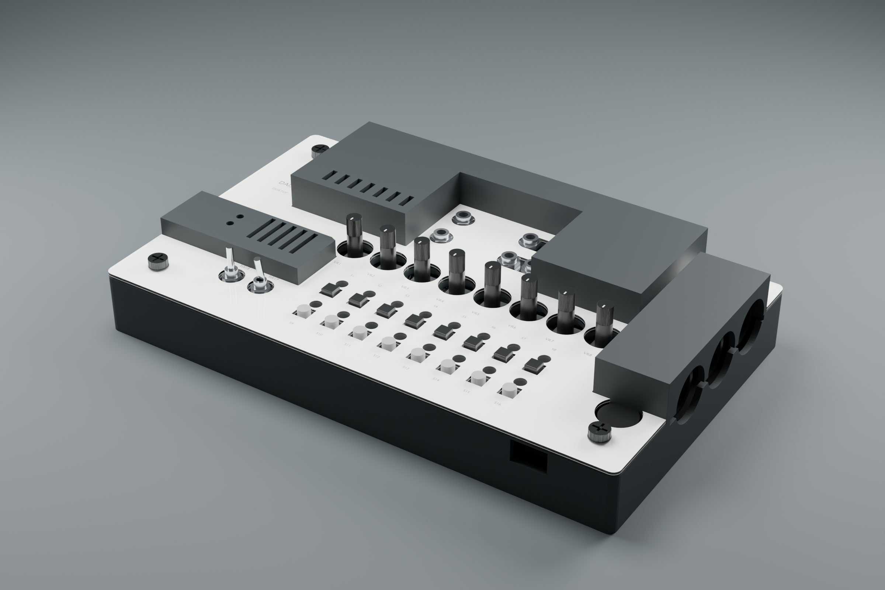
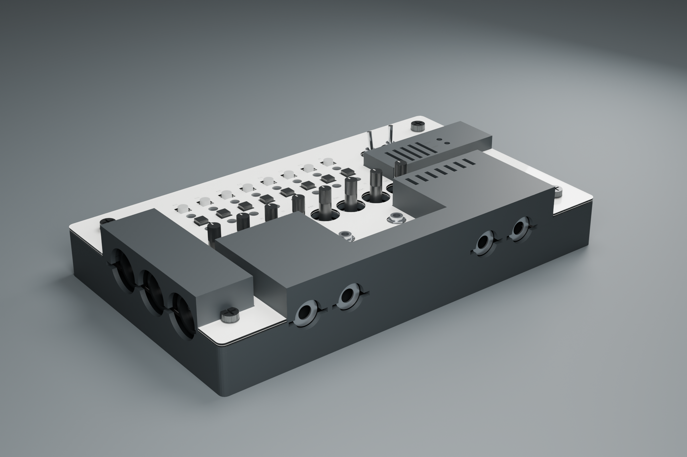
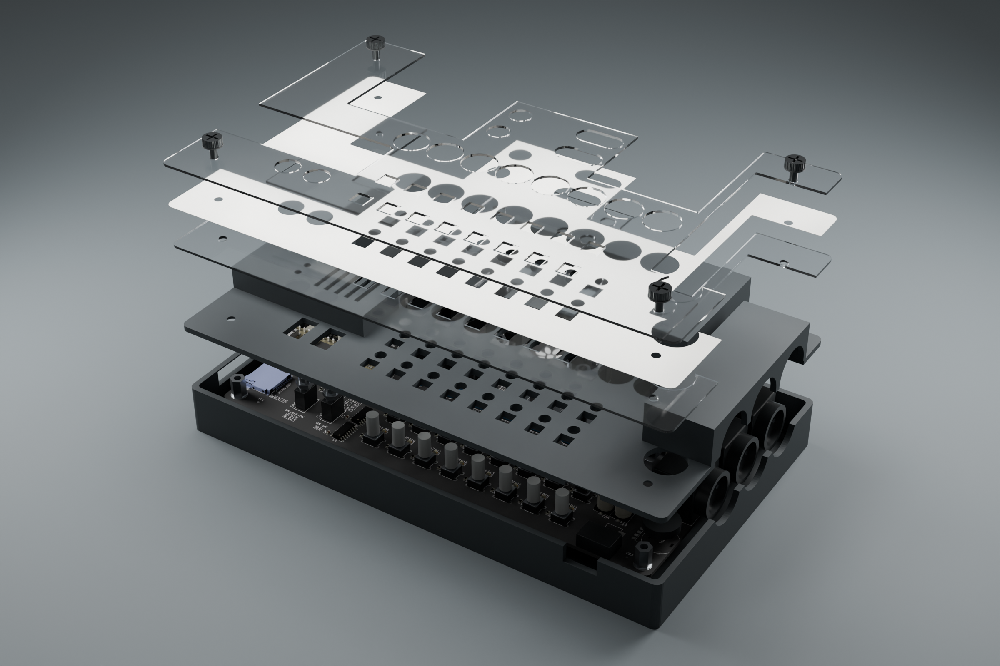

# V3 als detaillierte Baugruppenansicht

**RH-Korrektur 25.10.2026:** Die Renderer spiegeln die importierten STLs
nicht mehr. Sie laden unmittelbar die korrigierten Druckdateien.
Alte ZIP-Pakete sind zurückgezogen; [Nachweis und Ersatz](ORIENTATION_FIX.md).

**Stand 24.10.2026: digitale Visualisierung. Hardware NICHT GEMESSEN.**
Die vorhandene Konstruktion aus [V3](UNIFIED_V3.md) wird mit detaillierterer
Bestückung und Materialien dargestellt. Das Rendering ändert weder die
Druckteile noch die Acrylkonturen und ist keine Fertigungsfreigabe.



## Verwendete Werkzeuge

- **KiCad 10.0.6:** Originalplatine aus dem gepinnten Herstellerstand,
  Export von Platinenkörper, Pads, Bestückungsdruck und verfügbaren
  STEP-Bauteilen als GLB. Der exportierte Arbeitsstand ist eine Kopie;
  die Herstellerdatei wird nicht geändert.
- **trimesh 4.12.2:** Zusammenfassung der zahlreichen GLB-Einzelflächen
  nach Material und definierte Umrechnung von Metern in den mm-Arbeitsraum.
- **Blender 5.2.1 / Cycles:** Materialien, Beleuchtung und Ansichten;
  2.400 × 1.600 Pixel, 96 Samples, Denoising, OptiX auf RTX 5060 Ti.
- **manifold3d:** Die Gehäuse-STLs stammen weiterhin aus dem geprüften
  V3-Generator. Dafür wird keine neue, abweichende Rendergeometrie erfunden.

## Herkunft der Geometrie

Die PCB-Kontur, Bohrungen und Bauteilpositionen kommen aus dem
[offiziellen Rev4-KiCad-Board](https://github.com/daisyaudio/Seed3-DevKit-Desktop/tree/987297fb7c9a8c58721ef40abf6d6eedd1fcda2a/pcb).
186 Footprints erhalten vorhandene STEP-Modelle. Dazu gehören die meisten
passiven/aktiven Bauteile sowie die USB-C- und microSD-Modelle aus den
mitgelieferten Bibliotheken. Die Originalplatine besitzt 239 Footprints;
darin enthalten sind auch Bohrungen, Fiduziale, Logos und QR-Markierungen,
für die kein eigener 3D-Körper erforderlich ist.

Das **Seed3 Rev5** stammt aus dem
[Hersteller-FBX-Paket](https://daisy.nyc3.cdn.digitaloceanspaces.com/products/seed3/Seed3-models.zip).
Seine Form wird übernommen; Ausrichtung und Einbauhöhe auf dem Desktop-Kit
bleiben vorläufig. Der Transformationsweg erhält die Händigkeit: Die
Stiftseite zeigt zum Desktop-PCB. Die Modul-PCB-Oberseite liegt im Entwurf
9 mm über der großen Platine. Die endgültige Einsteckhöhe ist NICHT GEMESSEN.

Die fehlenden Bedienelemente werden anhand der bisher dokumentierten
Nennmaße nachgebildet: 16 Kappen auf TL1105-Tastern, acht Potis mit
6-mm-Wellen und nominal 25 mm Spitzenhöhe, zwei Dailywell-Kippschalter,
sechs senkrechte Mono-Buchsen, vier horizontale Audiobuchsen und drei
DIN-Buchsen. Diese Modelle zeigen Bauform und Anordnung, sind jedoch keine
herstellerzertifizierten STEP-Modelle. Die kundenspezifische Poti-Ausführung
`-0085` ist weiterhin nicht durch eine eigene Zeichnung bestätigt.

Die **montierte Kappenhöhe bleibt mit 13 mm angenommen**. Die Knurlies
erhalten gerändelte schwarze Köpfe und Kunststoffscheiben als optische
Annäherung. Kopf-/Scheibenmaße und Gewindegänge sind nicht als exaktes
Befaco-Modell nachgewiesen. Die M3-Metallpfosten folgen dem V3-Aufbau.
U1 und L2 haben in der installierten Bibliothek kein passendes 3D-Modell;
sie werden nicht durch vermeintlich exakte Ersatzmodelle ersetzt.

Die Werkstoffe sind visuell angenähert: dunkler Druckkunststoff, Nickel/Stahl,
schwarze und graue Kappen, zwei klare 1-mm-Acrylschichten und neutrales
Beschriftungspapier. Die LED-Fenster stellen unbeleuchtete LEDs dar.
Die Glanzkanten und feine Druckoberfläche sind Shader-Effekte. Die obere
Acrylplatte wird ausschließlich für die Ansicht um 0,015 mm versetzt,
um deckungsgleiche optische Grenzflächen zu vermeiden.





## Formate und Einheiten

Die kleineren Ansichten und die STL-Montageansicht liegen unter
[realistic-v3/](realistic-v3/). Die großen Arbeitsdateien werden unter
`output/realistic-v3/` erzeugt und sind nicht als große Binärdateien im Git
gespeichert.

| Datei | Verwendung |
| --- | --- |
| `case-realistic-studio.png` | Perspektivische Gesamtansicht |
| `case-realistic-rear.png` | Rückseite und seitliche Anschlüsse |
| `case-realistic-exploded.png` | Aufbau mit angehobenen Deckschichten |
| `case-assembly-view.stl` | Gehäuse, beide Acrylplatten und Papier in Montageposition; **mm**, reine Ansichtsdatei |
| `desktop-case-assembly.glb` | Vollständige farbige Baugruppe zum Drehen und Ausblenden von Teilen; glTF-Einheit **Meter** |
| `desktop-case-realistic.blend` | Editierbare Blender-Szene, Arbeitsmaßstab **1 Einheit = 1 mm** |
| `board-model-inventory.json` | Original-Footprints, Modellzuordnung und Quell-Hashes |
| `render-manifest.json` | Quellen, Annahmen, Geräte und Ausgabe-Hashes |
| `export-validation.json` | Nachprüfung von Einheiten, Außenmaßen, Bildgrößen und Quell-Hashes |

Die STL-Montageansicht ist **kein einzelnes Druckteil**: Mehrere Körper liegen
in Einbaulage übereinander.
Die gemeinsame STL behält auch deckungsgleiche Kontaktflächen zwischen
Schichten; als zusammengefasstes Netz ist sie deshalb nicht durchgehend
mannigfaltig. Die fünf zugrunde liegenden Einzelkörper sind geschlossen.
Für den Druck weiterhin nur die einzelnen
`tray.stl` und `unified-carrier.stl` aus `unified-v3/` verwenden. Acryl und
Papier werden nach den SVG-Konturen zugeschnitten. STL speichert keine
Materialien oder Transparenz; dafür ist GLB die bessere Baugruppenansicht.

## Reproduktion

Erforderlich sind die lokale KiCad-Modellbibliothek und die bereits für V3
verwendeten Herstellerdateien unter `build/case-reference/`. Zusätzlich:

```text
USB4110GFA.step
TF-01A.step
seed3-models/ES_Daisy_Seed3_Rev5.fbx
```

USB-C und SD liegen in `pcb/ES-Seed3-Devkit-Desktop-Rev4/libs/` des oben
gepinnten Hersteller-Repositories. Die Download-Dateien bleiben im lokalen
Referenzverzeichnis und werden nicht mit veränderten Namen als eigene
Bibliothek ausgegeben.

```powershell
& 'C:/Program Files/KiCad/10.0/bin/python.exe' hardware/desktop-case/prepare_render_board.py
.tools/case/Scripts/python.exe hardware/desktop-case/compact_render_board.py
.tools/case/Scripts/python.exe hardware/desktop-case/check_stl_orientation.py
& 'C:/Program Files/Blender Foundation/Blender 5.2/blender.exe' --background --python hardware/desktop-case/render_realistic_case.py
.tools/case/Scripts/python.exe hardware/desktop-case/validate_realistic_case.py
```

Der vollständige V3-Drucktest wird damit nicht wiederholt. Geprüft werden
die Einheiten und Koordinaten der importierten Platine, die erhaltenen
Quell-Hashes, die Maße der Montage-STL und der exportierten GLB sowie die
Sichtbarkeit und Anordnung in allen Renderansichten. Die konstruktiven
Kollisionsprüfungen bleiben im V3-Prüfmanifest dokumentiert. Die neue
Visualisierung bescheinigt keine vollständige Kollisionsfreiheit aller
Bestückungsteile oder Passung am realen Board.

**Digital geprüft am 24.10.2026:** Alle fünf verwendeten Gehäuse-/Schicht-STLs
stimmen mit den geprüften V3-Dateien überein und sind einzeln geschlossen.
Montage-STL: 215 × 129 × 39,8 mm. GLB: 0,215 × 0,0398 × 0,129 m in dessen
Y-oben-System. Quellen-/Ausgabe-Hashes und alle drei Bildgrößen bestätigt.
Gesamt-, Rück- und Explosionsansicht wurden nach dem finalen Render visuell
geprüft. Papier-/Tasterhöhe, Passform und Belastbarkeit bleiben NICHT GEMESSEN.

**Ergänzung 25.10.2026:** Alle fünf korrigierten Druck-STLs und GLB-Teile
stimmen in ihrer tatsächlichen Einbaulage ohne zusätzliche Spiegelung
überein. Die maximale Vertexabweichung ist kleiner als 0,000012 mm.
Die unabhängige Prüfung der Hersteller-Landmarken besteht; die frühere
Orientierung scheitert an denselben Prüfpunkten.

## Quellenhinweise

PCB und zugehörige Design-Dateien: Daisy / Qu-Bit Electronix; siehe Lizenz
im Hersteller-Repository. KiCad-Bauteile: jeweilige Autoren der installierten
`kicad-packages3D`-Bibliothek. Deren STEP-Köpfe nennen CC-BY-SA 4.0 mit der
Ausnahme für elektronische Designs und daraus erzeugte Dateien. Dies ist
eine Baugruppenansicht, keine neu veröffentlichte Bauteilbibliothek.
Seed3-FBX: Electro-Smith / Daisy. Geometrische Annäherungen für Bedienelemente
und Gehäusevisualisierung sind im Render-Skript ausdrücklich bezeichnet.
