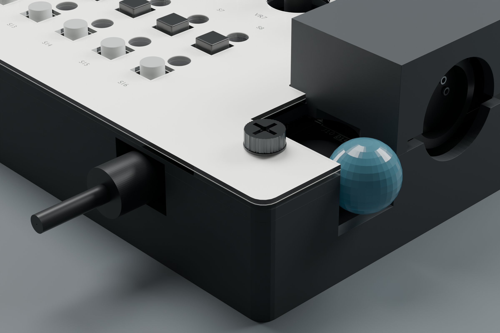

# Kopfhörer und Lautstärkerad: ACCESS-2026-10-25

**CAD-Korrektur am 25.10.2026. Hardware-Bedienbarkeit NICHT GEMESSEN.**
Die Nutzerfrage zum rechten Bereich deckte zwei weitere Schwächen des
vorherigen Entwurfs auf. Diese Änderung kommt nach der getrennt geprüften
[RH-Orientierungskorrektur](ORIENTATION_FIX.md).

## Herstellerdaten und bisheriger Fehler

Die offizielle BOM nennt für RV1 **Alps Alpine RK10J12R0A0B**. Der
[Hersteller](https://tech.alpsalpine.com/e/products/detail/RK10J12R0A0B/)
nennt Ø14 mm und 1 mm Radscheibendicke. Die
[Zeichnung Nr. 4, PDF-Seite 4](https://tech.alpsalpine.com/assets/catalog/product-catalog-rv-03.en.pdf)
zeigt die niedrige Bauhöhe von 2,5 mm. Die bisherigen schematischen Modelle
mit 10 mm Höhe waren falsch. Ein Ø16-mm-Loch über einer 11,15 mm hohen
Bedienfläche ließ das Rad tief versenkt; die rechte Wand war geschlossen.
Die MIDI-Haube überdeckte außerdem einen Teil des oberen Lochs.

J5 ist laut BOM **Same Sky SJ-3523-SMT-TR**. Aus Hersteller-Footprint und
[CUI-Bauteilzeichnung](https://datasheet.octopart.com/SJ-3523-SMT-CUI-datasheet-96684.pdf)
folgen der 6 × 14,5-mm-Körper, der 2,5-mm-Kragen und die Öffnungsrichtung:
**vorne rechts, nach vorn**, nicht durch die rechte Seitenwand.
Die Buchsenfront liegt bei PCB-Y 110,7 mm; die äußere Gehäusefront bei
120 mm. Der Steckerkörper muss deshalb etwa 9,3 mm in den Gehäuseausschnitt
hineinreichen können. Eine allein für den Metallstift freie Öffnung reicht
nicht aus.

## Geometrieänderung in der aktuellen V3

- Rechte Wand, Druckträger und beide Acrylplatten erhalten einen verbundenen
  Griffausschnitt zum Rad. Das Papier folgt der geänderten Kontur. Die Öffnung
  setzt unmittelbar hinter der MIDI-Haubenfront an, ohne einen 0,15-mm-
  Acrylreststeg stehenzulassen.
- Die Kopfhöreröffnung ist nach unten erweitert. Der Zugang wird mit einem
  **geraden Ø10-mm-Steckerkörper in vollständig eingesteckter Position**
  geprüft. Das ist ein definiertes Entwurfsziel, kein Modell des eigenen Kabels.
- Das Render-Modell zeigt RV1 jetzt mit niedriger Bauhöhe und J5 entsprechend
  dem Hersteller-Footprint. Die MIDI-Haube und der Befestigungspunkt H4 bleiben
  erhalten.

Nennmaße und Quellen stehen in `right-controls.json`. Die V2 bleibt eine
ältere Referenz ohne diese ACCESS-Aussparung; für das aktuelle Gehäuse V3
mit `access_revision=ACCESS-2026-10-25` verwenden.



Der Stecker und die transparente Fingerkontur in dieser Detailansicht sind
Prüfkörper. Sie erscheinen weder in den Druck-STLs noch in der normalen
GLB-Baugruppe. Es handelt sich nicht um eine vermessene Hand oder ein
bestimmtes Kopfhörerkabel.

## Prüfung der tatsächlich exportierten Dateien

`check_right_access.py` liest die fünf V3-STLs wieder ein und prüft unabhängig
von den Ausschnitt-Helfern:

| Prüfkörper in physischen RH-Koordinaten | Ziel |
| --- | --- |
| Ø10 mm, Länge 25 mm, ab (173,6; −110,7; 16,9) nach vorn | Ganz eingesteckter Stecker inklusive Kunststoffkörper |
| Ø14 mm, Länge 14 mm, ab (198,2; −93,8; 19,9) nach rechts | Seitlicher Fingerzugang, geometrische Hüllkontur |
| Ø14 mm, Höhe 1 mm, Z 15,9–16,9 | Nominale drehende Radscheibe |

Der [vorherige Export](orientation-audit/right-access-before.json) besitzt
positive Überschneidungen des Steckerkörpers mit der Wanne und der
Fingerkontur mit allen fünf Schichten. Der
[korrigierte Export](orientation-audit/right-access-after.json) ergibt für
alle 15 Paarungen **0 mm³ Überschneidung**.

Ein zweiter Codex-Agent konstruierte die Prüfzylinder separat mit einer
anderen Segmentzahl und prüfte die tatsächlichen STL-Dateien erneut:
ebenfalls 15-mal 0 mm³. Seine eigenen Material-/Öffnungspunkte bestätigen
den offenen Zugang rechts und die größere Frontöffnung. Alle fünf Teile
bleiben geschlossen und zusammenhängend.

H4 bleibt durch Material verbunden. Direkt aus STL-Schnitten ermittelt:
1,5 mm Reststeg neben der unteren Pfostentasche, 3,3 mm neben der Bohrung
und in den Acrylplatten. Das ist **kein Festigkeitsnachweis**.
Die gewählte Finger-Hüllkontur hat an einer Kante nur 0,2 mm nominelle
Reserve; Drucktoleranzen und reale Fingerformen sind damit nicht abgesichert.
Größere/gewinkelte Stecker und die tatsächliche Bedienbarkeit sind ebenfalls
**NICHT GEMESSEN**.

```powershell
.tools/case/Scripts/python.exe hardware/desktop-case/check_right_access.py
```

Die Prüfung ist eine zusätzliche Pflicht vor dem Paketieren. Ein korrekt
orientiertes, aber geometrisch blockiertes Gehäuse darf das Paket-Gate
nicht mehr bestehen.
