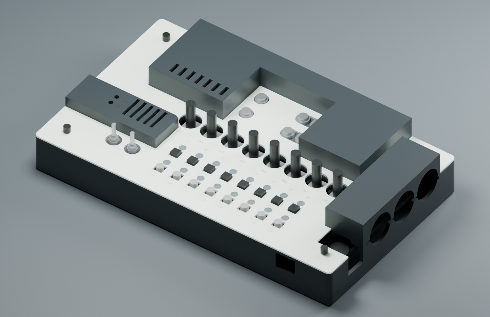
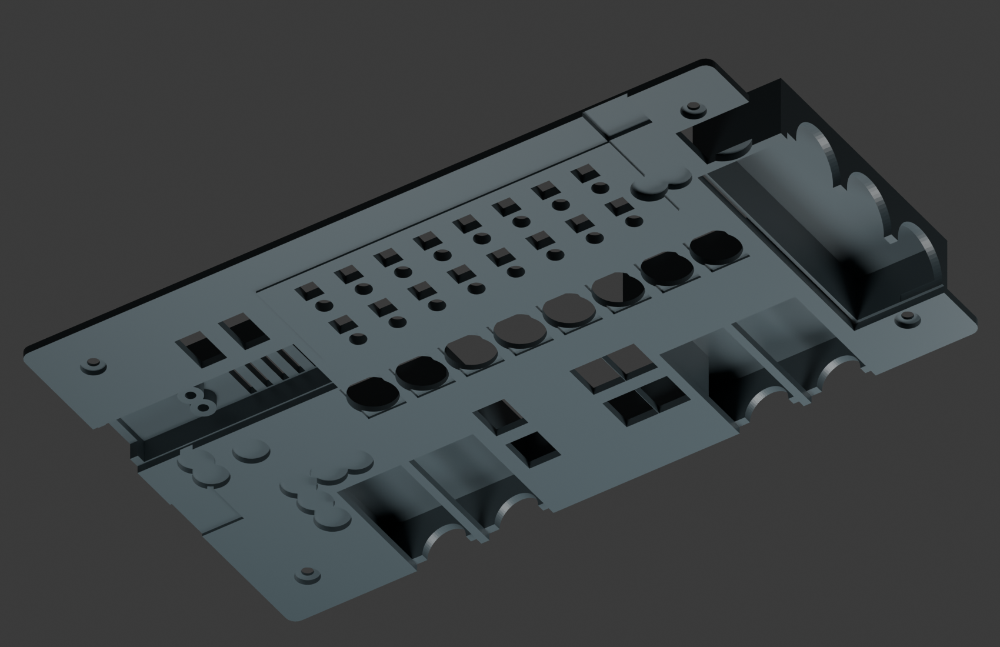
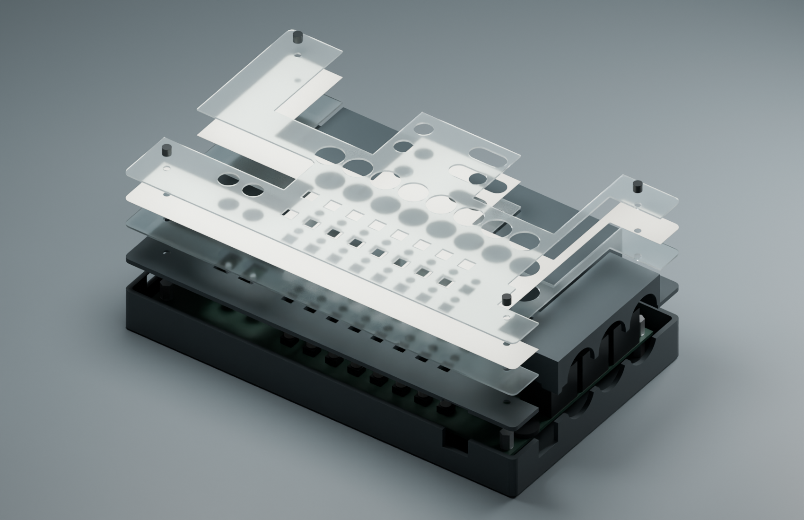

# Durchgehender Träger V3

**Korrigierter Export RH-2026-10-25:** Frühere Druckdateien sind wegen
Spiegelung zurückgezogen. [Ursache, Zweitprüfung und Ersatzpaket](ORIENTATION_FIX.md).

**ACCESS-2026-10-25:** [Rad und Kopfhörerzugang](RIGHT_ACCESS.md) sind
zusätzlich korrigiert: niedriger RK10J, seitliche Grifföffnung und Freiraum
für einen vollständig eingesteckten Ø10-mm-Steckerkörper.

**Stand 24.10.2026: CAD-Passstudie. Hardware, Festigkeit und Druckbarkeit am
Prototyp NICHT GEMESSEN.** V3 ersetzt die getrennten Hauben und das separat
angeschraubte Raster aus [V2](CLOSED_V2.md) durch **ein einziges Druckteil**.
Die Bodenwanne bleibt abnehmbar. Beide 1-mm-Acrylplatten für die
Papierbeschriftung bleiben erhalten.

> **Frühere Exporte zurückgezogen:** Die Spiegelung von `tray.stl` und
> `unified-carrier.stl` ist im aktuellen Stand korrigiert und unabhängig
> geprüft. Der [ursprüngliche Befund](#befund-druckteile-gespiegelt) bleibt
> unten als Fehlerdokumentation erhalten.

**Die Bedienfläche ist eben:** Untere Acrylplatte, Papier und obere Acrylplatte
liegen jeweils in einer einzigen Ebene. Tasterkappen, Potiwellen und
Kippschalter ragen durch einzelne Öffnungen. Das Papier läuft jetzt auch
zwischen allen Tasten durch; das große gemeinsame Tastenfenster bleibt nur
als alternative Papierkontur für einen einfacheren Zuschnitt erhalten.
Die erhöhten Druckhauben über Seed und den hohen Buchsen unterbrechen die
ebene Fläche weiterhin. Eine rechteckige Acrylfläche über dem gesamten
Board einschließlich dieser Bereiche passt auf der aktuellen Höhe nicht.



## Was zusammengehört

Der Träger verbindet die ganze Bedienfläche mit den erhöhten Abdeckungen über
Seed, rückwärtigen Audiobuchsen und seitlichen DIN-Buchsen. Das Tasterraster
ist an seiner Unterseite angeformt. Es gibt keine separaten Haubenfüße,
M2-Schrauben oder Rastermuttern mehr. Alle diese Bereiche sind im CAD
**ein zusammenhängender Volumenkörper**, nicht lediglich nebeneinander
angeordnete Einzelteile.

Die Grundhaut ist 2,4 mm stark; die erhöhte Kontur passt sich den verschieden
hohen Bauteilen an. Eine überall flache Platte würde entweder die hohen
Buchsen treffen oder die Taster zu tief versenken. Die Stufen und Hauben
gehören deshalb fest zur durchgehenden Platte. Die Außenmaße bleiben
215 × 129 mm; die höchste Haube endet bei 39,8 mm über dem Gehäuseboden.



Durch die gemeinsame Grundhaut entfallen verschraubte Übergänge zwischen
Raster, Hauben und Bedienfläche. Das vereinfacht Ausrichtung und Montage.
Eine höhere Belastbarkeit ist das Konstruktionsziel; ein quantitativer
Festigkeitsnachweis liegt noch nicht vor. Die großen Hohlräume und
Unterseitentaschen erfordern eine Prüfung im Slicer und voraussichtlich
entfernbare Druckstützen. Druckorientierung und Material sind noch nicht
an einem Ausdruck bestätigt.

## Metallpfosten und Plattenpaket

Vier M3-Metallpfostenpaare an H1–H4 tragen weiterhin den Aufbau. Die Potis
werden freigestellt. Die oberen Pfosten greifen von unten in Ø-7-mm-Taschen
des Trägers; die darüber verbleibende dünne Auflage liegt direkt auf Metall.
Der Wannenrand endet jetzt unter der Trägerhaut statt unter der Acrylplatte.

| Element | V3-Nennmaß |
| --- | --- |
| Untere M3-Metallpfosten | 10 mm, Innen-/Innengewinde |
| PCB | 1,6 mm |
| Obere M3-Metallpfosten | 8 mm, Außen-/Innengewinde, darunter 0,2 mm feste Metalldistanz |
| Lokale Trägerauflage über Pfosten | 0,8 mm; restliche Haut 2,4 mm |
| Untere Acrylplatte | 1 mm, Unterseite 9 mm über PCB |
| Papier | angenommen 0,15 mm |
| Obere Acrylplatte | 1 mm; Oberfläche 11,15 mm über PCB |

Die Bedienhöhe ist damit gegenüber V2 unverändert. Die 0,2-mm-Distanz ist
eine Entwurfsvorgabe, keine gemessene oder bereits beschaffte Hardware.
Pfosten, Distanzscheiben und die gedruckten Auflagen müssen zusammen passen.
Nicht durch Anziehen eine Höhendifferenz oder PCB-Durchbiegung ausgleichen.

Bei konservativ 6 mm nutzbarem M3-Knurlie-Gewinde ergibt sich:

```text
6 − 0,8 Trägerauflage − 1 Acryl − 0,15 Papier − 1 Acryl
= 3,05 mm Eingriff im oberen Metallpfosten
```

Das liegt nur 0,05 mm über dem verwendeten 3-mm-Entwurfsziel und ist deshalb
**noch keine toleranzfeste Serienauslegung**. Tatsächliche Knurlie-Länge,
Papierdicke und Montagepaket prüfen; gegebenenfalls die lokale Pfostenauflage
anpassen. Obere Innengewinde benötigen mindestens 5 mm freie Tiefe.
Mit 6-mm-Außengewindestift oben und M3×6 von unten verbleiben nominal
1,2 mm zwischen den Schraubenenden im unteren 10-mm-Pfosten.

## Buchsen, Papier und Taster

Die sechs senkrechten 3,5-mm-Buchsen gehen mit ihren Gehäusen durch den
Druckträger. Ihre Muttern klemmen nur die untere Acrylplatte auf der
nominalen 9-mm-Gehäuseschulter. Auch die beiden Kippschalter sind dort zur
zusätzlichen Verschraubung vorgesehen; deren tatsächliche Schulterhöhe bleibt
offen. Der direkte PCB-Sitz von Potis und Schaltern ist vom Nutzer bestätigt
(24.10.2026); daraus folgt keine gemessene Bauteilhöhe. Die obere Acrylplatte
hat größere Mutterfenster. Für die Gewinde-
und Bauteilquellen gilt die [Maßgrundlage in V2](CLOSED_V2.md).

Zum Papierwechsel werden die vier Knurlies gelöst und die obere Klarplatte
abgehoben. Untere Acrylplatte und Träger bleiben montiert. Wie zuvor gilt:
Potiknöpfe über Ø 14 mm müssen vorher abgezogen oder die Konturen angepasst
werden. Die vollständige Demontage des Trägers erfordert dagegen auch das
Lösen der Buchsen- und Schaltermuttern.



Das integrierte Raster liegt von 6 bis 9 mm über dem PCB. Alle 16 Öffnungen
sind 5,8-mm-Quadrate und können sowohl die quadratischen schwarzen als auch
die runden grauen 5-mm-Kappen aufnehmen. Die Acrylöffnungen bleiben
6,4-mm-Quadrate. Runde Kappen erhalten damit eine seitliche Führung, aber
keine Drehsicherung. Die Führung darf den Schaltweg und die Rückkehr nicht
behindern; Haltekraft auf dem Betätiger kommt von der Kappe selbst.

Weil der neue Druckträger undurchsichtig ist, enthält er zusätzlich
16 senkrechte Ø-4,8-mm-Sichtöffnungen über den LEDs. Die Acrylschichten
darüber bleiben klar. Das Papier hat einzelne Kappen- und LED-Ausschnitte
und liegt auf der unteren Acrylplatte auch zwischen den Tastern vollflächig
auf. Die Tasterführung sitzt darunter im Druckträger. Papier und obere
Klarplatte sind nicht in einzelne Segmente aufgeteilt. Sichtbarkeit bei
schrägem Blick sowie Passung der Papierkanten sind NICHT GEMESSEN.

Die alternative Kontur `paper-overlay-fast-change.svg` behält das frühere
gemeinsame Taster-/LED-Fenster bei. Die Hauptkontur `paper-overlay.svg` und
die Ansichtsgeometrie verwenden die neue Fläche mit Einzellöchern. LED-
Ausschnitte sind nur im undurchsichtigen Papier und Druckträger erforderlich,
nicht in den transparenten Acrylplatten.

Die montierte Kappenhöhe ist weiterhin **nur mit 13 mm angenommen**.
Bei 0,25 mm nominalem Hub bleiben rechnerisch 1,6 mm gedrückter Überstand.
Für mindestens 0,8 mm wären mindestens 12,2 mm montierte Kappenhöhe nötig.
Die kleine H2–S9-Höhenlehre und der Führungscoupon aus V2 bleiben passend.
Die Hinweise zur freien H2-Auflage und zur Prüfung am stromlosen Board in
[V2](CLOSED_V2.md) gelten weiterhin.

BOOT/RESET erhalten die bisherigen Führungsbohrungen in der jetzt
integrierten Seed-Haube. Lage und Werkzeuglänge bleiben vorläufig. Der
herausnehmbare isolierende Druckstift ist eine Passstudie und vor Anwendung
am tatsächlichen Modul abzugleichen.

## Überstand der Potis und Kippschalter

Die obere Acrylfläche liegt nominal 11,15 mm über PCB. Die
[Hersteller-Stückliste](https://daisy.nyc3.cdn.digitaloceanspaces.com/products/seed-3-desktop/Seed3-DevKit-Desktop_Rev4-bom.csv)
nennt für VR1–VR8 `RV09AF-40-25K-B10K-0085`. Die
[Alpha-Standardzeichnung](https://www.taiwanalpha.com/downloads?id=72&target=products)
zeigt bei der vertikalen 25K-Ausführung L = 25 ± 0,5 mm ab Auflageebene bis
Wellenende. Daraus folgt **13,85 mm nominaler Wellenüberstand**, ohne
zusätzlichen aufgesteckten Knopf. Die kundenspezifische Endung `-0085` ist mit
dieser allgemeinen Zeichnung nicht gesondert nachgewiesen.

Die beiden Dailywell-Schalter sind laut BOM `2MS1T1B1M2QE` und
`2MS3T1B1M2QE`. Mit 8,64 mm Körperhöhe, 5,59 mm B1-Hülse und 9,40 mm T1-Hebel
aus der [Dailywell-Zeichnung](https://lv.mouser.com/datasheet/2/979/dailywell_10012019_2M_Series-1660477.pdf)
ergibt sich bei unmittelbar auf dem PCB sitzendem Gehäuse eine nominale
Spitzenhöhe von 23,63 mm, also **12,48 mm über Acryl**. Hebelstellung,
tatsächlicher Gehäusesitz und die Definition der Spitzenhöhe im gekippten
Zustand beeinflussen das reale Maß.

Alle Überstände: **rechnerisch aus Nennmaßen, Hardware NICHT GEMESSEN**.
Die V3-Vorschauen wurden am 24.10.2026 entsprechend berichtigt: Zuvor waren
Potiwellen mit nur 15 mm Gesamthöhe und Schalter mit 20,59 mm dargestellt.
Die 11,15-mm-Bedienebene ändert sich dadurch nicht. Die spätere ACCESS-
Korrektur verändert die Ausschnitte rechts, siehe oben.

## Unterseitige Freiräume und Prüfstand

Die neue Haut liegt teilweise tiefer als die frühere Acrylplatte. Deshalb
sind unterseitig Taschen für die Potigehäuse und die zehn hohen
100-µF-Kondensatoren vorgesehen. Die Kondensatormittelpunkte stammen aus dem
gepinnten Rev4-KiCad-Board; die geprüften Hüllkörper verwenden Ø 6,3 × 7,7 mm
als Nennmaß. Die Taschen reichen bis 8,3 mm über PCB und lassen lokal
0,7 mm Dachhaut unter der unteren Acrylplatte stehen. Das ist eine zusätzliche
Pass- und Druckprüfstelle. Die vollständigen Bestückungshöhen und mögliche
Bestückungsunterschiede anderer Revisionen sind nicht damit nachgewiesen.

Digital geprüft am 24.10.2026:

- Acht exportierte Körper geschlossen, konsistente Orientierung und jeweils
  genau eine zusammenhängende Komponente; darunter der komplette Druckträger.
- Zehn Paarungen der fünf montierten Gehäuse-/Plattenteile überschneidungsfrei.
- Alle fünf Teile frei von den nominalen seitlichen Anschluss-Zugangsvolumen.
- Papierkontur in der Draufsicht vollständig von der unteren Acrylfläche
  unterstützt; keine frei über einem ihrer Ausschnitte liegenden Papierbereiche.
- Alle 16 Kappen-Hüllflächen frei durch Träger und beide Acrylschichten.
- Alle 16 Kappen-Hüllflächen auch frei durch die neue Papierkontur.
- Alle 16 senkrechten LED-Sichtöffnungen in Träger und Papier frei.
- 28 nominale Hüllkörper für Kondensatoren, Potis, senkrechte Buchsen und
  Metallpfosten ohne Überschneidung mit dem Träger.
- Rechnerisches Gewindebudget und Abstand der unteren Schraubenenden geprüft.
- Exportierte STL erneut eingelesen; geschlossene Körper und Datei-Hashes
  bestätigt. Beide PDF-Seiten und alle drei CAD-Ansichten visuell geprüft.

Vollständige Bauteil-/Steckermodelle, Passung am Board, Festigkeit,
Drucktoleranzen, Reibung und thermisches Verhalten: **NICHT GEMESSEN**.
Keine Fertigungsfreigabe. Erst Kappenhöhe und kleinen Coupon prüfen, danach
den großen Passprototyp beauftragen.

## Befund: Druckteile gespiegelt

**Historischer Befund zum zurückgezogenen Export vor `RH-2026-10-25`.**
Die folgende Beschreibung dokumentiert den damaligen Fehler. Die Korrektur
ist inzwischen umgesetzt; siehe [Nachweise](ORIENTATION_FIX.md).

**Digital geprüft am 25.10.2026, nicht korrigiert.** Die Druckteile
`tray.stl` und `unified-carrier.stl` übernehmen die KiCad-Koordinaten
unverändert (y in der Draufsicht nach unten) und legen Z nach oben. Das
ergibt ein linkshändiges System. STL wird von Slicern rechtshändig gelesen;
die gedruckten Teile sind deshalb ein Spiegelbild des Boards.

Nachgemessen an den Wandöffnungen in Platinenkoordinaten:

| Öffnung | Lage in der STL | Am Board |
| --- | --- | --- |
| USB-C J7, microSD | Wand x = −9, y ≈ 41 / 92 | links |
| MIDI-DIN J8, J10, J11 | Wand x = 206, y ≈ 20 / 44 / 68 | rechts |
| 6,35-mm-Buchsen J1–J4 | Wand y = −9 | hinten |

Im Slicer liegen die 6,35-mm-Buchsen damit vorn. Dreht man das Teil so, dass
sie hinten liegen, sitzt MIDI links und USB/SD rechts; Taster und Potis sind
ebenso gespiegelt. Eine 180°-Drehung behebt das nicht.

Nicht betroffen:

- `lower-acrylic-1mm.svg`, `upper-acrylic-1mm.svg` und `paper-overlay.svg`
  liegen in SVG-Draufsicht (y nach unten) richtig. Alle Ausschnitte für
  H1–H4, S1–S16, D1–D16, VR1–VR8, SW17/SW18 und die sechs senkrechten
  Buchsen treffen die Rev4-KiCad-Positionen ohne Abweichung.
- Die Renderbilder sind richtig, weil `render_unified_preview.py` und
  `render_realistic_case.py` die importierten STLs mit `v.co.y *= -1`
  spiegeln. Die Bilder verdecken den Fehler der Druckteile daher.

Die inzwischen umgesetzte Korrektur: beim STL-Export y spiegeln (y → −y) und die
Dreiecks-Umlaufrichtung umkehren; danach die Spiegelung in beiden
Render-Skripten entfernen und die Wandöffnungen erneut gegen KiCad prüfen.
Die alten Dateien bleiben zurückgezogen.

## Dateien und Reproduktion

Die aktuelle Ausgabe liegt unter [unified-v3/](unified-v3/).

| Dateien | Verwendung |
| --- | --- |
| `tray.stl`, `unified-carrier.stl` | Die zwei großen Druckteile |
| `lower-acrylic-1mm.svg`, `upper-acrylic-1mm.svg` | Acryl-Schnittkonturen, mm |
| `paper-overlay.svg` | Durchlaufendes Papier mit einzelnen Kappen-/LED-Ausschnitten |
| `paper-overlay-fast-change.svg` | Alternative mit gemeinsamem Tasterfenster |
| `*-reference.stl` | Reine Ansichtsgeometrie für Acryl/Papier, kein Druckersatz |
| `H2-S9-cap-height-gauge.stl`, `guide-clearance-coupon.stl` | Kleine Passproben |
| `removable-service-tool-fit-study.stl` | Unbestätigte Service-Werkzeuglänge |
| `acrylic-fit-study-a4.pdf` | Zwei A4-Seiten, 1:1, mit 100-mm-Kontrollstrecke |
| `validation.json` | Digitale Prüfungen, Annahmen und SHA-256 der Quellen/Ausgaben |

STL-Einheit mm; alle STL-Unterseiten auf Z=0. Der Einbauversatz steht in
`validation.json`. Die STL-Unterseite des Trägers ist die Unterseite des
angeformten Rasters, nicht die Unterseite der Grundhaut.
STL-Koordinaten sind rechtshändig: X rechts, Y nach hinten, Z nach oben.
Das entspricht `X=x, Y=-y, Z=z` gegenüber den internen PCB-Draufsichtdaten.

```powershell
.tools/case/Scripts/python.exe hardware/desktop-case/build_unified_case.py
& 'C:/Program Files/Blender Foundation/Blender 5.2/blender.exe' --background --python hardware/desktop-case/render_unified_preview.py
```

Gemeinsame Quellen und Hardware-Nennmaße stehen in `closed-mechanics.json`.
Die abweichenden V3-Pfosten- und Trägermaße stehen ausdrücklich in
`build_unified_case.py`; V2 bleibt als frühere Studie unverändert erhalten.
Die Vorschauen verwenden die exportierten Gehäuse-STLs und schematische
Elektronik. Sie sind keine Fotografie eines gebauten Prototyps.
