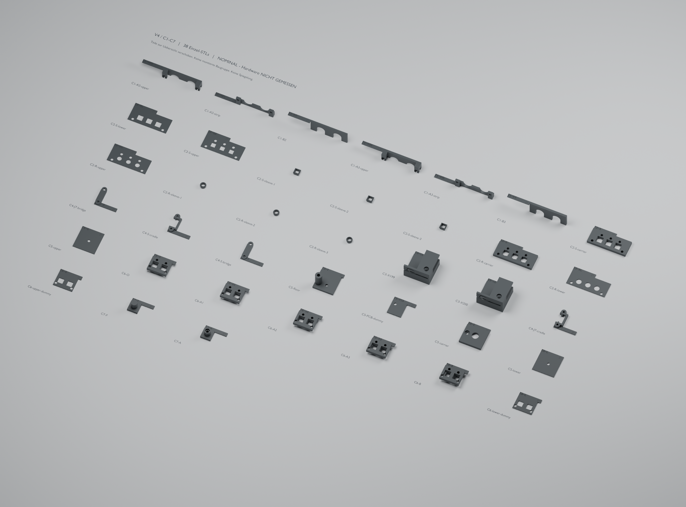

# V4 – früherer vollständiger Prüfkatalog

**Vereinfachung vom 26.10.2026:** Für den Einstieg genügt jetzt
[eine einteilige Kappenprobe](simple-guide/README.md). Der Nutzer hat die
zusätzliche Auszugssicherung abgewählt: Originalkappen aufstecken und
gemeinsam seitlich führen reicht. Die folgenden 38 Dateien bleiben als
optionale frühere Studien erhalten; sie sind **kein Pflichtdruckprogramm**.
Die Haltehülsen und ihr bisheriges Abnahmekriterium sind damit überholt.

Stand 25.10.2026. **Hardware NICHT GEMESSEN. Sämtliche folgenden CAD-Maße
sind NOMINAL in mm**, sofern nicht anders angegeben. Auch ein digitales
„passed“ ist keine bestätigte Passung oder Festigkeit. Stufe 2 beginnt erst
nach Messwerten und ausdrücklicher Freigabe durch den Nutzer.

Basis: `origin/main` 5f25359, einschließlich PR #43,
[korrigiertes Konzept](../ALTERNATIVE_CONCEPT.md) und
[Konzeptprüfung](../REVIEW_ALTERNATIVE_CONCEPT_2026-10-25.md).
Keine Firmwareänderung, kein Flashen, keine Hardwareprüfung durch den Agenten.



## Dateien, Maßquelle und Orientierung

- [v4-parameters.json](v4-parameters.json): einzige Maßquelle der Konstruktion.
  Jeder Maßeintrag enthält `value`, `unit`, `status` und `source`.
  Gemessene Werte dort ersetzen; `status: GEMESSEN`, Datum und Messmethode
  ergänzen. Hersteller-Nennwerte sind keine Messung des eigenen Boards.
- [build_v4_coupons.py](build_v4_coupons.py): erzeugt **38 einzelne STLs**,
  [C6-paper.svg](coupons/C6-paper.svg) und Montage-/Druckangaben in
  [manifest.json](coupons/manifest.json).
- [validation.json](coupons/validation.json): Dateiprüfung, Kollisionen in mm³,
  Rechnung, Grenzen und bewusst beibehaltene Vergleichsprobleme.
- [orientation.json](coupons/orientation.json): unabhängige Prüfung mit
  `check_stl_orientation.py`, einschließlich absichtlich gespiegelter Gegenproben.

Rev4-Quelle: [KiCad bei Herstellercommit 987297f](https://github.com/daisyaudio/Seed3-DevKit-Desktop/tree/987297fb7c9a8c58721ef40abf6d6eedd1fcda2a).
Für X/Y gelten die PCB-Koordinaten des Konzepts: X rechts, Y zum Spieler.
STL: **+X rechts/MIDI, +Y hinten/Audio, +Z oben**. Es wird genau einmal
`(x, -y, z)` exportiert, mit korrigierter Dreiecksreihenfolge.
Renderer importieren die STLs ohne Spiegelung.

Jede Datei liegt mit ihrer Unterkante auf Z=0. X/Y bleiben im Boardbezug;
für die Montage `installed_z_offset` aus dem Manifest addieren. Dann ist Z=0
die bestückte PCB-Oberfläche. Im Slicer dürfen die Teile einzeln verschoben
und räumlich gedreht werden; nicht spiegeln oder skalieren.
Die Übersicht zeigt verschobene Einzelteile, keine fertig montierte Baugruppe.
Kennungsfahnen gehören zur jeweiligen STL und sind beim Prüfen berücksichtigt.
Hülsen haben aus Platzgründen 1/2/3 eingeprägte Punkte statt einer Fahne.

## Druck und Reihenfolge

**PETG-CF schwarz, Schicht 0,12, 40 % Infill, 4 Perimeter, Maßstab 1:1,
keine automatische Lochkompensation.** Angegebene Wandmaße sind CAD-Sollwerte;
dünne Zungen erlauben nicht überall vier nebeneinanderliegende Bahnen.
Druckprofil, Düse, Linienbreite, Material und Nacharbeit im Formular erfassen.
Bohrungen zunächst unverändert prüfen. Aufbohren und Entgraten getrennt notieren.
1,0/1,6/0,15 liegen nicht sämtlich auf dem Schichtraster; die reale Dicke messen.
**Keinen 0,15-mm-Papierdummy drucken**, echtes Papier verwenden.

| Dateien – gilt jeweils für alle genannten Varianten | Drucklage | Stützen |
| --- | --- | --- |
| C1-A2/A3 `upper`, `strip`; C1-B2/B3 | Blendenfläche flach aufs Bett, echte 90°-Drehung | Muttertaschen lokal unterstützen, vollständig säubern; 0,035-Stufe berücksichtigen |
| C2-S/R `carrier`, `lower`, `upper` | Größte flache Unterseite aufs Bett | Keine; obere Dummyplatten bei Bedarf mit Brim |
| C2-S/R `sleeve-1/2/3` | Kleine untere Ringfläche aufs Bett, Z-Achse aufrecht | Nur Flanschunterseite lokal; Innenraum und Federzungen freihalten |
| C3-X199, C3-X200 | Boden auf Bett, Z-Achse aufrecht | Dach und Kopfhörerbogen zugänglich unterstützen; alle Reste entfernen |
| C4-J7/S `cradle` | Untere Schienenflächen aufs Bett | Gegebenenfalls örtlich an Anschlägen, Buchsenraum frei |
| C4-J7/S `bridge` | Flache Oberseite aufs Bett, echte 180°-Drehung | Keine |
| C5 alle fünf Teile | Flache Unterseite aufs Bett | Keine; Einsatzbohrung senkrecht |
| C6-O/A1/A2/A3/B | **Deckseite** aufs Bett, echte 180°-Drehung; Röhrchen stehen dann nach oben | Keine im Lichtkanal; Schulter wird zum oberen Abschluss |
| C6-lower/upper-dummy | Flache Unterseite aufs Bett | Keine |
| C7-A/F | Boden auf Bett | Keine |

Anprobe am stromlosen Board. PETG-CF ist hier **nicht als elektrische
Isolation qualifiziert**. Keine Druckfläche auf unbekannte Lötspitzen oder
Bauteile drücken. Die vorgesehenen Nylonkontakte bzw. Schraubloch-Auflagen
von beliebigen Druckflächen unterscheiden.

Zuerst C5 als Stapelprobe und C2 als Passprobe. C6 zunächst **O ohne
Lichtleiter**. Ob Rundstab oder PLP2 gebraucht werden, entscheidet die
Sichtprobe. Es wurde nichts bestellt. C3-X199 ist der bevorzugte Versuch;
X200 ist ein rechnerisch problematischer Vergleich, keine Empfehlung.
C4 zunächst am Dummy; das tatsächliche Schirmblech muss vorher vermessen sein.

## C1 – Neutrik J4/J3, geschlossener Kreis und U-Schlitz

Achsen X39,915/62,400, Z8,14, Anlage Y3,50/3,535 aus
[Neutrik ST-NMJ6HCD2](https://www.neutrik.com/media/8582/download/st-nmj6hcd2.PDF?v=3)
und Rev4-KiCad. Die Blende enthält die **0,035-Stufe**, statt beide Anlagen
gleichzusetzen. Dieser Unterschied ist kleiner als eine Druckschicht;
Planlage deshalb am realen Paar prüfen und gegebenenfalls gemeinsam anpassen.

- **A2/A3:** je Oberteil und Schließleiste, Kreis Ø11,4 über der Trennfuge.
  Die Leiste hat rückwärtige Finger in Taschen des Oberteils. Zwei Schrauben
  kommen **waagerecht von der Audioseite**: A2 M3×8, A3 M3×10, jeweils mit
  M3-Mutter in rückwärtiger Sechskanttasche. Kein Werkzeugzugang durch das
  PCB von unten nötig. Muttertaschen vor Montage säubern. Nicht mit den
  Neutrik-Muttern verwechseln.
- **B2/B3:** einteilig, U-Schlitz nach unten offen, Ø11,4 oben.
  Eine Scheibe stellt keinen geschlossenen Ring und keine Abhebesicherung her.
  Der Coupon braucht beim Belastungsversuch eine eigene Halterung; nicht
  an den verlöteten Buchsen hebeln oder durch Kabelgewicht testen.
- T=2/3 sind Versuche. Neutrik nennt Panel <4,7; die Nasenlänge 5,79
  beweist keinen vollen Muttereingriff für diese Varianten. Tatsächliche
  Mutter, Scheibe, Gewindeauslauf und Planlage entscheiden.

Prüfkörper: volle Ø11,4-Bohrlehre, Nuss-Außenhülle Ø16 und eine **angenommene**
20-mm-Außenhülle eines SW11-Gabelschlüsselkopfs. Der Nussboden liegt nur
0,14 über PCB: nacktes PCB nominal frei, Bestückung nicht nachgewiesen.
Der breite Gabelkopf schneidet in dieser Lage das PCB; Werkzeug möglichst
außerhalb der Kante ansetzen bzw. reales dünneres Werkzeug prüfen.
Achsabstand 22,485; Abstand Nuss Ø16 zur Nachbarmutter-Eckhülle
`22,485 − 8 − 11/√3 = 8,134` horizontal. Werkzeugform und Griffschwenk
sind damit nicht vollständig erfasst.

## C2 – eckige und runde Kappenhülsen

Je drei Plätze, Raster 12,285714, LED 7 dahinter. S: 1SBLK, R: 1RLGR.
Nennhüllen aus [1SBLK](https://configured-product-images.s3.amazonaws.com/2D/specs/1SBLK.pdf)
und [1RLGR](https://configured-product-images.s3.amazonaws.com/2D/specs/1RLGR.pdf).
Montierte Oberkante 13 ist **angenommen**, kein Zeichnungsmaß.

Die drei Hülsen sind nebeneinander nach steigendem X angeordnet:
**1 Punkt = 0,1; 2 = 0,2; 3 = 0,3 Spiel je Seite** zwischen Kappe und
Hülsenwand; beim Rundteil radial. Das ist 0,2/0,4/0,6 Durchmesserzugabe,
nicht das Flansch-Taschenspiel. Dort gelten 0,05 je Seite.
Hülse außen maximal 6,80 quadratisch bzw. Ø6,88, Flansch 8 quadratisch
bzw. Ø8. Gemeinsame untere Platte `C2-S-lower`: Quadrat 7,1.
Separate Rundvariante `C2-R-lower`: Ø7,1. Rundflansch in Quadrat: je Seite
0,45 nomineller Übergriff. Auch `C2-S-carrier` nimmt beide Hülsenformen auf.

Träger unten/oben 4,8/9; Taschensohle 7,7; Flansch in Ruhe 8,0–8,6;
untere Platte 9–10; Papier 10–10,15; obere Platte 10,15–11,15.
Hülse endet bei 9,5. Aufwärtsreserve bis zur festen unteren Platte 0,4;
selbst dann bleibt sie unter dem Papier. Abwärtsreserve 0,3; beim
typischen Tasterhub 0,25 verbleiben nominal nur 0,05. Kein Überlastnachweis.
Die Hülse beginnt bei 5,0 und ist unten offen. Eine Sitzlippe unter der
Kappe würde bei angenommener Kappenhöhe13 den knappen Tasterraum belegen.
Die gedruckten Teile sind zusätzlich gegen eine konservative TL1105-Hülle
6×6×4 geprüft; Betätiger und echte Kappeninnenaufnahme bleiben Messpunkte.
Zur Ø3,2-Lichtöffnung bleiben `7 − 4,05 − 1,6 = 1,35` Steg.

Kappe in Hülse einsetzen, dann Hülse in Träger legen, untere Platte mit
zwei M3×10 und Muttern fixieren; Papier/obere Platte auflegen. Für die
Auszugsprobe obere Platte/Papier abnehmen und untere Platte weiterhin
festhalten/abstandsgerecht sichern. Ein zweiter Schraubensatz oder eine
Klemme übernimmt das während des Umbaus. Nichts am PCB verspannen.

**Haltezungen sind ein offener Versuch.** Die eckige Originalkappe hat
keinen nachgewiesenen äußeren Hinterschnitt. Die Zähne greifen mit
nominal 0,15 Übermaß in die Kappenhülle. Das ist elastische Klemmung,
noch kein bewiesener Formschluss oder verlässliches Einrasten.
Rückstellkraft, Auszug, Kippen, Federbruch und die echte TL1105-Gehäusehülle
sind am Muster zu prüfen. Der digitale Flanschauszugstest beweist nur,
dass **die Hülse** an der festen unteren Platte anschlägt. Falls die Kappe
rutscht oder die Taste nicht frei zurückkehrt: diese Variante verwerfen;
Klemmung/Innenaufnahme neu entwickeln oder Kappenwahl bewusst ändern.
Nicht durch stärkeres Andrücken auf dem Taster nachhelfen.

Die FDM-Dummyplatten sind keine optisch brauchbaren Acrylplatten.
In echtem klarem Unteracryl bleiben die LEDs geschlossen überdeckt.
Die LED-Löcher im oberen C2-FDM-Dummy dienen nur der Registrierung.

## C3 – geschlossene rechte Ecke

Enthält flache Radscheibe Ø14×1 bei Z1,5–2,5, H4-Auflage, seitliche
Fensterkante und J5-Frontöffnung im selben Coupon. Radzentrum
191,325/91,6; Rand 198,325. Fenster Y80–101, Z−3…6,5, Dachoberseite 9.
Seiteneintritt in Y um 0,6 aufgeweitet; Z wird dadurch nicht vergrößert.
Unter PCB darf die Fingernische nur außerhalb X197 liegen. Ein eigener
PCB-Durchlass hält die Randwand frei. Der H4-Schutzdom hat außen Ø9 und
innen Ø6,6 für den echten Metallpfosten (angenommen SW5,5); er endet
0,4 unter dem PCB. Der Durchgang läuft auch durch das Dach, damit der
obere Metallpfosten frei bleibt. Boden und Pfostenhöhe stammen aus C5;
der I/I10-Bolzen steht auf dem 3-mm-Boden, M3×6 von unten. Kein massiver
Druckdom wird zusätzlich in den Raum des Metallpfostens gesetzt.

Prüfkörper: Fingerkugel R7 tangential an der **Scheibe**, Radialweg
−20/−10/0/+10/+20°, MIDI-Körper Ø21 bei J10 und Kopfhörerkörper Ø10 bei
J5. J5-Gehäusehöhe 5 nach Zeichnung, abweichend vom alten 6-mm-Renderwert.
J5 öffnet nach vorn zum Spieler; J10 nach rechts. Die STL wird nicht gespiegelt.

| Variante | Fingerhöhe am Außenfenster, mittig | Oberer Abstand bei ±20° | Ergebnis NOMINAL |
| --- | --- | --- | --- |
| X199 | −0,999…4,999 | +0,145 | Geprüfte Kugelpositionen frei; sehr kleine Randreserve |
| X200 | −2,544…6,544 | −0,878 | Dachkollision; als Vergleich beibehalten |

Analytischer Kugelschnitt und tatsächliches STL-Kollisionsvolumen stehen
getrennt im Protokoll. Eine facettierte Kugel kann winzige Kollisionen
unterschätzen; schon mittig fehlen bei X200 analytisch 0,044.
Kein kontinuierlicher Bewegungs-, Reibschluss- oder menschlicher Handnachweis.
Mit echten Steckern gleichzeitig versuchen; H4-Metallpfosten mit einbeziehen.

## C4 – zwei getrennte USB-Versuche

`J7` und `S` jeweils mit abnehmbarer Brücke. Schienen und vorderer/hinterer
Anschlag umfassen nur die angenommene robuste Schirmhülle. Eine vordere
Stufe **hinter** der Steckebene wird angenommen; deren X-Lage 2,4 ab Mund
ist nicht nachgewiesen. Der 12×6-Steckerkörper bleibt im Nennmodell voll
einsteckbar. Das ist kein Beleg für eine reale belastbare USB-Schulter.

**J7:** BOM HYCW445-USBC16-730B, Footprint/Referenz USB4110-GF-A.
Keine bestätigte Gleichheit. **S:** Lage aus Seed3-Rev5-FBX; dessen gesamte
USB-Baugruppenbounds sind keine präzisen Sattelflächen. Seed-PCB-Oberkante
9 angenommen, separate PCB-Rechteckhülle als konservativer Prüfkörper.
Schienen beginnen über dieser Fläche, statt durch das Modul-PCB zu laufen.

Zwei M3×6 je Brücke, Pilot Ø2,5 im Kunststoff für geschnittenes M3-Gewinde.
Dies ist ein **Prüfgewinde**, kein freigegebener dauerhafter Kraftpfad.
Nenn-Schraubenspitzen beim Modell etwa 0,26 über Haupt-PCB bzw. 0,16 über
Seed-PCB; tatsächliche Schrauben, Köpfe, Pfostenhöhe und Nachbar-SMDs prüfen.
Nicht anziehen, bevor die Hülle identifiziert und das Spiel kontrolliert ist.
Die Brücke hat 0,5 Abstand zum Schirm und erzeugt zunächst keinen Kontakt.
Die spätere Anlage braucht definierte Anpassung ohne Vorspannung am USB.

Demontage: **Brücke lösen, danach auch die offene Haltergabel nach oben
abnehmen, erst dann Seed-Modul ziehen.** Ein Hochziehen des Moduls durch
den montierten Halter ist nicht vorgesehen. Der Gabel-Abhebeweg wird gegen
die Schirmhülle in elf Positionen geprüft; Nachbar-SMDs und endgültige
Anbindung an den künftigen Träger bleiben offen.

## C5 – Metallstapel und Trägerdom

Boden, PCB-Dummy, Trägerstück, unterer und oberer Plattendummy.
Metallteile nicht durch gedruckte Nachbildungen ersetzen.
Werte aus Konzept Punkt 7, absolute Höhe ab Bodenunterseite:

| Rechnung/Ebene | NOMINAL |
| --- | ---: |
| Boden / zylindrische Kopfsenkung | 3,0 / Ø6,4 × 1,8 |
| ISO-7380-1-Kopf M3, Hülle | Ø5,7 × 1,65 |
| M3×6 in unteren I/I-Bolzen | `6 − (3 − 1,8) = 4,8` Eingriff |
| PCB unten / oben | `3 + 10 = 13` / 14,6 |
| Oberer A/I-Bolzen + Scheiben | `8 + 2×0,5 = 9,0` |
| Zapfen im unteren I/I-Bolzen | `6 − 1,0 − 1,6 = 3,4` |
| Abstand gegenüberliegender Schraubenspitzen | `10 − 4,8 − 3,4 = 1,8` |
| Unteracryl unten / Klarplatte oben | 23,6 / 25,75 |
| Knurlie-Eingriff, konservativ nutzbar 6 | `6 − (1 + 0,15 + 1) = 3,85` |
| Abstand Sacklochende bei angenommenen 5 Gewindetiefe | `5 − 3,85 = 1,15` |
| Trägerhaut / Kopfvertiefung / Resthaut | 3,6 / 1,8 / 1,8 |
| M3×12 unter der Haut | `12 − (3,6 − 1,8) = 10,2` Freiraum |
| Trägerschraubenspitze relativ PCB | −4,8 |

Der Einsatzdom liegt bei X−6 außerhalb des PCB, Radius 4,5 (ganze Hülle
X−10,5…−1,5). Referenz-Einsatz
[ruthex RX-M3Sx4.0](https://www.ruthex.de/products/ruthex-gewindeeinsatz-m3s-100stuck-rx-m3x4-0-short-messing-gewindebuchsen-fur-3d-druck),
Ø4,6/L4, Pilot Ø4,0 mit 1 zusätzlicher Tiefe nach
[Hersteller-Datenblatt](https://www.igo3d.com/mediafiles/Sonstiges/Ruthex/ruthex_Datenblatt_RX-Serie.pdf).
Darunter bleibt Schraubenfreiraum bis 10,8 unter der Haut. Nicht 10,2
als Gewindeeingriff ausgeben. Einsatz im ausgebauten Coupon setzen.
Das macht noch keinen passenden Dom innerhalb des späteren Gesamtgehäuses.

Montage: M3×6 von unten → I/I10 → PCB-Dummy1,6 → Scheiben2×0,5 → A/I8
mit Zapfen6 → Unterplatte1 → Papier0,15 → Oberplatte1 → Knurlie.
Trägerstück separat mit M3×12 in den Außendom schrauben. Träger um den
Metallpfosten freigeschnitten. Ringauflage unter Bodenschraube 1,2; Last,
Setzung und wiederholtes Lösen nicht geprüft. Gegenüber V3 liegt PCB um
0,2 höher; alle hier montierten Couponhöhen sind PCB-relativ.

## C6 – Licht zunächst ohne Lichtleiter prüfen

Je Variante zwei Paare, Raster 12,285714, LED 7 hinter dem Taster,
0603-Prüfhülle 1,6×0,8×0,8. Unter- und Oberacryl über den LEDs geschlossen;
[Papierkontur](coupons/C6-paper.svg) mit LED-Loch Ø3,5 und Kontrollkontur in 1:1.
Quadratische Flanschtasche 8,1 nimmt die eckige 8er- und runde Ø8-Hülse auf.
Beide C2-Hülsenformen sind gegen die exportierten C6-Träger geprüft.
Flanschspiel hier 0,05 je Seite, auch beim Rundflansch zur Seitenwand.

| Variante | Lichtweg / Montage | NOMINAL |
| --- | --- | --- |
| O | Offener Kanal bis nahe LED; zuerst vergleichen | Ø3,2, Steg zur Tasche 1,35 |
| A1/A2/A3 | Klares PMMA Ø3 in Stufenbohrung einlegen | Bohrung Ø3,10/3,15/3,20, **diametrales** Spiel 0,10/0,15/0,20 |
| B | Optional klarer Bivar PLP2-250, von oben einpressen | siehe Rechnung unten |

A: LED-Oberkante 0,8 angenommen; Schulter bei `0,8 + 0,4 = 1,2`.
Unteres Loch Ø2,5, Schulterdicke 0,3; Ø3-Stab kann nicht durchfallen.
Ziel-Oberkante `9 − 0,1 = 8,9`; Zuschnitt `8,9 − 1,2 = 7,7`.
**Startwert, keine Schnittfreigabe für ungemessene Teile:** erst reale
Schulter und Plattenunterseite bestimmen, Stab separat messen und so
anpassen, dass positive Luft bleibt. 0,1 Nennluft ist kleiner als eine
Druckschicht. Der Stab darf die untere Platte beim Anziehen nicht anheben.
Montierte geschlossene Unterplatte sichert nach oben; bei abgenommener
Unterplatte über einer Schale arbeiten. Endflächen säubern, Schnitt und
etwaige Politur im Helligkeitsvergleich dokumentieren.

B: [Bivar-Zeichnung PLP2-XXX Rev Y](https://www.bivar.com/parts_content/Datasheets/PLP2-XXX.pdf)
misst **X vom unteren Rohrende bis unter den Kopf**, nicht Gesamtlänge.
PLP2-250: X6,35; konservative Kopfhülle Ø3,302, Gesamtkopfhöhe 0,762.
Sitz bei 7,55 ergibt Unterende 1,20 und Kopfoberkante 8,312: LED-Luft 0,40,
Acryl-Luft 0,688. PLP2-10MM wäre hier zu lang. Pressbohrung Ø2,921,
Grifflänge 1,5 innerhalb Hersteller-Panelbereich 1,194–2,362; Kopfvertiefung
Ø3,5. Untere Fangschulter bei 1,1 sichert zusätzlich gegen Absinken.
Die REF-Rippenhülle schneidet die Pressbohrung absichtlich; ihr Volumen ist
eine obere Hülle für diskrete Rippen, kein ermitteltes Einpressmaß oder Kraft.
Der gewölbte Kopf ist bei der Kollisionsprobe konservativ zylindrisch umhüllt.
Kopf zuerst von oben einsetzen, am Coupon abstützen, niemals auf der LED.

Reststeg A bei größter Bohrung: `7 − 8,1/2 − 3,2/2 = 1,35`.
B an der Kopfvertiefung: `7 − 8,1/2 − 3,5/2 = 1,20` – **genau am Ziel**,
ohne Toleranzreserve. Druckabweichungen und echte Kappentaschen messen.
Die allgemeine Bivar-Zeichnungstoleranz ±0,127 für zöllige Dreidezimalmaße
ist separat erfasst; sie ersetzt keine gemessene Sitzhöhe im Druck.

Unteracryl anbringen, Papier einlegen, obere Klarplatte auflegen und über
die beiden M3×10 sichern. Bei der Montage nur 1/0,15/1 dicke reale
Materialien für einen Sichtvergleich verwenden; undurchsichtige FDM-Dummys
dienen der Passprobe. Keine Kraft über Stäbe auf LED oder Acryl übertragen.

**Punktmodell, keine optische Aussage:** Blick aus Spieler-Richtung in
derselben Tasterspalte; Kappe5 breit, Oberkante13. Abstand LED zur vorderen
Kappenkante `7 − 2,5 = 4,5`. Bei Lichtpunkt Z9:
`atan((13−9)/4,5) = 41,63°` über der Horizontalen.
Bei LED-Punkt Z0,8 sind es 69,75°. Tatsächlicher A-Auslass8,9 und
B-Kopfhülle8,312 liegen etwas tiefer als9. Weder Helligkeit, Abstrahlkegel,
Brechung, Kopplung noch Blendung werden daraus abgeleitet. Ohne Lichtleiter
bleibt zudem die Tunnelabschattung. Entscheidung aus Spielerposition mit
gleichem LED-Zustand und denselben transparenten Platten treffen.

## C7 – Stützen

F bei 43,5/11: fester Dom endet 0,4 unter PCB-Unterseite.
A bei 144/11: M3-Muttertasche, Nylon-M3×10 **von oben**, Kopf als isolierende
Kontaktfläche. Startmodell Kopf Ø5,5×2, tatsächliche Schraube vorher messen.
Kopfoberseite bei 0,2 unter PCB-Unterseite; Spitze bleibt nominal 0,8 über
Bodenunterseite. Einstellung bei abgenommenem PCB, dann Konterung prüfen.
Kein vorgespannter Lift des PCB. Kontaktgröße ist hier der **Nylonkopf**,
kein angenommener Ø6-Druckteller.

Beide Punkte sind Startstellen „Audio links/rechts“ aus
[support-location-review.json](../orientation-audit/support-location-review.json):
je null rückseitige Kupfer-Pad-/Via-Schnittpunkte für Ø6.
Das beweist keine freie Unterseite: Lötspitzen, Lack und Bauteilüberstände
bleiben zu messen. Boden/Dom sind Bench-Fixtures, keine geprüfte Auflage
auf der restlichen Bestückung. Später muss der einstellbare Dom zugänglich
und gegen Verstellen gesichert sein.

## Teile bereitlegen, Einkauf nur bei Bedarf

Mengen für einen gleichzeitig aufgebauten Probensatz; Varianten teilen sich
reale Kappen und Werkzeuge. Kein Auftrag zum Bestellen.

| Teil | Menge / Spezifikation NOMINAL |
| --- | --- |
| Vorhandene Originalkappen | Je 3×1SBLK / 3×1RLGR zum Vergleich; für C6 zwei davon umstecken |
| Neutrik-Muttern/Scheiben | 2 originale Sätze; SW11-Werkzeug und reale Ø16-Nuss mitbringen |
| C1-Verschraubung | Je 2×M3×8 und 2×M3×10, 4×M3-Mutter; A2/A3 parallel möglich |
| C2/C6-Verschraubung | Zusätzlich 4×M3×10, 4×M3-Mutter; Wechsel der oberen Platte muss Unterplatte gesichert lassen |
| C4/C5 M3×6 | 5×ISO 7380-1: 4 Brückenschrauben, 1 Bodenschraube |
| C5 Trägerbefestigung | 1×M3×12 ISO 7380-1, 1×ruthex RX-M3Sx4.0, Wärme-Einsetzwerkzeug |
| C5 Metallstapel | 1×M3 I/I10, 1×M3 A/I8 mit Zapfen6 und nutzbarer Sacklochtiefe ≥5, 2×Scheibe0,5; Maße vor Kauf/Einbau bestätigen |
| Knurlie | 1×Befaco, nutzbare Gewindelänge und eigene Scheibe messen |
| C2/C5/C6 Acryl/Papier | Klares Acryl je1 + Papier etwa0,15 + klares Acryl1; FDM ist nur Formdummy |
| C7 | 1×Nylonschraube M3×10 mit passendem Kopf, 1×M3-Mutter, Konterlösung nach Probe |
| Werkzeuge | Messschieber/Tiefenmaß, Gewindebohrer M3 für C4, vorsichtige Handmontage, Halteklemme |
| Optional A | Klares **PMMA-Rundmaterial Ø3,0**, Meterware; 20 Zuschnitte (16 + 4 Ersatz) à7,7 plus angenommene0,5 Schnittverlust =164 Mindest-Rohbedarf; 1m reicht für Proben und Reserve |
| Optional B | **20×Bivar PLP2-250 klar**, kein `-D`-Diffusorsuffix; zunächst O vergleichen |

## Messformular – bewusst leer

Erst nach eigener Messung `GEMESSEN` und Datum eintragen. Leere Felder sind
keine bestandene Probe. „Passt“ allein ersetzt kein Maß.

| Allgemein | GEMESSEN / Beobachtung | Datum |
| --- | --- | --- |
| Boardrevision und tatsächliche Bestückung | | |
| Drucker/Düse/Linienbreite/Material/Profil | | |
| Tatsächliche Wand-, Dummy- und Papierdicken | | |
| Lochkompensation deaktiviert / Nacharbeit | | |
| Orientierung: Audio hinten, Seed links, MIDI rechts | | |

| Coupon / Prüfgröße | GEMESSEN / Beobachtung | Datum |
| --- | --- | --- |
| C1 A2: Planlage beider Buchsen, Ø, Scheibe/Mutter, voller Eingriff | | |
| C1 A3: dieselben Maße, Frontschrauben erreichbar | | |
| C1 B2/B3: gleiche Maße, Scheibentragfläche, eigene Abhebesicherung | | |
| C1 SW11/Nuss: Außendurchmesser, Ansatz, Schwenkweg, PCB-Abstand | | |
| C2 S1/S2/S3: Innen-/Außenmaß, Einrast-/Klemmverhalten, Auszug | | |
| C2 R1/R2/R3: dieselben Maße; gemeinsame/getrennte Platte | | |
| C2: montierte Kappenhöhe je Taste, Ruhelage, echter Hub, Rückkehr | | |
| C2: Oberplatte entfernt, Unterplatte fest: Kappe UND Hülse gehalten | | |
| C2: keine Vorspannung, unterer Anschlag, Kippen, Federzustand | | |
| C3 X199: Dach-/Radlage, Fingerbewegung, H4-Pfosten | | |
| C3 X200: tatsächliche Einschränkung, kein erzwungener Einbau | | |
| C3 J5/J10 gleichzeitig: reale Steckerhüllen, Einstecktiefe/Zugriff | | |
| C4 J7: MPN, echte robuste Anschlagflächen, 12×6-Stecker komplett drin | | |
| C4 Seed: Sitzhöhe, PCB-/SMD-Freiheit, Brücke/Gabel/Modul entnehmbar | | |
| C4: Spiele, Schraubenspitzen, keine Vorspannung/Verkippung | | |
| C5: Boden-/PCB-/Acryl-/Papierdicke, PCB-Oberkante, PCB+9-Ebene | | |
| C5: Schrauben unter Kopf, echte Scheiben und Bolzen/Zapfen | | |
| C5: Endabstände unten, Knurlie-Eingriff, nutzbare Sacklochtiefe | | |
| C5: Einsatzsitz, M3×12-Spitzenfreiraum, Haut/Boden-Verformung | | |
| C7 F: Lötspitzenhöhe, wirklicher Spalt | | |
| C7 A: Nylonkopfmaße, Einstellung ohne Vorspannung, Konterung | | |
| S9+S16 allein 5s, Toy Piano Bootfunktion: **Nutzerprobe** | | |
| Weitere Pflichtmaße aus Konzept „Vor CAD und Druck messen“ | | |

| C6 Lichtprobe, gleiche Spielerposition/Umgebung/LED-Ansteuerung | Sitz / Istmaße | Luft zur LED / Acryl | Helligkeit / Sichtbarkeit / Datum |
| --- | --- | --- | --- |
| O: zwei LEDs ohne Lichtleiter | | | |
| A1: Ø3,10-Bohrung, Rundstab | | | |
| A2: Ø3,15-Bohrung, Rundstab | | | |
| A3: Ø3,20-Bohrung, Rundstab | | | |
| B: PLP2-250 | | | |
| Taschensteg, Kopfvertiefung, beide Platten ohne Druck geschlossen | | | |
| Entscheidung: O genügt / A / B / weitere Änderung | | | |

## Lokale Reproduktion und Prüfumfang

Im Repository-Root, mit Python und `hardware/desktop-case/requirements.txt`:

```powershell
.tools/case/Scripts/python.exe hardware/desktop-case/v4/build_v4_coupons.py
.tools/case/Scripts/python.exe hardware/desktop-case/check_stl_orientation.py --v4-coupons hardware/desktop-case/v4 --output hardware/desktop-case/v4/coupons/orientation.json
.tools/case/Scripts/python.exe hardware/desktop-case/v4/validate_v4_coupons.py
```

Der Generator ruft beide Prüfer selbst auf. Er liest keine alten
Board-/Mechanikdateien als versteckte Maßquelle. CSG-Schlitzreste unter
0,0001 werden vor dem STL-Export vereinfacht; jede ausgelieferte Datei
wird danach unabhängig geladen: geschlossen, positive Außenorientierung,
eine Komponente, Z-Unterkante0 und RH-Landmarken. Gegenproben spiegeln
jedes Teil um seine eigene Y-Mitte und müssen scheitern.

Der zweite Prüfer importiert keine Konstruktionsfunktionen. Auch die
Prüfkörper werden nach `build/v4-checks/probes/` geschrieben und wieder
eingelesen; ihre Hashes stehen im Bericht. Intersektionstoleranz 0,001mm³
ist eine numerische Schwelle, keine erlaubte mechanische Durchdringung.
Die Dateien enthalten getrennt zwingende Freiräume, erwartete
Flanschanschläge, Klemm-/Presshüllen und nicht freigegebene Zugangsversuche.
`passed` bescheinigt **ausschließlich die angegebenen digitalen Prüfungen**.

Nicht enthalten: vollständige Bestückungs-/Lötspitzenhüllen, Kabelbiegung,
kontinuierlicher Fingerweg, echte Kappeninnengeometrie, Kräfte, Ermüdung,
optische Simulation oder Baugruppen-Freigabe aller 16 Plätze. V4-Gesamtgehäuse,
BOOT/RESET-Servicekonstruktion und endgültige Befestigung sind Stufe2.
Keine GitHub Actions, Firmware-Builds oder Hardwarezugriffe ausgeführt.

**Nach dem PR Stopp.** Messwerte samt gewählten Varianten eintragen;
Lichtleiter können nach der offenen Vergleichsprobe vollständig entfallen.
