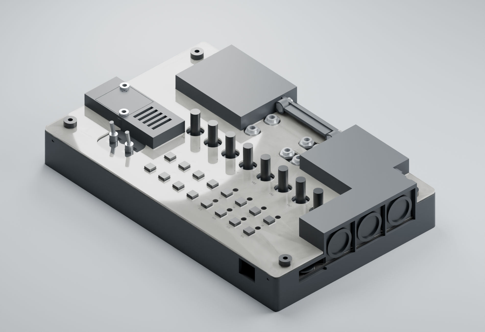

# V4 – vollständiger erster Gehäusedruck

Stand 27.10.2026: Rückblendenzugang und gemeinsame Buchsentaschen korrigiert.
Auf ausdrücklichen Nutzerwunsch wird jetzt das gesamte Gehäuse
als erster Passversuch gefertigt. Die Einzelproben sind dafür keine Voraussetzung
mehr. **Vier Druckteile**, zwei klare Acrylplatten und eine Papiereinlage;
Originalkappen aufstecken und seitlich führen. Keine 16 Hülsen und keine
Lichtleiter. Alle Hardwaremaße sind **NOMINAL / NICHT GEMESSEN**.



## Fertigungsauftrag

Das Paket `V4-KOMPLETTDRUCK.zip` enthält genau vier STL-Dateien im Ordner
`print/`. Jeweils **ein Exemplar** bestellen:

| Datei | Funktion | Hüllmaß STL, mm | Drucklage |
| --- | --- | --- | --- |
| tray.stl | Bodenwanne und untere Halter | 203 × 128,6 × 21,2 | Boden unten |
| carrier.stl | Gemeinsamer Träger, Tasterführung, Schutzhauben | 203 × 128,6 × 23,4 | Wie STL, Stützen von unten |
| rear-panel.stl | Rückblende für vier Audiobuchsen | 160 × 7,035 × 18,4 | Um X −90° drehen, äußere Rückseite unten |
| seed-service-cover.stl | Abnehmbarer Seed-Serviceverschluss | 24,5 × 23,5 × 1,8 | Flach |

Die drei mitgelieferten **3MF-Druckplatten** enthalten dieselben vier Teile
bereits in dieser Drucklage: Platte 1 Wanne, Platte 2 Träger, Platte 3 Blende
und Serviceverschluss. STL **oder** 3MF verwenden, nicht beides bestellen.
3MF enthält Geometrie in Millimetern, kein Druckerprofil, keine erzeugten
Stützen und keinen G-Code. Benötigte nutzbare Bettfläche für Platte 1/2:
mindestens 219 × 144,6 mm einschließlich der vorgesehenen 8-mm-Ränder.

Startprofil: schwarzes PETG-CF, 0,12 mm Schicht, vier Wände, 40 % Füllung,
Maßstab 100 %, keine pauschale Lochkompensation. Der Träger braucht Stützen
unter der Hauptfläche und den Haubendächern; seine tiefsten USB-Halter liegen
unter der übrigen Haut. Im Slicer Kontaktflächen und Brücken prüfen. Die
Halter sind zur Unterseite hin zugänglich, Stützen vollständig entfernen.
Auch bei Blende/Wanne lokale Überhänge im Slicer prüfen. Die sehr schmale
Acrylauflage bei H3 nicht durch Stützreste oder Grate blockieren.
Die 2-mm-Lüftungsschlitze (Wanne links, Dach der Seed-Haube) frei von
Stützen und Fäden halten; nicht aufbohren, sonst entfällt der Griffschutz.

Zusätzlich `sheets/lower-acrylic.svg` und `sheets/upper-acrylic.svg` je einmal
aus **1,0 mm klarem Acryl** fertigen lassen; `sheets/paper.svg` ist eine leere,
flexibel beschriftbare Papierkontur. SVG in mm, Ansicht von oben: Audio oben,
Seed links, MIDI rechts. Nicht spiegeln und nicht automatisch auf Seitengröße
skalieren. Außenmaß der tatsächlichen Platten jeweils 202,5 × 128,1 mm;
das SVG-Zeichenblatt ist 203 × 128,6 mm. Papier zunächst 0,15 mm stark.
Die Acrylplatten bleiben über den LEDs geschlossen, nur das Papier hat dort
Ø3,5-mm-Löcher. Die Beschriftung in den Renderbildern ist ein Beispiel;
sie ist nicht in die neutrale Schnittkontur eingebrannt.

Die drei STLs unter `reference-NOT-FOR-PRINT/` im Repository stellen Acryl
und Papier dar. Sie fehlen absichtlich im Druckpaket und werden nicht gedruckt.

## Aufbau und Zugänge

**Korrektur gegenüber b904a7e:** Die beiden M3×8-Befestigungen der Rückblende
lagen hinter Haubenwänden. Schraubenköpfe und gerader Werkzeugweg waren
blockiert; diese Zugänge fehlten in der früheren Prüfung. Das bisherige ZIP
mit diesem Fehler ist durch das hier neu erzeugte Druckpaket ersetzt.

Die Wanne nimmt die PCB auf vier Metallpfosten auf. Der gemeinsame Träger
führt alle 16 Kappen direkt, schützt Seed und Steckverbinder und liegt unter
der festen unteren Acrylplatte. Die obere Acrylplatte hält das Papier; vier
Befaco Knurlies erlauben dessen Wechsel. Die Kappen brauchen keine zusätzliche
Auszugssicherung. Die nominalen 5,6-mm-Quadratführungen passen zur 1SBLK und
zur runden 1RLGR; obere Acrylplatte und Papier haben 5,8-mm-Öffnungen.

Die vier hinteren Audiobuchsen werden durch die **separate, geschlossene
Rückblende** mit Ø11,4-mm-Bohrungen und ihren vorhandenen Muttern gehalten.
Die größeren Ø18-mm-Öffnungen der äußeren Wanne dienen Stecker und Werkzeug.
Die zwei kleinen Ø3,4-mm-Bohrungen sind für M3×8 ISO7380 zur Verbindung mit
dem Träger. Sie sitzen jetzt im freien Mittelbereich bei PCB-X 80,5 und
124,5 mm, jeweils Z +16 mm. Die Trägeraugen sind über 2,4-mm-Unterstege mit
den benachbarten Audiohauben verbunden. Der Winkelrücklauf der Blende ist dort
freigestellt. Gerade zugänglich mit einem SW2-Inbusschlüssel; geprüft ist eine
Ø4-mm-Werkzeughülle, kein breiter Bithalter. Die Muttern vor dem Aufsetzen des
Trägers von innen axial in die Taschen einschieben. Der 10-mm-Zuführweg wird
am separaten Träger geprüft, ohne eingebaute PCB; er ist kein Nachweis eines
nachträglichen Mutternwechsels bei vollständig montiertem Gehäuse.

Die nur 0,1 mm dicken Druckstege zwischen den eng benachbarten Input-/Gate-
Buchsentaschen sind entfernt. Je Reihe ist daraus ein gemeinsamer Ausschnitt
geworden. Die untere Acrylplatte behält die einzelnen Ø6,4-mm-Buchsenlöcher
mit nominal 3,7 mm Steg dazwischen und nimmt die Buchsenmuttern auf.

USB- und MIDI-Halter haben zunächst neutrale Luft: passend zugeschnittene
isolierende Beilagen bringen sie bei der Montage ohne PCB-Vorspannung an
tragfähige Gehäuseflächen. Der tatsächliche HYCW-USB-Stecker ist nicht als
geometrisch identisch mit dem GCT-Referenzmodell bestätigt. Die Konstruktion
ist daher noch kein Nachweis der Entlastung bei Zug oder wiederholtem Stecken.

Rechts ist die **flache Ø14 × 1-mm-Radscheibe** über eine seitliche Nische
zugänglich, die Kopfhörerbuchse separat zur Spielerseite. Die MIDI-Anschlüsse
bleiben rechts. Beide USB-Zugänge und microSD sind links; für microSD ist ein
stumpfes Hilfswerkzeug eingeplant, kein bestätigter Fingernagelgriff.
Die beiden Seed-Mikrotaster erreicht man nach Lösen der zwei Schrauben des
Serviceverschlusses von oben. Es gibt keine dauerhaft aufliegenden Stößel.
Der Seed ist nach Abheben des Trägers herausnehmbar. Ein Firmware-Bootloaderweg
ersetzt diese mechanischen Zugänge nicht.

**Lüftung mit Griffschutz.** Sechs Zuluftschlitze 2 × 4,2 mm in der linken
Wannenwand unter dem Seed (Y 58–78, Z +0,8 bis +5,0, also über der PCB) und
fünf Abluftschlitze 2 × 15 mm im Dach der Seed-Haube neben dem
Serviceverschluss. Die Luft strömt damit unten seitlich ein und oben aus der
Haube heraus. Nominale Öffnungsfläche 50,4 mm² Zuluft und 150 mm² Abluft,
zusätzlich zu den vorhandenen Anschlussöffnungen. Die Schlitzbreite 2 mm liegt
unter dem 2,5-mm-Prüfdraht nach IEC 60529 IP3X; das ist eine nominale
Geometrie, keine Zertifizierung. Kein Schlitz liegt im Boden, das Gehäuse
braucht daher keine Füße. Die linke Seite nicht direkt an eine Wand stellen.
Betriebstemperatur und Luftstrom sind **NICHT GEMESSEN**.

## Höhen und Verschraubung

Bezug ist jeweils die Oberseite der Haupt-PCB, Z=0. Bodenunterseite −14,6,
Bodenoberseite −11,6, PCB-Unterseite −1,6, Trägeroberseite und untere
Acrylunterseite +9,0, untere Acryloberseite +10,0, Papier bis +10,15,
obere Acryloberseite +11,15 mm. Gegenüber V3 liegt die PCB 0,2 mm höher.
Alle Geometrien und Zugangsprüfungen verwenden diese gemeinsame neue Lage.

Kappenoberkante nominal +13,0 mm: Überstand über oberes Acryl 1,85 mm,
bei 0,25 mm Tasterweg noch 1,60 mm. Diese Werte hängen von der realen Kappe
und ihrer Steckhöhe ab. Haubenoberkanten: Audio +20,9, MIDI +24,4 und Seed
+19,2 mm. Gehäusehöhe über Boden maximal 39,0 mm, ohne herausragende Bediener
und Schraubenköpfe. Potischaft und benutzter Knopf bestimmen die Gesamthöhe.

Unterer Pfosten I/I 10 mm auf 3-mm-Boden; M3×6 ISO7380 mit 1,8-mm-Kopftasche:
6 − (3 − 1,8) = **4,8 mm Gewindeeingriff**. Darauf PCB 1,6 mm und je zwei
0,5-mm-Scheiben; oberer A/I-Pfosten 8 mm mit 6-mm-Zapfen:
8 + 2 × 0,5 = **9,0 mm Plattenebene**. Zapfeneingriff unten:
6 − 1,6 − 1,0 = **3,4 mm**, Abstand zum unteren Schraubenende
10 − 4,8 − 3,4 = **1,8 mm**. Offene/ausreichend tiefe Pfostengewinde verwenden.

Knurlie M3×6 durch Acryl/Papier/Acryl = 2,15 mm:
6 − 2,15 = **3,85 mm** Eingriff ohne zusätzliche Scheibe.
Mit der mitgelieferten nominal 0,5-mm-Knurlie-Scheibe bleiben **3,35 mm**;
bei mindestens 5 mm nutzbarem Innengewinde genügend Bodenluft.
Die vier M3×12-Trägerschrauben liegen in Ø6,4 × 1,8-mm-Taschen;
lokale Hautdicke 3,6 mm, Schraubenüberstand 12 − (3,6 − 1,8) = **10,2 mm**.
Die Dombohrung bietet dafür 10,8 mm Tiefe und den vorgesehenen Gewindeeinsatz.

## Einkauf und vorhandene Teile

| Anzahl | Teil |
| --- | --- |
| 4 | Metall-Distanzbolzen M3 Innen/Innen, 10 mm, SW5,5 |
| 4 | Metall-Distanzbolzen M3 Außen/Innen, Körper 8 mm, Zapfen 6 mm, SW5,5, nutzbares Innengewinde ≥5 mm |
| 8 | Metall-Unterlegscheiben M3, je 0,5 mm stark, passend zur Pfostenauflage |
| 6 | M3×6 ISO7380: vier Boden-, zwei Serviceschrauben |
| 4 | M3×12 ISO7380 für Träger |
| 2 | M3×8 ISO7380 für Rückblende |
| 6 | Gewindeeinsätze ruthex RX-M3S×4.0, vier Wanne/zwei Seed-Service |
| 4 | M3-Muttern: zwei Rückblende, zwei Nylonstützen |
| 2 | Nylon-M3×10-Schrauben, nominal Kopf Ø5,5 × 2 mm, als isolierende PCB-Unterstützung |
| 4 | Befaco Knurlies M3×6 einschließlich ihrer Scheiben |
| 2 | Klare Acrylplatten, je 1,0 mm, aus den SVG-Konturen |
| 1 | Papierbogen, nominal 0,15 mm, individuell beschriftet |
| nach Bedarf | Dünnes isolierendes PET-/Nylon-Beilagenmaterial für die Anschlussanschläge |
| vorhanden | Vier Neutrik-Muttern SW11 und zugehörige Scheiben |
| vorhanden | Sechs Eurorack-Buchsenmuttern/Scheiben M6×0,5 |
| optional vorhanden | Zwei Kippschaltermuttern, erst bei bestätigter Auflagehöhe verwenden |
| 16 | Bestellte Original-Tasterkappen; hier keine zusätzlichen Druckhülsen |

Die Mutter/Scheibe der Audioanschlüsse muss auf der nominell 5,79 mm langen
Nase nach 2,0 mm Rückblende noch voll greifen. Es bleiben **3,79 mm** für
Scheibe und Mutter; deren tatsächliche Dicke ist noch zu prüfen. Die nur im
Bild angenommene 0,5-mm-Scheibe mit 3-mm-Mutter ist keine Herstellerbestätigung.

## Montagefolge

1. Teile entgraten, Stützen entfernen und alle sechs Gewindeeinsätze außerhalb
   der Elektronik einsetzen. Zwei Rückblendenmuttern von innen in die beiden
   neuen mittleren Trägertaschen einschieben, solange der Träger abgenommen ist.
   Vier untere Metallpfosten mit M3×6 von unten befestigen.
2. Zwei Nylonstützen samt M3-Kontermuttern einsetzen. Die Köpfe müssen auf
   den vorgesehenen freien PCB-Zonen bei (87;93) und (137;93) liegen.
   Auflage zunächst mit Luft einstellen, dann ohne Biegen anlegen; elektrisch
   leitendes PETG-CF darf die PCB nicht berühren.
3. Rückblende **axial auf die vier Buchsennasen schieben**, bevor bzw. während
   die PCB in die Wanne kommt. Geschlossene Bohrungen lassen sich nicht von
   oben über bereits festgesetzte Buchsen herunterdrücken. Scheiben/Muttern
   zunächst lose ansetzen.
4. PCB aufsetzen, pro Ecke zwei 0,5-mm-Scheiben und einen oberen 8-mm-Pfosten
   montieren. USB-/Audio-/MIDI-Anschläge mit dünnen isolierenden Beilagen an
   solide Gehäuseflächen anpassen. Keine Bestückung und keine Lötstellen belasten.
5. Träger gerade absenken und mit vier M3×12 befestigen. Die zwei hinteren
   M3×8 verbinden Rückblende und Träger. Audio-Scheiben/Muttern anziehen,
   dabei Buchsenlage halten und tatsächlichen Gewindeeingriff prüfen.
6. Untere Acrylplatte über die Bedienelemente führen, auf den Metallpfosten
   ablegen und über die sechs Eurorack-Buchsen befestigen. Nominale
   Kippschalter-Auflageschulter +8,64 liegt 0,36 mm unter der Platte +9,0:
   **Schaltermuttern weglassen, solange diese Lücke nicht passend unterlegt
   oder am echten Schalter widerlegt ist.** Nicht durch Anziehen schließen.
7. Originalkappen aufstecken, freies Drücken und Rückstellen aller 16 Taster
   prüfen. Papier und obere Acrylplatte auflegen, vier Knurlies montieren.
   Beim Papierwechsel bleiben unteres Acryl und Buchsenmuttern montiert;
   gesteckte Kabel und zu große Potiknöpfe gegebenenfalls vorher abnehmen.
8. Seed-Serviceverschluss mit zwei M3×6 befestigen. Für Seed-BOOT/RESET
   Verschluss wieder abnehmen; keine Schraube oder Stütze gegen das Modul drücken.

## Prüfung und erste Montage

Die tatsächlichen sieben STL-Netze (vier Druckteile, drei Plattenreferenzen)
sind geschlossen, außenorientiert und jeweils zusammenhängend. Unabhängig
geprüft: RH-Ausrichtung samt absichtlich gespiegelten Gegenproben, SVG-Konturen
gegen STL-Flächen und alle Bedienloch-Landmarken. **5.830 digitale
Intersektionsprüfungen ohne unerwarteten Schnitt**, einschließlich PCB,
186 KiCad-Bauteilboxen, 445 Seed-Modellboxen, Kappen in Ruhe/gedrückt,
Stecker, Schrauben/Pfosten sowie fünf Fingerkugelpositionen an der Radnische.
Für jeden der elf Lüftungsschlitze belegt eine Ø1,6-mm-Probe den freien
Durchgang, und ein Ø2,5-mm-Prüfdraht muss am selben Schlitz anstoßen.
Neu: 98 Prüfungen für die Rückblendenbefestigung und gemeinsamen
Buchsentaschen. Je Befestigung werden sitzender Kopf, Kopf-Zuführweg,
gerader Inbusschlüssel, Schraubenschaft, sitzende Sechskantmutter und deren
Zuführweg gegen alle sieben Gehäuse-/Plattenteile geprüft. Zwei weitere
Landmarken prüfen die neuen Befestigungslöcher und zwei die entfernten
Buchsenstege, jeweils mit benachbartem Material und gespiegelter Gegenprobe.
`access-regression.json` dokumentiert sechs tatsächliche alte Kopf-/Werkzeug-
Kollisionen aus Git-Stand b904a7e. Die neuen Prüfungen verwerfen die alten
STLs mit acht Kollisionsbefunden und vier fehlgeschlagenen Landmarken;
der korrigierte Stand besteht diese Gegenprüfung.
Der minimale Steg zwischen Potiöffnungen Ø11 beträgt nominal 4,279 mm;
die zusammenhängende Acrylzunge zu H3 ist mit 2,2 mm schmal und liegt auf.

Diese Prüfung belegt die angegebenen Modellfreiräume. Sie misst weder
Drucktoleranz noch Haltekraft, Lebensdauer, Optik oder echte Fingerbedienung.
Besonders offen sind reale Kappensteckhöhe, Seed-Sitzhöhe, USB-HYCW-Gehäuse,
Schalterauflage und Stecker-/Mutternprofile. Für den ausdrücklich gewünschten
ersten Komplettdruck werden diese Risiken akzeptiert; eine Erfolgsquote lässt
sich ohne reale Passprobe nicht angeben.

Bei erster Montage nur tatsächlich beobachtete Ergebnisse eintragen:

| Punkt | Ergebnis / Datum / Methode |
| --- | --- |
| PCB liegt spannungsfrei; Nylonstützen isolieren | NICHT GEMESSEN |
| Alle 16 Kappen frei, voller Hub, Rückstellung | NICHT GEMESSEN |
| Audio/USB sitzen in Haltern, Einstecken ohne PCB-Biegen | NICHT GEMESSEN |
| Alle MIDI-/CV-/USB-/Kopfhörerstecker vollständig gesteckt | NICHT GEMESSEN |
| Lautstärkerad bei geschlossenem Dach erreichbar | NICHT GEMESSEN |
| Beide Seed-Taster bei abgenommenem Serviceverschluss erreichbar | NICHT GEMESSEN |
| microSD ein-/aussteckbar; Acryl/Papier wechselbar | NICHT GEMESSEN |
| Lüftungsschlitze frei; Temperatur Seed-Haube nach 30 min Betrieb | NICHT GEMESSEN |

## Reproduzieren

Aus dem Repository mit Python und `manifold3d`, `numpy`, `trimesh`:

```powershell
python hardware/desktop-case/v4/build_v4.py
python hardware/desktop-case/v4/validate_v4.py
python hardware/desktop-case/v4/verify_access_regression.py
python hardware/desktop-case/v4/package_v4.py
```

Alle Eingangsmaße mit Status und Quelle stehen in `../v4-parameters.json`.
`manifest.json`, `validation.json` und `print-validation.json` binden die
Dateien über SHA-256. Die neuen Dateien ändern keine V1–V3-Druckmodelle.
Renderbilder werden mit `render_v4.py` aus genau diesen STLs und lokal
bereitgehaltenen Hersteller-Modellen erzeugt; deren fremde Quelldateien
werden nicht mit dem Druckpaket veröffentlicht. Große Buchsenkörper,
Bediener, Muttern und Knurlie-Köpfe sind im Bild vereinfachte nominale
Darstellungen; insbesondere sind die DIN-Kontaktlöcher nicht ausmodelliert.
