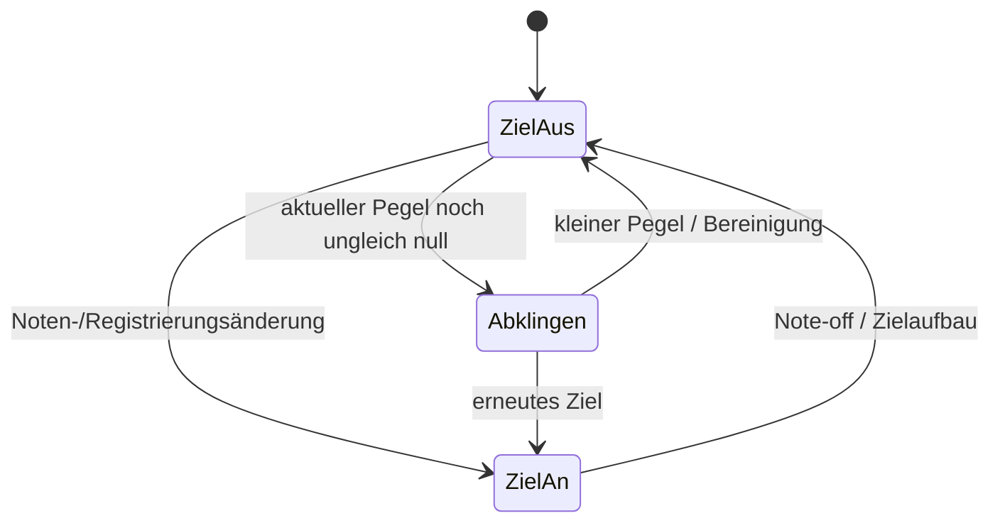

> Forschungssnapshot vom 01.11.2026. Links für diese Übergabe angepasst;
> historische Aussagen und eigene Ersatzverfahren beachten. Siehe [Herkunft](../PROVENANCE.md).

# Streichfett: Audiopfad, Taktstruktur und Stimmen

01.11.2026. [Quelle/Adresskonvention](../PROVENANCE.md).
Dies ist ein substanzieller Forschungsstand, **keine abgeschlossene Rekonstruktion**.

## Tatsächlicher Einstieg und Besitz

**SF-A03 BESTÄTIGT, manuelle Dispatch-/RTTI-Prüfung plus Imageanker:**
`JuceVST3Component` hat eine `IAudioProcessor`-Unterstruktur bei `+0x8`.
Das ergibt sich aus dem RTTI-ClassHierarchyDescriptor, nicht aus einem GUI-Namen.
Vtable RVA `0x3326F0`, Slot 9 führt zu `0xD910`. Dessen verkettete Fortsetzung
ruft bei `0xDC4A` den Float-Adapter `0x113B0` und alternativ bei `0xDC64`
den Double-Adapter `0x11D70` auf. Float-Dispatch bei `0x11D12` über Slot
`+0x38` erreicht im konkreten Processor-Vtable `0x3338A8` den Renderpfad
`0xDF430`. Der Double-Slot `+0x30` zeigt auf den leeren Pfad `0x19FC00`;
die Existenz des generischen Double-Adapters beweist keine Double-DSP-Unterstützung.

Factory `0xCF7A0` registriert über `0xDF80` getrennte Erzeuger:
Component `0xCFE70 → 0xB2D0 → 0xE3230` (Processor-Konstruktion bei
`0xB36C`), Controller `0xCFD10 → 0xD86C0`.
Die Factory-Pointer und ihre Aufrufer wurden manuell verfolgt; diese ganze
Factory-Kette ist nicht vollständig Gegenstand der 36 automatischen Anker.

**SF-A04 BESTÄTIGT, Besitzinterpretation:** Processor `P` konstruiert bei
`0xE3412` eine `StreichfettAudioSource` bei `A=P+0x1F8`.
Darin liegt die Engine bei `E=A+0x140=P+0x338`.
`P+0x120E0` ist ein separater Audio-Wrapperpointer. Der finale virtuelle
Aufruf des Processors bei `0xE0963` geht darüber, **nicht** direkt auf die Engine.
Die AudioSource-Vtable `0x34D210`, Slot 3, enthält `0x261880`;
dort ruft `0x26191F` die Engine `0x267480` mit `A+0x140` auf.
Die zusätzliche Wrapperbindung ist ebenfalls geschlossen: Erzeugung
`0xE5007`, Vtablezuweisung `0xE501B` auf `0x3373C0` (RTTI
`ResamplingAudioSource`), Eingangszeiger `0xE5025` auf P+0x1F8,
Besitzerfeld-Zuweisung `0xE50B6` auf P+0x120E0. Der Wrapper-Renderpfad
`0x1808D0` ruft bei `0x180A6F` den Eingang bei Wrapper+8 über Slot
+0x18 auf. Dieser Slot ist an der konstruierten Source `0x261880`.

**SF-A05 BESTÄTIGT für die interne 40-kHz-Zeitbasis:**
`0xE0B00` berechnet bei `0xE0B3A` den Quotienten `40000 / hostFs` und
schreibt ihn bei `0xE0B84` in Wrapperfeld `+0x18`. Die Engine produziert
16 Integer-Samples je Kernschritt; die Source puffert sie kanalweise bei
`A+0x98` und `A+0xD8` und konvertiert anschließend zu Float.
Im Konvertierpfad stehen 32767 und `-1/32768`. Die exakte Kombination
von Betragsbildung, Clipping und Vorzeichen ist noch nicht vollständig als
Ausgangsgleichung geschlossen. **Kein direktes int32/2^31-Modell voraussetzen.**
Der Resampler reicht bei `0x181249` die Hostrate multipliziert mit seinem
Quotienten an die Source weiter: hostFs·(40000/hostFs)=40000.
Periodenabgleich und Wrapperbindung bestätigen dieselbe Zeitbasis. Hostblockgröße
ist davon unabhängig. Host-Sampleraten-Grenzen, Busverhandlung und exaktes
Resamplingfilter bleiben OFFEN.

## Adressgraph der Engine

| Reihenfolge in `0x267480` | Ziel | Rolle / Grad |
| --- | --- | --- |
| `0x267545` | `0x27BE80` | String-Takte, Notenpegel, Ereigniskern; BESTÄTIGT |
| `0x267551` | `0x27A430` | Koeffizienten-/Steuerzustände; Rolle teilweise offen |
| `0x267562/573/584` | `0x27A670` ×3 | drei rekursive Formungszustände; keine pauschale Biquad-Zuordnung |
| `0x267610/623/636` | `0x27D030/27CD60/27D1C0` | selektierter Ensemblemodus; BESTÄTIGT |
| `0x267647/658` | `0x27AB60/27AE90` | bedingte Registrierung/Notenziele, nach dem aktuellen Ensembleblock |
| `0x267673` | `0x265F40` | Phaser, über Registry-Zuweisung zugeordnet |
| `0x2676B6/6CA` | `0x266CE0` ×2 | getrennte Tapkorrekturen der Stereoarme |
| `0x267720` | `0x2606E0` | separate Solo-Sektion |
| `0x26773D/752` | `0x266AA0` ×2 | kanalweise Mischung/Skalierung, genaue Balancekennlinie OFFEN |
| `0x267767` | `0x265680` | globaler Reverb |
| `0x2677A8/7C9` | `0x266880` ×2 | kanalweise Pegelstufe |
| `0x2677EA` | `0x266E50` | Ausgangsbegrenzung/-quantisierung, vollständige Kennlinie OFFEN |

Die Aufrufreihenfolge ist geprüft. Zwischenpuffer, bedingte Zweige und
Skalierungen gehören zum Graphen; er ist kein Beweis einer stets aktiven
seriellen Kette. Insbesondere entsteht die Solo-Sektion **nach** String-Ensemble
und Phaser. Der Reverb verarbeitet die spätere Mischung beider Sektionen.

## Typbezogene Feldkarte

| Bezug | Felder | Typ/Rolle / Grad |
| --- | --- | --- |
| E | `+0x000..0x41F` | 256×int32 Ereignisring plus angrenzender Randbereich; kein 256-Stimmenpool |
| E | `+0x420..0x61F` | 128×int32 aktuelle String-Notenpegel |
| E | `+0x620..0x81F` | 128×int32 Notenziele/registrierte Beiträge |
| E | `+0x820..0x83F` | acht Registergewichte; nicht acht Stimmen |
| E | `+0x840 + 0x10·k`, k=0..11 | zwölf gemeinsame Taktobjekte mit Periodenfeld +4 und Ereigniszeit +8 |
| E | `+0x980`, `+0x984` | Q24-Blockzeit / Integrationszustand |
| E | `+0x988/+0x98C` | zwei Hüllkurvenkoeffizienten; physikalische Kennlinie OFFEN |
| E | `+0x99C` | Änderungsflags; Bits 1/2 steuern Ziel-/Gewichtsaktualisierung |
| E | `+0x9B4`, `+0x9C4/+0x9EC/+0xA14` | Steuerung und drei Formungskontexte |
| E | `+0xA3C` | **ein** Ensemblezustand der String-Summe |
| E | `+0x1364/65/66` | Enable byte / Modus byte / vorzeichenbehaftetes Gainwort |
| E | `+0x1378` = S | Solo-Sektion |
| S | `+0x38 + 0x80·j`, j=0..7 | acht eigenständige Poolobjekte, nicht SIMD-Spuren |
| Soloobjekt | `+4/+0xC`, `+0x76..0x79` | Hüllkurvenzustände, Note, Velocity-/Timbreskalar, Gate-/Nebenflags; genaue Typnamen teilweise PLAUSIBEL |
| E | `+0x1BF0` | Reverbzustand mit 64-KiB-Floatring und weiteren Zuständen |
| E | `+0x11D30` | Phaserzustand |

Diese Bereiche sind aus Verbrauchern und Schreibern zugeordnet. SIMD-Pakete
mit vier int32-Werten sind Verarbeitungsspuren, keine zusätzlichen Noten.

## Ein vollständiger struktureller Stringpfad

**SF-C01 BESTÄTIGT, manuell; Zahlenabgleich automatisch:**
`0x27B720` setzt zwölf Periodenfelder der gemeinsamen Taktobjekte. Eine
Tonhöhenänderung benutzt negierten Eingang, groben Tabellenindex und
Interpolation. Für den oberen Takt passt die aus der Quelle gelesene
Q24-Periode zu `40000/f(127)` mit relativem Fehler `7,45·10^-9`, wobei
`f(m)=440·2^((m-69)/12)`. Das ist ein Abgleich, keine exportierte Tabelle.
Grenzpfade für große Bend-/Transposewerte sind noch nicht vollständig interpretiert.

**SF-C02 BESTÄTIGT für Ereigniskern und Akkumulator; Divide-down PLAUSIBEL:**
`0x27EF50` verarbeitet gemeinsame Taktereignisse und greift auf Notenpegel
im Oktavabstand von zwölf Einträgen zu. Die Kernelzeile bei RVA `0x2AB040`
wird aus acht Bits der Ereignisbruchzeit mit 32 Byte Zeilenabstand gewählt.
Der Helfer `0x27EEC0` addiert **acht** Beiträge in den Ereignisring:

`r[j+i] ← W32(r[j+i] + ASR64(k_i · ΔA, 32)), i=0..7`.

`k_i` sind herstellerspezifische Koeffizienten, nicht übernommen. Auch
inline existieren solche Kernelbeiträge. Die genaue Entstehung jedes
`ΔA`, alle Oktavübergänge und Kernel-DC-/Bandbegrenzung sind noch OFFEN.
Dies ist kein Nachweis gewöhnlicher Waveform-Wavetable-Oszillatoren.

Die Ausgabestufe `0x27C037` beginnt mit der belegten lokalen Rekurrenz

`z[n] = W32(z[n-1] + r[j+n] - ASR32(z[n-1],8))`.

Ohne Quantisierung: `z[n]=(255/256)z[n-1]+r[j+n]`.
Die Leckintegration gehört zum Klangpfad. Die Blockzeit steigt um
`0x10000000 = 16·2^24`. Ringbereinigung, Randkopien und die kleine
Endzustandslöschung sind nicht mit dieser Einzelgleichung vollständig beschrieben.

**SF-B01 BESTÄTIGT für die Hüllkurvenfamilie; Zeitkennlinie OFFEN:**
`0x27B500` bearbeitet aktuelle Pegel und Ziele in Arrays, mit zwei
vorzeichenabhängig ausgewählten Koeffizienten. Lokaler Kern:

`a' = W32(a + ASR64((t-a)·K,32))`.

Die Aufrufer bilden K durch Linksverschieben der Felder `E+0x988/98C` um 16.
Die [gezielte Vertiefung SF-F01/F02](focused-findings.md) schließt inzwischen
die Crescendo-/Release-Zuordnung und die Koeffizienten-zu-Sekunden-Umrechnung:
α=k/65536, Update 0,4 ms. Rundung sämtlicher Grenzfälle und der vollständige
Host-/UI-Wertebereich bleiben OFFEN; Zeitkonstante und UI-Attackangabe
sind weiterhin getrennte Größen.

## Noten und Zustandsübergänge

**SF-B02 BESTÄTIGT, Event-/Poolpfade:** `0xDF430` dekodiert MIDI-Ereignisse,
führt getrennte String-/Soloänderungen aus und ruft den Audio-Wrapper am Ende.
Solo Note-on `0x260490`; Solo Note-off `0x261820`; String-Zielaufbau
`0x27AE90`; Ziel-Löschung `0x27B9F0`. Ein Notenbitmap liegt bei `P+0x120F0`.
Die String-Ziele werden aus Note-/Registrierungsbeziehungen aufgebaut;
128 Arrayplätze sind keine 128 unabhängigen frei startenden Oszillatoren.

Das Diagramm beschreibt die String-Ziel-/Pegeltrennung; präzise Retrigger-,
Sustain- und Quantisierungskanten sind ausdrücklich nicht vollständig belegt.
Solo Note-off durchsucht acht Objekte, prüft die Notennummer bei `+0x76`
und weitere Flags und ändert beide Zustandsbytes `+4/+0xC`.
Note-on berücksichtigt wiederholte Noten und vergleicht kombinierte
Hüllkurven-/Zustandswerte. **FIFO, oldest, lowest oder quietest stealing
wird daraus noch nicht als fertige Regel behauptet.** Tie-Breaks und
Sustain-/All-notes-off-Sonderfälle bleiben OFFEN.

MIDI und Parameter werden im Processor verarbeitet; samplegenaue Übernahme
der VST3-Offsets in die Engine ist noch nicht bewiesen. Die eigene
Spezifikation fordert sie unabhängig davon ausdrücklich.

Nächste fachliche Lücken: vollständige Notenbitmap→Ziel-Abbildung,
Ereignisamplituden, fünf rekursive Formungszustände pro Kontext, Solo-Wellen-
und Hüllkurvenmodus sowie Resamplingfilter und vollständige Busverhandlung.
